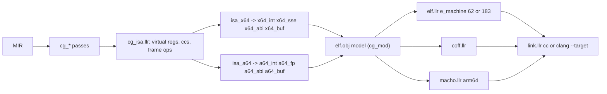

# Darwin arm64: self-hosting plan

This file is the work plan for making the self-hosted compiler in `self/` build itself on an
Apple Silicon Mac. It is written so another agent can pick it up cold. Read `HANDOFF.md`
first (rules, decisions, architecture, implementation notes), then this file, then the
workflow you need in `docs/workflows/`. When code and this file disagree, trust the code and
fix this file.

Status legend: `[ ]` not started, `[~]` in progress, `[x]` done. Update the boxes as you go
and add a dated line to the **Progress log** at the bottom.

## Goal

`scripts/self.sh --stage` prints `self|stage2=equal` on this Mac, `scripts/self.sh` then
runs the suite with `llrs2` at `fails=0`, and `scripts/install.sh` installs `llrs2` as
`llrc` on Darwin the way it already does on Linux and Windows. The x86-64 ELF and COFF
output of `self/` stays byte-identical throughout.

## Situation on 2026-10-30

- Host: macOS 27.0.1, `arm64`, Apple clang 21 at `/usr/bin/cc`, Rust 1.99 via rustup
  (`aarch64-apple-darwin` only), Homebrew LLVM 23 at `/opt/homebrew/opt/llvm/bin`
  (keg-only; `clang`, `llvm-mc`, `llvm-objdump`, `llvm-nm`; backends include `aarch64`,
  `x86-64`, `riscv64`, `systemz`). `ld.lld` is the rustup copy under
  `~/.rustup/toolchains/*/lib/rustlib/*/bin/gcc-ld/`. Rosetta is **not** installed and is
  not part of this plan. Page size is 16 KiB. bash is 3.2.
- Stage 0 (`compiler/`, Cranelift) builds and emits arm64 Mach-O. `tests/run.sh` with stage 0
  is `fails=0` for goldens, std tests, `tests/check.sh`, and `tests/mir.sh`. `tests/self.sh`
  is `fails=33` (known: `llr-check` emits no borrow errors and has no `--deny`).
  `tests/cross.sh` passes with Homebrew clang.
- `self/` emits x86-64 only, into `elf.llr` (ELF64) or `coff.llr`. On this Mac
  `scripts/self.sh` builds `llrs0` with stage 0, then `llrs0` builds `llrs1` and the link
  fails with `ld: unknown file type in .../llrs.o` because the object is ELF.
- The install-session changes (Darwin stage-0 install, `llr_trace_push` / `llr_trace_pop`
  in `tests/cross_stub.c`, the bash 3.2 `set +u` guard, Homebrew clang, the execute bits on
  `scripts/self.sh`, `tests/mir.sh`, and `tests/self.sh`, and the install docs) are in
  `06d7d5f` (`add plan for apple self hosting`). That message is not
  `platform: darwin installs stage 0, cross stub trace shims`. The history was left as it is.
- `~/.local/bin/llrc` is stage 0 today; `~/.zshrc` puts `~/.local/bin` on `PATH`.

## Rules for this work

- Every rule in `HANDOFF.md` applies: files under 500 lines, functions under 40
  (`llr-fmt --lint`), reuse before refactor before new code, a `(test ...)` per function,
  `|` records in tool and script output, one commit per phase with the suite green.
- The x86-64 output must not change. Phase 0 builds a byte snapshot of every x86-64 object
  `self/` can produce on this machine; every later phase re-compares against it. Nothing
  x86-64 can run here, so the snapshot is the only guard for Linux and Windows.
- Stage 0 is the reference. For an encoding question use `llvm-mc`; for a codegen question
  build the same source with stage 0 `--emit-obj` and read `llvm-objdump -d -r`.
- Widening the language is allowed when the seam needs it, and is done in stage 0 and
  `self/` in the same commit with a `tests/run` golden, per HANDOFF. The plan below needs no
  language change; record any gap in **Progress log** before adding one.
- Do not reopen the choices in **Decisions**.

## Decisions (made with the owner on 2026-10-30, do not reopen)

| Topic | Decision |
| --- | --- |
| route | Native aarch64 backend in `self/` plus a Mach-O writer. Not Rosetta, not an x86-64 Mach-O writer. |
| form | Binary encoder and object writer, like `x64_buf.llr` + `elf.llr` + `coff.llr`. No assembly text, no `clang -c` dependency. |
| seam | A `cg_isa.llr` interface with virtual registers and abstract condition codes; `isa_x64.llr` and `isa_a64.llr` implement it; dispatch is a flag in `cg_mod.cg`, no trait object. |
| ABI | AAPCS64. Llrst-internal calls use 8-byte stack slots; externs are scalar and never exceed eight arguments, so the Apple packed-stack variant never applies. Sret stays the first integer argument, as on x64. |
| objects | `macho.llr` consumes `elf.obj` like `coff.llr` does. `elf.llr` gains the aarch64 relocation kinds and a selectable `e_machine` so `aarch64-unknown-linux-gnu` works from `self/` too. |
| linker | Darwin host link stays `cc <obj> -o <out> llr_stat.o -pthread` (no `-pie`). No `xcrun`, no `-isysroot`. |
| register policy | `acc=x9 tmp=x10 hi=x11 addr=x12 dst=x13 big_disp=x14 frame_imm=x15`, `fp0=d16 fp1=d17`. `x16`/`x17` are left for linker veneers, `x18` is reserved on Apple, `x29`/`x30` are frame and link. |

## Architecture



| path | role | phase |
|------|------|-------|
| `self/cg_isa.llr` | the interface every `cg_*` pass emits through; dispatches on `isa.a64` | 1 |
| `self/isa_x64.llr` (`isa_x64_fp.llr` if needed) | x86-64 side; maps virtual registers to `rax rcx rdx r11 r10 xmm0 xmm1 rbp rsp` | 1 |
| `self/cg_cast.llr` | casts split out of `cg_op.llr` (497 lines today) | 0 |
| `self/a64_buf.llr` | words, registers, condition codes, label fixups, relocation kinds | 2 |
| `self/a64_int.llr`, `self/a64_fp.llr` | integer and floating-point encoders | 2 |
| `self/a64_abi.llr` | `x0..x7`, `v0..v7`, 8-byte stack slots | 2 |
| `self/a64.llr` | encoder tests against `llvm-mc` bytes | 2 |
| `self/macho.llr` (`macho_out.llr` if needed) | Mach-O 64 arm64 relocatable object | 3 |
| `self/isa_a64.llr` (split as needed) | aarch64 side of the seam | 4 |
| `tests/x64_ref.sh` | x86-64 object snapshot and compare | 0 |
| `docs/spec/targets.md` | triples per compiler | 5 |

## Implementation notes (things you would otherwise rediscover)

Census of x86-64 coupling in `self/` (textual occurrences, 2026-10-30):

| file | `x64_int.` | `x64_sse.` | `x64_abi.` | `x64_buf.` (mostly register and cc constants) |
|---|---|---|---|---|
| `cg_frame.llr` | 28 | 4 | 11 | 67 |
| `cg_term.llr` | 20 | 0 | 8 | 92 |
| `cg_op.llr` | 78 | 34 | 0 | 175 |
| `cg_ovf.llr` | 25 | 0 | 0 | 46 |
| `cg_drop.llr` | 22 | 0 | 0 | 46 |
| `cg_clos.llr` | 25 | 0 | 20 | 88 |
| `cg_entry.llr` | 21 | 0 | 0 | 38 |
| `cg_mod.llr` | 0 | 0 | 2 | 8 |

`cg_vt.llr`, `cg_lay.llr`, `cg_bits.llr` have none. `x64.llr` is tests only.

- Register contract baked into every pass (`cg_op.llr` line 1, `cg_frame.llr` line 1):
  `rax` scalar result, `rcx` second operand and shift count, `rdx` div/mul high half,
  `r11` place address (`cg_frame.place`, `addr_local`), `r10` store destination and copy
  destination (`store_s`, `copy_off`), `xmm0`/`xmm1` as literal `0`/`1` in `x64_sse` calls,
  `rbp`-relative slots. Condition codes `x64_buf.e ne l le g ge b be a ae o p` appear in
  `cg_op.icc/fcc`, `cg_cast` range checks, `cg_ovf` (`o` signed, `b` carry), `cg_drop`,
  `cg_term.emit_if/emit_sw`. Idioms to abstract: `xor rax,rax` zero, `movsx/movzx` widening,
  `setcc`, `bsr` exactness, `ud2` trap, `test rax,rax`, `cqo/cdq`, `shl cl`.
- Frame (`cg_frame.open`, lines 173-196): slots grow downward from `rbp`; sret slot, locals
  plus 1-byte drop flags, 16-byte trace frame, inline trace frames, then `scratch`, a fixed
  4096-byte temp region, then `frame = align16(cur + out_bytes)` with `out_bytes=256`.
  Prologue `push rbp; mov rbp,rsp; [__chkstk on win]; sub rsp,frame`. No callee-saved
  registers are used. `cg_clos.tramp` uses a fixed 512-byte frame and stores the environment
  pointer at `[rbp-400]`; stack homes are `off - 8 - 512`.
- Two relocation vocabularies exist. `x64_buf.llr` lines 70-76: encoder kinds
  `rel32=2 pc32=3 plt32=4 abs64=5`. `elf.llr` lines 33-37: ELF `r_type` `abs64=1 pc32=2
  plt32=4`. `elf.enc_kind`/`enc_addend` (lines 79-85) translate; `pc32`/`plt32` get addend
  `-4` because the disp32 field sits four bytes before the end of the instruction. `coff.llr`
  drops that addend (REL32 implies it). Mach-O arm64 relocations are REL with the addend in
  the instruction, and `adrp`/`add`/`bl` need addend 0, so `a64_buf` relocation kinds should
  be `branch26 page21 pageoff12 abs64` with addend 0, and `elf.enc_addend` returns 0 for
  them.
- `coff.llr` is the template for a second writer: `(pub (fn bytes ((o (& elf.obj))) str`,
  reads `text data rodata bss syms rels` directly, section numbers 1..4 match ELF so
  `sym.sec` passes through, symbol index shifts by one because COFF has no null symbol.
- `cg_mod.llr`: `cg` struct lines 12-40; `new (checked darwin win be)` lines 54-87;
  `host_name` lines 89-97 renames `open fcntl bind connect socket setrlimit` to `llr_*` on
  Darwin and nothing else (no `_` prefix anywhere; Mach-O needs `_` on every symbol, which is
  the writer's job); `append_fn` lines 304-310 copies `x64_buf.buf` into `.text` and converts
  `x64_buf.rel` via `elf.add_enc`; `finish` lines 331-333 picks `coff` on `win` else `elf`;
  `call_cc`/`a0`/`a1` lines 312-329 leak `rcx/rdi/rdx/rsi`.
- Stage 0 reference object for `tests/run/hello.llr` on this Mac (`llvm-objdump -h -r`):
  sections `__bss`, `__const` (string bytes), `__const` (string records with
  `ARM64_RELOC_UNSIGNED` to `_llr_sbN`), `__text`; text relocations `ARM64_RELOC_BRANCH26`
  for calls and `GOT_LOAD_PAGE21`/`GOT_LOAD_PAGEOFF12` pairs for every data and extern
  address. `self/` may use `PAGE21`/`PAGEOFF12` directly for symbols defined in the object
  and `BRANCH26` for externs; the Apple linker inserts veneers.
- Mach-O object shape to emit: `MH_MAGIC_64`, `CPU_TYPE_ARM64` (`0x0100000c`), subtype
  `ALL` (0), `MH_OBJECT` (1), flags `MH_SUBSECTIONS_VIA_SYMBOLS` (`0x2000`); one
  `LC_SEGMENT_64` holding `__TEXT,__text` (`S_REGULAR | S_ATTR_PURE_INSTRUCTIONS |
  S_ATTR_SOME_INSTRUCTIONS`), `__DATA,__data`, `__DATA,__const` for rodata (it carries
  pointer relocations), `__DATA,__bss` (`S_ZEROFILL`); `LC_BUILD_VERSION` (platform macOS 1,
  minos 11.0); `LC_SYMTAB`; `LC_DYSYMTAB` with symbols ordered local, external defined,
  undefined and the three index ranges filled. `relocation_info` is 8 bytes:
  `r_address`, then `r_symbolnum:24 r_pcrel:1 r_length:2 r_extern:1 r_type:4`. Types:
  `UNSIGNED 0` (`r_length 3`), `BRANCH26 2` (pcrel), `PAGE21 3` (pcrel), `PAGEOFF12 4`,
  `ADDEND 10`. Section-relative addresses: a symbol `n_value` is the address within the
  object's flat section layout, so give each section a `vmaddr` that follows the previous one.
- Apple arm64 facts that affect codegen: `sp` must be 16-aligned at every instruction that
  uses it as a base; `sub sp, sp, #imm` takes 12 bits (optionally shifted 12), so a frame
  over 4095 bytes goes through `x15`; `ldr/str [x29, #imm]` unsigned scaled imm12 reaches
  32 KiB for 8-byte accesses but needs `ldur/stur` for negative offsets in `-256..255` and a
  scratch address (`x14`) beyond that; the guard page is 16 KiB, so a frame larger than that
  touches each page in the prologue (the fixed 4096-byte temp region plus `thir*` frames
  exceed it); `x18` is reserved; `fcvtzs`/`fcvtzu` saturate, and the explicit range and
  exactness checks in `cg_cast` stay so the `tests/panic/cast_*` goldens keep their text;
  NaN is `fcmp` then `vs`.
- `sys.arch` is a compile-time string: `self/prog.llr` line 120 and `self/lower_call.llr`
  line 180 hard-code `"x86_64"`. Stage 0 prints `isa.triple().architecture`, which is
  `aarch64` on this Mac. `tests/mir.sh` compares MIR, so the a64 ISA must produce `"aarch64"`.
- `self/drive.llr`: `target_ok` lines 45-48 rejects any triple without `x86_64` or with
  `apple`; `is_darwin` lines 54-56; `build` lines 75-97 constructs `cg_mod.new` and calls
  `link.link`. `self/llrs.llr` lines 137-138 also gate on `target_ok`. `self/load.llr`
  `os_name` lines 61-67 chooses `sys_windows.llr` or `sys_posix.llr`; Darwin stays on
  `sys_posix.llr` because `runtime/llr_stat.c` (under `#ifdef __APPLE__`, lines 184-304)
  translates open flags, `fcntl`, `sockaddr_in`, `setrlimit` resource 7, and `errno`.
- `self/link.llr`: `host_darwin` lines 52-56 (`uname -s`), `host_cc` lines 74-82 omits `-pie`
  on Darwin. Nothing else needs to change for the host link.
- `self/x64_abi.llr` classifies only (`classify cc cls out`); sret is prepended by callers
  (`cg_frame.classes`, `cg_term.marshal`, `cg_clos.in_cls/out_cls`). Every aggregate is a
  pointer, floats are `cls_float`, nothing else. The a64 twin keeps that shape.
- Encoder oracle, verified on this machine:
  `echo 'add x0, x1, #4' | /opt/homebrew/opt/llvm/bin/llvm-mc -triple=arm64-apple-macos -show-encoding`
  prints `[0x20,0x10,0x00,0x91]`.
- `scripts/self.sh` sets `SOURCE_DATE_EPOCH=0` and links every stage as the same path so
  the output file name is not part of the image. If `llrs1 != llrs2` in Phase 6, the usual
  causes are hash-ordered `map` iteration in symbol emission and uninitialised pad bytes in a
  writer; `cmp -l` then `llvm-objdump -d` on both finds the first difference.

## Line budget (raw `wc -l`, 2026-10-30)

| File | Lines | Note |
| --- | --- | --- |
| `self/cg_op.llr` | 287 | Casts live in `cg_cast.llr` (229 lines) |
| `self/thir_expr.llr` | 493 | not touched by this plan |
| `self/lower.llr` | 493 | not touched by this plan |
| `self/collect.llr` | 461 | not touched by this plan |
| `self/cg_frame.llr` | 458 | Phase 1 removes x64 calls; should shrink |
| `self/cg_term.llr` | 408 | Phase 1 |
| `self/elf.llr` | 396 | Phase 3 adds aarch64 kinds; split tests out if it nears 500 |
| `self/cg_mod.llr` | 333 | Phase 1 and 3 |

Totals: `self/` 12731 lines in 56 files; `std/sys.llr` 63, `sys_posix.llr` 122, `sys_windows.llr` 122.

## Phases

### Phase 0: guards and splits (no behaviour change) `[x]`

Files: `tests/x64_ref.sh` (new), `self/cg_op.llr`, `self/cg_cast.llr` (new), `tests/run.sh`, `HANDOFF.md`.

1. `[x]` Commit the pending working-tree changes listed in **Situation**.
2. `[x]` `tests/x64_ref.sh`: `LLRC` defaults to `target/self/llrs0` (built by `scripts/self.sh`
   up to its first step; add `--llrs0` to `self.sh` or build it inline with stage 0). For
   every `tests/run/*.llr`, every `std/*.llr` that has a `(test` form (`--test`), and
   `self/llrs.llr`, run `build FILE --emit-obj --target x86_64-unknown-linux-gnu -o DIR/NAME`.
   `--save DIR` writes the objects; the default compares against `target/self/x64_ref` with
   `cmp -s` and prints `ok|x64/NAME` or `fail|x64/NAME|first=<byte>`; last line
   `done|fails=N`. Add a Windows pass with `--target x86_64-pc-windows-gnu` for the COFF
   writer. `tests/run.sh` calls it after `tests/cross.sh` when the snapshot directory exists.
3. `[x]` `tests/x64_ref.sh --save target/self/x64_ref` once, before any `self/` edit.
4. `[x]` Move `cast`, `eval_cast`, `fcvt`, `icast`, `cast_chk`, `cast_su`, `cast_hi`,
   `cast_to_s`, `itof`, `utof`, `exact`, `abs_rcx`, `ftoi`, `trunc_f`, `chk_f`, `fmin`,
   `fmax`, `fpow`, `fbound`, `imin`, `imax` (`cg_op.llr` lines 283-497) into `cg_cast.llr`;
   `cg_op.eval_cast` becomes a call into `cg_cast`. Snapshot compare must be byte-equal.
5. `[x]` `tests/check.sh`, `tests/mir.sh`, `scripts/check-lines.sh` clean. HANDOFF
   Architecture pass table gains `cg_cast.llr`.
6. `[x]` Commit: `self: cg_cast split, x64 object snapshot harness`.

### Phase 1: the ISA seam (x86-64 bytes unchanged) `[ ]`

Files: `self/cg_isa.llr` (new), `self/isa_x64.llr` (new; `isa_x64_fp.llr` if over 500), `self/cg_frame.llr`, `self/cg_term.llr`, `self/cg_op.llr`, `self/cg_cast.llr`, `self/cg_ovf.llr`, `self/cg_drop.llr`, `self/cg_clos.llr`, `self/cg_entry.llr`, `self/cg_mod.llr`.

1. `[ ]` `cg_isa.llr` constants: virtual registers `acc tmp hi addr dst fp0 fp1 fp sp` plus
   `ret_i ret_f` and `arg_i N`/`arg_f N` accessors; condition codes
   `eq ne lt le gt ge ult ule ugt uge ovf carry unord`; a `(pub (struct isa (pub (a64 bool)) (pub (win bool))))`
   stored in `cg_mod.cg` and passed by `(& isa)`.
2. `[ ]` Operations, each a thin function taking `(&mut x64_buf.buf)` (rename the field type
   later) and the `isa`: `ld w dst base disp`, `st w src base disp`, `lea dst base disp`,
   `mov_rr`, `mov_ri` (64-bit), `zero dst`, `sym_addr dst sym`, `call_sym`, `call_r`,
   `jmp lab`, `jcc cc lab`, `label`, `bind`, `cmp_rr w`, `cmp_ri w`, `test_rr w`, `setcc cc`,
   `add sub mul and or xor` (rr and ri), `sdiv udiv srem urem` (result in `acc`), `shl shr sar`
   (count in `tmp`), `neg`, `not`, `widen w signed`, `add_ovf sub_ovf mul_ovf -> cc`,
   `exact_bits` (the `bsr` use), `trap`, fp `fld fst fadd fsub fmul fdiv fneg fcmp i2f f2i f2f`
   with `single bool`, `to_ret`/`from_ret` (no-op on x64), `prologue frame`, `epilogue`,
   `probe frame`, `save_args`, `pass_reg`, `pass_mem`, `copy n`, `trace_push disp sym`,
   `trace_pop disp`.
3. `[ ]` Replace every `x64_int.*`, `x64_sse.*`, `x64_abi.*`, and `x64_buf.<register|cc>` use
   in the eight `cg_*` files with the seam. After this, `rg 'x64_' self/cg_*.llr` lists only
   `x64_buf.buf`, `x64_buf.new`, `x64_buf.len`, `x64_buf.at`, `x64_buf.finish`, and
   `(. b rels)` in `cg_mod.append_fn`; those move behind `cg_isa` in Phase 4.
4. `[ ]` `x64_abi.classify` is called only from `cg_isa.classify`; `cg_mod.call_cc/a0/a1`
   move into `isa_x64`.
5. `[ ]` `tests/x64_ref.sh` byte-equal for every object; `tests/check.sh`, `tests/mir.sh`
   `fails=0`; `scripts/check-lines.sh` clean.
6. `[ ]` Commit: `self: cg passes emit through cg_isa; x86-64 bytes unchanged`.

### Phase 2: aarch64 encoder and ABI `[ ]`

Files: `self/a64_buf.llr`, `self/a64_int.llr`, `self/a64_fp.llr`, `self/a64_abi.llr`, `self/a64.llr` (all new).

1. `[ ]` `a64_buf.llr`: registers `x0..x30 sp` (`fp=29 lr=30`, `sp` as id 31 in the
   base-register position, `xzr` as 31 in operand positions, handled per encoder), `v0..v31`;
   condition codes `eq=0 ne=1 cs=2 cc=3 mi=4 pl=5 vs=6 vc=7 hi=8 ls=9 ge=10 lt=11 gt=12 le=13`;
   `push_w` little-endian 32-bit word; labels with `b` (imm26) and `b.cond` (imm19) fixups
   patched into the instruction bitfields in `finish`; relocation records
   `{at kind sym}` with kinds `branch26 page21 pageoff12 abs64`.
2. `[ ]` `a64_int.llr`: `mov_ri` as the shortest `movz`/`movk`/`movn` sequence; `add_ri`/
   `sub_ri` imm12 with optional `lsl 12`, otherwise through `x15`; `add_rr sub_rr adds subs
   cmp_rr cmp_ri`; `and_rr orr_rr eor_rr`; `lslv lsrv asrv`; `mul madd msub sdiv udiv smulh
   umulh`; `neg mvn`; `sxtb sxth sxtw uxtb uxth`; `ldr str` imm12 scaled for 8/4 bytes,
   `ldrb ldrh ldrsb ldrsh ldrsw strb strh`, `ldur stur` family for -256..255, a helper that
   picks the form or materialises the address in `x14`; `stp ldp` pre/post-index for
   `x29,x30`; `b b_cond bl blr br ret`; `cset csel`; `clz`; `brk 0`; `adrp add_lo12`;
   `mov_sp` (`add sp, x29, #0` and `mov x29, sp`).
3. `[ ]` `a64_fp.llr`: `fmov` gpr to fpr and back (32 and 64), `ldr/str` s and d with the
   same offset helper, `fadd fsub fmul fdiv fneg`, `fcmp`, `scvtf ucvtf` from w/x to s/d,
   `fcvtzs fcvtzu` to w/x, `fcvt` s to d and d to s.
4. `[ ]` `a64_abi.llr`: `cls_int` to `x0..x7`, `cls_float` to `v0..v7`, overflow to 8-byte
   stack slots at `[sp, #8k]`; `classify cc cls out` with the same `arg {reg xmm off}` shape
   as `x64_abi` so `cg_isa.classify` is one call.
5. `[ ]` `a64.llr`: one `(test ...)` per encoder form asserting exact bytes taken from
   `llvm-mc -triple=arm64-apple-macos -show-encoding`; label fixup tests for forward and
   backward branches; a relocation record test.
6. `[ ]` Commit: `self: aarch64 encoder, fp, abi`.

### Phase 3: object writers `[ ]`

Files: `self/macho.llr` (new; `self/macho_out.llr` if over 500), `self/elf.llr`, `self/elf_out.llr`, `self/cg_mod.llr`.

1. `[ ]` `macho.llr` `(pub (fn bytes ((o (& elf.obj))) str)` emitting the shape in
   **Implementation notes**. Every symbol name gets a `_` prefix. Symbols ordered local,
   external defined, undefined; `n_type` `N_SECT` (`0x0e`), `N_SECT|N_EXT` (`0x0f`),
   `N_UNDF|N_EXT` (`0x01`); `n_sect` 1..4 for text, data, const, bss. `n_value` is the flat
   address (`vmaddr` of the section plus the offset). Section `vmaddr` values follow one
   another with 16-byte alignment for text and 8 for the rest.
2. `[ ]` Relocations: `abs64` becomes `UNSIGNED` with `r_length 3`, `r_pcrel 0`;
   `branch26` becomes `BRANCH26`, `r_length 2`, `r_pcrel 1`; `page21` becomes `PAGE21`,
   `r_pcrel 1`; `pageoff12` becomes `PAGEOFF12`, `r_pcrel 0`; all `r_extern 1` with
   `r_symbolnum` the Mach-O symbol index. A non-zero addend emits `ADDEND` first (guard; the
   codegen uses addend 0). Relocations per section are listed in reverse address order, as
   Apple tools do; `llvm-objdump -r` must accept either.
3. `[ ]` `elf.llr`: `enc_kind` and `enc_addend` learn `branch26 -> R_AARCH64_CALL26 283`,
   `page21 -> ADR_PREL_PG_HI21 275`, `pageoff12 -> ADD_ABS_LO12_NC 277`, `abs64 -> 257`
   when the object is aarch64; `elf.obj` gains `(pub (machine i64))` set by `cg_mod.new`;
   `elf_out.ehdr` writes it (62 or 183). Existing x86-64 tests unchanged.
4. `[ ]` `cg_mod.finish`: `win -> coff.bytes`, `darwin -> macho.bytes`, else `elf.bytes`.
5. `[ ]` Tests: `(test ...)` forms in `macho.llr` on a hand-built hello object assert the
   magic, `ncmds`, section count, symbol order, and one relocation of each kind; from the
   shell, `file` says `Mach-O 64-bit object arm64` and
   `/opt/homebrew/opt/llvm/bin/llvm-objdump -h -r -t` prints the expected table.
6. `[ ]` Commit: `self: mach-o arm64 writer, aarch64 elf relocations`.

### Phase 4: aarch64 side of the seam `[ ]`

Files: `self/isa_a64.llr` (new; split into `isa_a64_fp.llr`, `isa_a64_frame.llr` as needed), `self/cg_isa.llr`, `self/cg_frame.llr`, `self/cg_clos.llr`, `self/cg_entry.llr`, `self/cg_mod.llr`, `self/prog.llr`, `self/lower_call.llr`.

1. `[ ]` Frame: prologue `stp x29, x30, [sp, #-16]!; mov x29, sp; sub sp, sp, #frame`
   (via `x15` when over 4095); when `frame > 16384` a probe loop stores `xzr` every 16 KiB
   down to the new `sp`; epilogue `mov sp, x29; ldp x29, x30, [sp], #16; ret`. Slot access
   `[x29 - off]` through the offset helper. `frame` stays 16-aligned.
2. `[ ]` Arguments: `save_args` stores `x0..x7`/`d0..d7` into their slots and copies stack
   arguments from `[x29 + 16 + off]`; `pass_reg`/`pass_mem` fill `x0..x7`/`d0..d7` and
   `[sp, #8k]` inside the 256-byte out area; `to_ret` is `mov x0, x9` or `fmov d0, d16`;
   `from_ret` the reverse. `cg_entry` stores `w0`/`x1` into `llr_argc`/`llr_argv`.
3. `[ ]` Operations: compares are `cmp` then `b.cond` or `cset`; `--checked` add/sub use
   `adds/subs` with `vs` (signed) or `cs` (unsigned carry), mul overflow compares
   `smulh`/`umulh` against the sign-extension of the low half; `srem/urem` are `sdiv/udiv`
   then `msub`; shift counts are already masked in MIR; `trap` is `brk #0`; `sym_addr` is
   `adrp` + `add lo12` with a `page21` and a `pageoff12` relocation; `call_sym` is `bl` with
   `branch26`; `call_r` is `blr`.
4. `[ ]` Casts in `cg_cast.llr` keep every range and exactness check so the
   `tests/panic/cast_*`, `int_overflow`, and `shift_*` goldens match stage 0 text; only the
   primitives change. `exact_bits` uses `clz`.
5. `[ ]` `sys.arch` yields `"aarch64"` when `isa.a64` (`prog.llr` line 120,
   `lower_call.llr` line 180 take the string from the driver).
6. `[ ]` Closures: `cg_clos.tramp` stashes `x0..x7`/`d0..d7` in its frame, reloads the
   environment pointer, re-marshals through the seam; `env_drop`, drop glue, vtables, string
   records are unchanged above the seam.
7. `[ ]` `cg_mod.append_fn` and the buffer type behind `cg_frame.fncx` go through `cg_isa`
   so a function body is an `x64_buf.buf` or an `a64_buf.buf` by flag.
8. `[ ]` Gate: with `llrs0` built by stage 0, `LLRC=target/self/llrs0 tests/run.sh` on this
   Mac is `fails=0` for `run/`, `err/`, `panic/`, `warn/`, and every `std/*.llr --test`;
   `tests/x64_ref.sh` byte-equal. Debug by building the same source with stage 0
   `--emit-obj` and reading both with `llvm-objdump -d -r`.
9. `[ ]` Commit: `self: aarch64 codegen through cg_isa`.

### Phase 5: driver, link, scripts, docs `[ ]`

Files: `self/drive.llr`, `self/llrs.llr`, `self/link.llr`, `scripts/install.sh`, `tests/cross.sh`, `tests/run.sh`, `docs/install.md`, `docs/spec/targets.md` (new), `HANDOFF.md`, `UIFRAME.md`, `README.md`.

1. `[ ]` `drive.target_ok` accepts empty, `x86_64-*` without `apple`, and `aarch64-*` or
   `arm64-*` including `apple-darwin`; host ISA from `uname -m` next to `link.host_darwin`;
   `cg_mod.new` takes the `isa` record; `is_darwin` and the ISA select the writer.
2. `[ ]` `link.llr`: Darwin host unchanged; `aarch64-unknown-linux-gnu` through
   `clang --target=` as today. `load.llr` unchanged.
3. `[ ]` `scripts/install.sh`: remove the Darwin stage-0 branch so Darwin installs `llrs2`.
4. `[ ]` `tests/cross.sh`: with `LLRC` set to a `self/` build, also build
   `aarch64-apple-darwin` (`file` says arm64) and `aarch64-unknown-linux-gnu` (freestanding
   link with Homebrew clang and `ld.lld`); skip riscv64 and s390x for `self/` with
   `skip|cross|target=...|self=x86-64 and aarch64 only`.
5. `[ ]` Docs: `docs/spec/targets.md` lists triples per compiler (stage 0: x86-64, aarch64,
   riscv64, s390x; `self/`: x86-64 ELF and COFF, aarch64 ELF and Mach-O); `docs/install.md`
   drops the Darwin stage-0 paragraph; `HANDOFF.md` backend decision row, Architecture pass
   table (`cg_isa`, `isa_x64`, `isa_a64`, `a64_*`, `macho`, `cg_cast`), Phase 6 item 2,
   Line budget, Progress log; `UIFRAME.md` Phase 8 boxes marked done where this plan covers
   them; `README.md` table rows for `DARWIN.md` and the new backend.
6. `[ ]` Commit: `platform: darwin and aarch64 targets in self/, install llrs2 on a Mac`.

### Phase 6: stage 2 on this Mac `[ ]`

1. `[ ]` `scripts/self.sh --stage` prints `self|stage2=equal`. On a mismatch, `cmp -l
   target/self/llrs1 target/self/llrs2 | head` then `llvm-objdump -d` on both around that
   offset.
2. `[ ]` `scripts/self.sh` runs the suite with `llrs2` at `fails=0` (the 33 `tests/self.sh`
   rows are the known `llr-check` gap, not this plan). `tests/check.sh` and `tests/mir.sh`
   against stage 0 `fails=0`. `tests/x64_ref.sh` byte-equal.
3. `[ ]` `scripts/install.sh`; from a fresh shell `llrc version`, `llrc run examples/hello.llr`,
   `llr-grep "fn main" examples`.
4. `[ ]` `HANDOFF.md` status block: `self|stage2=equal|scripts/self.sh record at <sha>|darwin arm64`.
5. `[ ]` Commit: `self: llrs2 bootstraps on darwin arm64`.

## How to verify each phase

```
cargo build --release                                       # stage 0 at target/release/llrc
tests/x64_ref.sh --save target/self/x64_ref                 # once, Phase 0, before any self/ edit
tests/x64_ref.sh                                            # after every phase: byte-equal x86-64 objects
tests/check.sh; tests/mir.sh                                # self/ check and emit-mir equal to stage 0
scripts/check-lines.sh                                      # W at 500 lines, fail at 1000
echo 'add x0, x1, #4' | /opt/homebrew/opt/llvm/bin/llvm-mc -triple=arm64-apple-macos -show-encoding
target/release/llrc build FILE --emit-obj -o /tmp/ref && /opt/homebrew/opt/llvm/bin/llvm-objdump -d -r /tmp/ref.o
LLRC=target/self/llrs0 tests/run.sh                         # Phase 4 gate: self/ output runs on this Mac
scripts/self.sh --stage && scripts/self.sh                  # Phase 6
scripts/install.sh && llrc run examples/hello.llr
```

The sandbox used by some agents sets `CARGO_TARGET_DIR` to a temp cache; `unset
CARGO_TARGET_DIR` or read `cargo metadata --format-version 1` before looking for
`target/release/llrc`.

## Progress log

- 2026-10-30: plan written after two owner decisions (native aarch64 over Rosetta; binary
  encoder and writer over assembly text). Stage 0 installed as `llrc` on this Mac in the
  meantime; no `self/` code changed.
- 2026-10-30: Phase 0. Step 1 was already `06d7d5f`. `tests/x64_ref.sh` and `scripts/self.sh
  --llrs0` snapshot ELF and COFF. `tests/run/field_lib.llr` and `tests/run/pub_lib.llr` are
  skipped (no `main`). `tests/run` and `std` objects stayed byte-equal after the `cg_cast`
  split. Each moved function body matches the old `cg_op` body. `self/llrs` grew by the
  `cg_op.eval_cast` forwarder (481 bytes of `.text`), so those two snapshot files were
  refreshed. `tests/check.sh` and `tests/mir.sh` fails=0.
