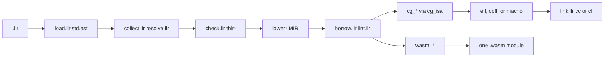

# Llrst: implementation handoff

This file is the work plan for Llrst. It is written so another agent can pick it up cold.
Read it, then `docs/canon/README.md`, then the workflow you need in `docs/workflows/`.
Finished plans are in `history/`: [history/bootstrap.md](history/bootstrap.md) (the first
build), [history/self-hosting.md](history/self-hosting.md) (the `self/` compiler),
[history/phases.md](history/phases.md) (phases 0-7), and
[history/ui.md](history/ui.md) (the `llr-ui` framework). The widget workflow is
[docs/workflows/ui.md](docs/workflows/ui.md).
When code and this file disagree, trust the code and fix this file.

Status legend used below: `[ ]` not started, `[~]` in progress, `[x]` done. Update the
boxes as you go and add a dated line to the **Progress log** at the bottom.

## Rules for this work

- Every source file stays under 500 lines; nothing may reach 1000. If a file you touch is
  already near 500, split it in the same phase before adding to it. Functions stay under
  40 lines (`llr-fmt --lint`). Counts in **Line budget** are from 2026-10-27.
- Order of operations for every change: **reuse** an existing function, else **refactor**
  one so it can be reused, else add new code. Do not widen the language only for `self/`.
- Every std function has a `(test ...)` form in its file; every error code has a
  `tests/err` case and a row in `docs/spec/errors.md`; every tool has a `docs/tools` page.
- Before committing: `llr-fmt <changed .llr>`, `llr-fmt --lint std/*.llr tools/*.llr`,
  `tests/run.sh` (and `tests/run.ps1` when the change touches Windows). Each phase is a
  separate commit with a one-line message; the suite is green at the end of every phase.
- No prose in diagnostics or tool output; one record per line, `|` separated.
- Stage 0 `llrc` (Rust) is the reference. A `self/` change that alters `check` stderr or
  `emit-mir` output must keep `tests/check.sh` and `tests/mir.sh` byte-equal, or change
  stage 0 in the same commit.

## Decisions (already made, do not reopen)

Original request, condensed: a compiled language `Llrst` (`.llr`), Rust bootstrap,
Rust-like memory safety, designed for model readability and few tokens, easy to refactor,
large growing std, one right way per task (documented), cross-platform, machine-readable
errors, low context use. Then: list agents' most used tools, reimplement them in Llrst,
install them, document them, write agent workflows.

| Topic | Decision |
| --- | --- |
| backend | Stage 0 is Cranelift 0.136 (`cranelift-codegen/frontend/module/object/native`), pure Rust, four hardware ISAs. The installed compiler is stage-2 `llrs` from `self/`, emitting x86-64 ELF64 or COFF and aarch64 ELF or Mach-O directly; `llrc` stays in the tree until two releases agree. |
| syntax | S-expressions, delimiters `( ) "` only; trivial grammar, no precedence. |
| memory | ownership + borrows with NLL-style regions on MIR; checked, no GC. |
| tools | `read grep find edit fmt test diff` first (highest-frequency agent tools); `write ls rm git http doc check` added since. One `.llr` per binary. |
| tool output | `tag|field|...`, one record per line; exit 0 ok, 1 tool error (`E|<tool>|0|0|0|code|k=v` on stderr), 2 negative result. Lists end with `more|...` when truncated. |
| integers | `+ - * neg` wrap by default. `--checked` traps them, `shl` `shr` outside `0..bitwidth`, an integer cast that does not fit, a float-to-int whose truncation does not fit, and an int-to-float that is not exact. Without it a shift count is masked with `bitwidth - 1`, a cast truncates, float-to-int saturates, int-to-float rounds. `MIN / -1` and `MIN % -1` always panic `int.overflow` via `sys.checked_div`. `wadd wsub wmul wneg` always wrap. |
| regex | backtracking, ASCII, no non-greedy; `\N` backreferences compare captured bytes and an unset group does not match; `--ic` lowercases pattern and text; word boundaries are ASCII `[A-Za-z0-9_]` only (`std/re.llr`). Fine for tool-sized input. |
| perf | `vec.sort` allocates a scratch buffer (stable merge). `map` heads shrink to a power of two, minimum 16, when `len * 8 <= heads` (`std/map.llr`). |
| visibility | `pub` is strict, per module. Only `pub` std types enter the prelude; std module fns need `(use std.X)`. A struct field and an enum variant are private unless `(pub (name type*))`. |
| directories | `fs.list` names come from `llr_readdir_name`, which reads `dirent` on Unix and `WIN32_FIND_DATA` on Windows (`runtime/llr_stat.c`, `runtime/llr_win.c`). |
| generics | A generic is typechecked only for the instances the driver compiles. One that is never instantiated is linted from its AST and is not MIR-checked. |
| git tool | `llr-git` reads status, diff, and log and does not change the repo. |
| C runtime | `runtime/*.c` shims stay C and are prebuilt by install. Cocoa UI shims are `runtime/*.m`, compiled with `clang -fobjc-arc` on Darwin only. The system C compiler is the linker driver only. |
| warnings | A warning exits 0. `--deny CODE` may be repeated; each named warning is printed as `E` and the process exits 1. `use.unused` and `fn.unused` are not emitted for `std`. `fn.unused` is not emitted for `pub`, `extern`, or `main`. |
| trait objects | `(& (dyn Trait))` is a fat pointer. `(box (dyn Trait))` owns the heap value; it is not `copy`. A value is packed where that type is expected. `(& box)` and `(&mut box)` are that fat pointer unless a reference to the box is expected. A trait in another module is `module.Trait`: `(box (dyn id.Id))`, `(impl id.Id ty ...)`, and `id.Id.method`. No trait default methods: a framework callback is a `(clos ...)` field. |

Out of scope: a garbage collector, a second syntax or precedence grammar, Unicode-aware
regex, and any change that exists only to make `self/` smaller.

## Architecture



| path | role | start here |
|------|------|-----------|
| `self/` | installed compiler (`llrs`); the `llrc` command is stage-2 `llrs` | `llrs.llr` (CLI), `drive.llr` (build) |
| `compiler/src/` | stage 0 `llrc` (Rust, Cranelift); not installed; reference for `tests/check.sh`, `tests/mir.sh` | `main.rs`, `driver.rs` |
| `std/` | standard library, 35 modules, all Llrst | `sys.llr` (externs, panic), `str.llr`, `vec.llr` |
| `tools/` | agent tools, one `.llr` per binary; `fmtlint.llr` is a `proj.` module of `llr-fmt` | `llr-read.llr` (smallest) |
| `runtime/` | C shims: `llr_stat.c` (Unix); `llr_wsa.c`, `llr_win.c`, `llr_win_sock.c`, `llr_win_proc.c` (Windows). UI: `llr_ui_win*.c`, `llr_ui_x11*.c`, `llr_ui_mac*.m`. Install compiles the host UI objects | |
| `tests/` | goldens `run/*.llr+.out`, `err/*.llr+.err`, `warn/`, `panic/`; `run.sh`/`run.ps1` suite; `check`, `mir`, `self` differentials (`.sh` + `.ps1`); `cross.sh` | `run.sh` |
| `scripts/` | `install.sh`, `install.ps1` (stage 0, then `llrs0..2`, install `llrs2`); `self.sh` and `self.ps1` (bootstrap); `check-lines.sh` | |
| `docs/spec/` | grammar, tokens, types, memory, errors, targets | `errors.md` is the code catalogue |
| `docs/canon/` | the one right way per topic | `README.md` |
| `docs/std/` | per-module API tables, generated by `llr-doc` from signatures | `README.md` |
| `docs/tools/` | ranked tool list, per-tool output grammars | `README.md` |
| `docs/workflows/` | step lists for agents | `debug.md` maps error codes to actions |

| pass | file(s) | what it owns |
|------|---------|--------------|
| load | `load.llr`, `src.llr` | main, sorted `std/`, host OS externs, then `proj.*` and `ui.*` on use; std search `--std`, `$LLRST_STD`, `<exe>/../std`, `<exe>/../../std`, `<exe>/../share/llrst/std`, `./std`; ui search `--ui`, `$LLRST_UI`, `<exe>/../share/llrst/ui`, `<exe>/../../ui`, `./ui` |
| resolve | `collect.llr`, `resolve.llr`, `prog.llr` | def ids, methods, traits and impls, visibility, `(inline ...)` notes |
| types | `ty.llr`, `lit.llr` | ints, floats, bool, refs, pointers, adts, fns, closures, dyn, params, infer; literal parsing |
| check | `check.llr`, `thir.llr`, `thir_expr.llr`, `thir_call.llr`, `thir_pat.llr`, `thir_lit.llr`, `thir_clos.llr` | one typed body per instance; closure capture |
| MIR | `lower.llr`, `lower_cf.llr`, `lower_call.llr`, `lower_match.llr`, `lower_clos.llr`, `lower_div.llr`, `inline.llr`, `mir.llr`, `mir_print.llr` | places, blocks, drop, `sys.checked_div`, inline substitution |
| borrowck | `borrow.llr`, `holders.llr`, `loans.llr`, `liveness.llr`, `moves.llr`, `static_ck.llr`, `lint.llr` | loans, holders, init, `'static`, warnings |
| codegen | `cg_mod.llr`, `cg_entry.llr`, `cg_frame.llr`, `cg_lay.llr`, `cg_op.llr`, `cg_cast.llr`, `cg_ovf.llr`, `cg_bits.llr`, `cg_term.llr`, `cg_drop.llr`, `cg_clos.llr`, `cg_vt.llr`, `cg_isa.llr`, `isa_x64.llr`, `isa_a64.llr`, `isa_a64_fp.llr`, `isa_a64_frame.llr`, `isa_a64_ovf.llr`, `x64.llr`, `x64_int.llr`, `x64_sse.llr`, `x64_abi.llr`, `x64_buf.llr`, `a64.llr`, `a64_int.llr`, `a64_mem.llr`, `a64_fp.llr`, `a64_abi.llr`, `a64_buf.llr` | every local a slot; SysV, Win64, or AAPCS64; `--checked` traps; vtables; closure trampolines |
| objects | `elf.llr`, `elf_out.llr`, `coff.llr`, `macho.llr`, `macho_out.llr`, `wasm.llr`, `wasm_out.llr` | ELF64 (x86-64 or aarch64), COFF (REL32, ADDR64), Mach-O arm64, or one Wasm module (`.wasm`) for `wasm32-wasi` and `wasm32-unknown-unknown`. Language pointers stay 8 bytes. `sys.os_id` is 3 on wasm. |
| link | `link.llr`, `link_so.llr`, `link_win.llr` | Unix `cc` plus `llr_stat.o`; Windows `cl /link /STACK:8388608 /Brepro` plus the prebuilt shims. A reference to `llr_ui_open` also links the host UI shim. `--emit-dylib` passes `-shared` or `/LD` |
| driver | `llrs.llr`, `drive.llr`, `diag.llr`, `cg_reload.llr` | `build run check emit-mir version`; `-o --std --ui --test --checked --deny --target --emit-obj --emit-dylib`; reachable instances from `main` or `--test` |

Generics are monomorphized by re-checking the body per instantiation. Only reachable
instances are compiled; std bodies are checked lazily.

## Status

```
commit|ebaed76|Merge pull request #1 from AVoSI-VI/self-hosting-esty
suite|tests/run.ps1|fails=3|2026-10-27|run/cast_float panic/cast_f_high panic/cast_f_neg|cranelift emit unreachable
self|stage2=equal|scripts/self.sh record at 1732bd6|darwin arm64
wasm|self/ emits one .wasm module|os_id=3|wasm32-wasi and wasm32-unknown-unknown|suite=tests/wasm.sh
lines|compiler=9263 rs|self=12731 llr|std=6049 llr|tools=859 llr|max_file=compiler/src/mir/lower.rs 497|budget=500 soft, 1000 hard
```

## Implementation notes (things you would otherwise rediscover)

Paths in this section name stage 0 (`compiler/src/`). The `self/` owner of each concern is
in the **Architecture** pass table; the behaviour is the same unless Phase 1 in
[history/phases.md](history/phases.md) says otherwise.

ABI and data (`codegen/mod.rs`, `codegen/func.rs`)
- Scalars by value; aggregates (structs, enums, `str`, `vec`) passed as a pointer and
  copied into the callee's stack slot in the prologue; aggregate returns via an sret
  pointer as first param. Externs must have scalar params/returns.
- Every MIR local is a stack slot; values are loaded/stored, no SSA variables.
- `"literal"` has type `(& str)` and points at a static 24-byte `{ptr,len,cap=0}` record
  (`str_data`); `str.drop` frees only when `cap > 0`. Length bytes follow target
  endianness (`big_endian`).
- Panic messages are built in std: `str.oob(len, idx)` / `str.oob_range(len, lo, hi)`;
  the compiler only supplies `loc`. Goldens for them live in `tests/panic/`.
- Integer `/` and `%` lower to `sys.checked_div` (`mir/lower_div.rs`): operands widen to
  `i64`, the call carries a `file|line|col` literal, the result truncates back. The
  function's own division stays raw (`Lower::raw_div`) so the rewrite does not recurse.
  Float division is unchanged. `checked_div` always rejects signed `MIN / -1` and `MIN % -1`.
  Goldens: `tests/panic/div_zero*`, `tests/panic/div_min`, `tests/panic/rem_min`, `tests/run/div_ok`.
- `fs.mtime` and `fs.size` call `llr_stat_mtime` / `llr_stat_size` in `runtime/llr_stat.c`.
  `fs.list` calls `llr_readdir_name` there for `d_name`.
  On Darwin, `extern_id` renames `open`, `fcntl`, `bind`, `connect`, `socket`, and `setrlimit` to `llr_*` in that object. The wrappers translate Linux open flags, a 16-byte `sockaddr_in`, `EAGAIN` to 11, and `setrlimit` resource 7 to `RLIMIT_NOFILE`. `__errno_location` calls `__error`.
  `link.rs` appends `llr_stat.o` on Unix, or compiles and links `llr_wsa.c`, `llr_win.c`,
  `llr_win_sock.c`, and `llr_win_proc.c` on Windows,
  from `$LLRST_RUNTIME`, `$LLRST_STD/..`, `<exe>/../share/llrst/`, `<exe>/../../runtime/`, or `./runtime/`.
  `install.sh` and `tests/run.sh` compile the Unix object. `tests/run.ps1` does not;
  `llrc` compiles the Windows objects. `poll` is in `llr_win_sock.c`. `llr_call_child` is in `llr_win_proc.c`.
- `mir/lint.rs` runs after borrowck. `flow.unreachable` is an unreachable block that
  contains something other than `Drop`/`StorageDead`/`Nop` (the empty block opened after
  `(ret)` is skipped). `name.unused` is a local or parameter that is never an operand,
  borrow, or discriminant; names starting with `_` are skipped. A warning exits 0 unless
  `--deny CODE` names it; `--deny` may be repeated and then that warning is an `E`.
  `use.unused` and `fn.unused` are not emitted for an `std` module. `fn.unused` is not
  emitted for `pub`, `extern`, or `main`. Goldens: `tests/warn/`.
  An inlined call pushes a panic frame named with `fn_path`. Drop glue pushes `drop.<type>`.
- `+ - * neg` wrap by default. `llrc --checked` traps them (`codegen/ovf.rs` calls
  `sys.abort` with `int.overflow`) using Cranelift `sadd_overflow` / `uadd_overflow` and
  the sub/mul pairs. `wadd` `wsub` `wmul` `wneg` always wrap; the map hash uses `wmul`.
  The same flag panics `cast.overflow` for a float-to-int whose truncation does not fit and
  for an int-to-float that is not exact (`codegen/ops.rs`). Without it, float-to-int saturates.
- `(sizeof T)` is `Callee::Sizeof`; `(sys.arch)` is a compile-time `(& str)`; `sys.argc`
  / `sys.argv` read globals set by the generated C `main` (`emit_entry`).
- `--test`: each `(test ...)` becomes `llr_test_i`; `emit_test_entry` calls
  `test.run(name, fnptr)` per test, sums failures, calls `test.done(fails)`. `test.run`
  forks (`std/test.llr`), filters by `argv[1]` substring.

Drops (`mir/lower.rs`, `codegen/func.rs`, `codegen/drop.rs`)
- Each local whose type `needs_drop` has an i8 drop flag: set on whole-local assign and
  call dest, cleared on `Move` rooted at the local, `Stmt::Forget`, and after `Drop`.
- `Stmt::Drop(place)`: whole local -> flag-guarded glue call; projection -> unconditional.
- Drop glue per concrete type: user `drop` method first (any `(impl T (fn drop ((self (&mut T))) unit ...))`), then fields / enum payload by tag.
- Scopes (`Scope { drops, all }`) emit `Drop` then `StorageDead` on exit; `ret`/`brk`/`cont`
  emit drops down to the target depth without popping.
- Match by value: binding a non-copy payload moves it (clears the whole flag), so
  wildcard payload fields are dropped explicitly only in that case (`moved_any`). Without
  moves, the whole value drops at scope end. This fixed a double free; keep it.
- Assignment `(set place v)` drops the old value unless the place goes through a raw ptr.
- `mem.replace`, `mem.forget`, `ptr.read/write` are the escape hatches std uses.

Borrow checker (`borrow/`)
- Moves: forward "maybe moved" bitset per local; `Move` of a whole local (no deref) marks,
  whole-local write clears. Moving out of a field/deref is rejected earlier in lowering
  (`move.field`, `move.deref`), except match bindings on a whole local.
- Loans (`loans.rs`): one per `Rvalue::Ref`, indexed in program order. Holders are a
  forward dataflow in `holders.rs` over `(loan, local)` pairs, union at joins, recorded per
  point. Transfer: a whole-local `Assign`/call dest and `StorageDead` kill that local's
  pairs; `Ref{place}` gens its own loan plus every pair of `place.local` (a reference into a
  holder reaches what it holds); `Use`/`Cast`/`Struct`/`Variant` operands flow pairs when
  either side is ref-bearing; calls flow eligible args into the dest; and for each arg typed
  `(&mut X)` with ref-bearing `X` (`mut_ref_sink_args`), the referents of the mutable loans
  it holds become holders of every other ref argument (so `vec.push (&mut hold) (& a)` makes
  `hold` hold the loan on `a`).
- Eligible call args (`loans::eligible_args`): params sharing a named lifetime with the
  return type; else the single ref param; else `self` if a ref; else all ref params.
- Region of a loan = points where any holder is live (backward liveness, `liveness.rs`).
  A loan never conflicts at its own creation point or with accesses rooted at a holder.
- Conflicts (`check.rs`): mutable loan vs any access; shared loan vs write/move/`&mut`.
  `Drop`/`StorageDead` of the borrowed local with a holder live afterwards is
  `borrow.escape` (reported at the borrow span); loans through a deref are exempt.
- Two-phase: `&mut` created directly as a call argument (or an implicit reborrow in
  argument position) acts shared until the call terminator of the same block.
- Implicit reborrow: using a `&mut` place as an operand produces `&mut *place` into a
  temp instead of moving it (`Lower::reborrow`).

Checker conventions (`check/`)
- Bidirectional: `want` flows into literals, `opt.none`, `vec.new`, generic calls.
  Unsuffixed int literals are `Infer(_, int=true)` and default to `i64` in `finish`.
- `coerce`: `&mut T` where `& T` is wanted inserts `(& (@ e))`.
- `if` without else accepts any then-type (value discarded); `and`/`or` take 2+ args.
- `(try e)` works on `res`/`opt`; variant 0 is ok/some, 1 is err/none (std relies on it).
- `(assert_eq a b)` lowers to `test.eq_str/eq_int/eq_bool(loc, got, want)`; `(panic m)` to
  `sys.panic(loc, m)`; `loc` is a `"file|line|col"` literal built by `loc_lit`.
- Callee resolution order: local fn-typed variable, `lookup_fn`, struct ctor, enum variant,
  builtin (`thir::Builtin::from_path`).

Resolver (`resolve.rs`)
- All `std/*.llr` are always loaded; std types are prelude (no `use`), std module fns
  need `(use std.X)`. `proj.X` loads `X.llr` beside the main file.
- A std file compiled directly (its tests) is registered as both `main` and `std.X`.
- `type.fn` resolves methods first, then module-level fns of the module defining the type.
  `vec.sort`, `vec.has`, `vec.index` and the `map` key functions take trait bounds
  (`<T:Eq>`, `<T:Ord>`, `<K:Hash:Eq>`) since `ec125f7`; the fn-pointer forms are gone.
- Visibility: `Def.is_pub`; `Program::visible(from, d)` is `is_pub || same module`,
  checked in `resolve_ty`, the impl owner lookup, and the checker's `require_visible` at
  every fn/ctor/variant/const/pattern resolution. Error `name.private`. Only `pub` std
  types enter the prelude. `(pub ...)` wraps `fn extern struct enum trait const` and impl
  methods; `(pub (impl ...))` is a parse error. A struct field is private unless
  `(pub (name type))`. `field_of` and struct constructors outside the defining module
  report `name.private_field`. `mem.replace` of the whole value still copies private fields.

Tools (`tools/`, `docs/tools/`)
- `llr-fmt` is idempotent on the whole repo; the repo is formatted with it. `--lint` is
  clean on `std/` and `tools/`. `fmtlint.llr` is a `proj.` module of `llr-fmt`.
- `std/sexp.llr` is a comment-preserving S-expression reader used by `llr-fmt`. `std/ast.llr`
  is the surface grammar parsed from that tree and is what `self/` loads.

## Line budget

Raw `wc -l` on 2026-10-27. `self/` rows below were recounted on 2026-10-31. Split before adding if a file is near 500. `scripts/check-lines.sh`
and the copy inside `tests/run.ps1` scan `compiler/src`, `std`, `tools`, `docs`, `scripts`,
`tests`, and `self/` for `.rs .llr .md .sh`, plus `runtime/*.c`. `.gitattributes` stores `*.c` and `*.h` as LF.

| File | Lines | Note |
| --- | --- | --- |
| `compiler/src/mir/lower.rs` | 497 | Stage 0; split before a Phase 2 move change |
| `self/thir_expr.llr` | 493 | Split before Phase 1 span work |
| `self/lower.llr` | 493 | Statement spans are set before a `let` or `set` is lowered |
| `compiler/src/resolve.rs` | 487 | Stage 0 |
| `compiler/src/codegen/func.rs` | 486 | Trace push/pop lives in `codegen/trace.rs` |
| `std/http.llr` | 499 | Chunked bodies live in `http_body.llr`; frames live in `http_ws.llr` |
| `self/collect.llr` | 461 | Trait impl shape and generic bounds |
| `self/elf.llr` | 450 | aarch64 relocation kinds and `e_machine` |
| `self/isa_a64.llr` | 443 | integer, branch, and memory seam; fp, frame, and overflow are split out |
| `self/thir_call.llr` | 424 | Trait calls live in `thir_trait.llr` (82 lines) |
| `self/cg_frame.llr` | 415 | slot access through the ISA seam |
| `self/cg_isa.llr` | 381 | dispatches into an x64 or a64 buffer |
| `self/cg_op.llr` | 269 | Casts live in `cg_cast.llr` |
| `self/cg_cast.llr` | 217 | Cast emitters moved out of `cg_op.llr` |

## Phases

Phases 0 through 7 are done. The plan and its progress log are
[history/phases.md](history/phases.md).

## How to verify each phase

```
cargo build --release                         # stage 0 llrc at target/release/llrc; not installed
scripts/self.sh                               # llrs0, llrs1, llrs2, byte-compare, then the suite
scripts/self.ps1                              # the same bootstrap on Windows
scripts/self.sh --stage                       # stop after self|stage2=equal
scripts/install.sh [PREFIX]                  # stage 0, then install llrs2 as llrc on Linux and Darwin
scripts/install.ps1 [PREFIX]                 # same on Windows
LLRC=<prefix>/bin/llrc tests/run.sh          # goldens + every std test + line check
powershell -File tests/run.ps1                # same suite on Windows
tests/check.sh; tests/mir.sh                  # llrs check / emit-mir byte-equal to stage 0 (.ps1 twins exist)
tests/self.sh [STAGE]                         # diff STAGE (default llr-check) against stage-0 llrc check
<llrc> run tests/run/hello.llr --std std
<llrc> build std/re.llr --test --std std -o /tmp/t && /tmp/t [FILTER]
<llrc> check tests/err/X.llr --std std 2> tests/err/X.err   # regenerate a golden after a deliberate change
<llrc> build tests/panic/X.llr --std std -o /tmp/p && /tmp/p 2> tests/panic/X.err   # panic goldens (exit 101)
<llrc> emit-mir FILE --std std                # MIR dump, for borrow errors
scripts/check-lines.sh                        # W at 500 lines, fail at 1000
```

A sandbox may redirect `target/`; `cargo metadata --format-version 1` prints `target_directory`.
The installed `llrc` reads its executable path from `llr_exe_path`, not `argv[0]`, and
accepts flags before or after the subcommand, so `LLRC="llrc --std ./std"` works for `llr-test`.

## Progress log

