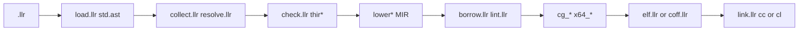

# Llrst: implementation handoff

This file is the work plan for Llrst. It is written so another agent can pick it up cold.
Read it, then `docs/canon/README.md`, then the workflow you need in `docs/workflows/`.
Finished plans are in `history/`: [history/bootstrap.md](history/bootstrap.md) (the first
build) and [history/self-hosting.md](history/self-hosting.md) (the `self/` compiler).
When code and this file disagree, trust the code and fix this file.

Status legend used below: `[ ]` not started, `[~]` in progress, `[x]` done. Update the
boxes as you go and add a dated line to the **Progress log** at the bottom.

## Rules for this work

- Every source file stays under 500 lines; nothing may reach 1000. If a file you touch is
  already near 500, split it in the same phase before adding to it. Functions stay under
  40 lines (`llr-fmt --lint`). Counts in **Line budget** are from 2026-10-27.
- Order of operations for every change: **reuse** an existing function, else **refactor**
  one so it can be reused, else add new code. Do not widen the language only for `self/`.
- Every std function has a `(test ...)` form in its file; every error code has a
  `tests/err` case and a row in `docs/spec/errors.md`; every tool has a `docs/tools` page.
- Before committing: `llr-fmt <changed .llr>`, `llr-fmt --lint std/*.llr tools/*.llr`,
  `tests/run.sh` (and `tests/run.ps1` when the change touches Windows). Each phase is a
  separate commit with a one-line message; the suite is green at the end of every phase.
- No prose in diagnostics or tool output; one record per line, `|` separated.
- Stage 0 `llrc` (Rust) is the reference. A `self/` change that alters `check` stderr or
  `emit-mir` output must keep `tests/check.sh` and `tests/mir.sh` byte-equal, or change
  stage 0 in the same commit.

## Decisions (already made, do not reopen)

Original request, condensed: a compiled language `Llrst` (`.llr`), Rust bootstrap,
Rust-like memory safety, designed for model readability and few tokens, easy to refactor,
large growing std, one right way per task (documented), cross-platform, machine-readable
errors, low context use. Then: list agents' most used tools, reimplement them in Llrst,
install them, document them, write agent workflows.

| Topic | Decision |
| --- | --- |
| backend | Stage 0 is Cranelift 0.136 (`cranelift-codegen/frontend/module/object/native`), pure Rust, four hardware ISAs. The installed compiler is stage-2 `llrs` from `self/`, emitting x86-64 ELF64 or COFF directly; `llrc` stays in the tree until two releases agree. |
| syntax | S-expressions, delimiters `( ) "` only; trivial grammar, no precedence. |
| memory | ownership + borrows with NLL-style regions on MIR; checked, no GC. |
| tools | `read grep find edit fmt test diff` first (highest-frequency agent tools); `write ls rm git http doc check` added since. One `.llr` per binary. |
| tool output | `tag|field|...`, one record per line; exit 0 ok, 1 tool error (`E|<tool>|0|0|0|code|k=v` on stderr), 2 negative result. Lists end with `more|...` when truncated. |
| integers | `+ - * neg` wrap by default. `--checked` traps them, `shl` `shr` outside `0..bitwidth`, an integer cast that does not fit, a float-to-int whose truncation does not fit, and an int-to-float that is not exact. Without it a shift count is masked with `bitwidth - 1`, a cast truncates, float-to-int saturates, int-to-float rounds. `MIN / -1` and `MIN % -1` always panic `int.overflow` via `sys.checked_div`. `wadd wsub wmul wneg` always wrap. |
| regex | backtracking, ASCII, no non-greedy; `\N` backreferences compare captured bytes and an unset group does not match; `--ic` lowercases pattern and text; word boundaries are ASCII `[A-Za-z0-9_]` only (`std/re.llr`). Fine for tool-sized input. |
| perf | `vec.sort` allocates a scratch buffer (stable merge). `map` heads shrink to a power of two, minimum 16, when `len * 8 <= heads` (`std/map.llr`). |
| visibility | `pub` is strict, per module. Only `pub` std types enter the prelude; std module fns need `(use std.X)`. A struct field and an enum variant are private unless `(pub (name type*))`. |
| directories | `fs.list` names come from `llr_readdir_name`, which reads `dirent` on Unix and `WIN32_FIND_DATA` on Windows (`runtime/llr_stat.c`, `runtime/llr_win.c`). |
| generics | A generic is typechecked only for the instances the driver compiles. One that is never instantiated is linted from its AST and is not MIR-checked. |
| git tool | `llr-git` reads status, diff, and log and does not change the repo. |
| C runtime | `runtime/*.c` shims stay C and are prebuilt by install; the system C compiler is the linker driver only. |
| warnings | A warning exits 0. `--deny CODE` may be repeated; each named warning is printed as `E` and the process exits 1. `use.unused` and `fn.unused` are not emitted for `std`. `fn.unused` is not emitted for `pub`, `extern`, or `main`. |

Out of scope: a garbage collector, a second syntax or precedence grammar, Unicode-aware
regex, growing the thread pool, and any change that exists only to make `self/` smaller.

## Architecture



| path | role | start here |
|------|------|-----------|
| `self/` | installed compiler (`llrs`); the `llrc` command is stage-2 `llrs` | `llrs.llr` (CLI), `drive.llr` (build) |
| `compiler/src/` | stage 0 `llrc` (Rust, Cranelift); not installed; reference for `tests/check.sh`, `tests/mir.sh` | `main.rs`, `driver.rs` |
| `std/` | standard library, 35 modules, all Llrst | `sys.llr` (externs, panic), `str.llr`, `vec.llr` |
| `tools/` | agent tools, one `.llr` per binary; `fmtlint.llr` is a `proj.` module of `llr-fmt` | `llr-read.llr` (smallest) |
| `runtime/` | C shims: `llr_stat.c` (Unix); `llr_wsa.c`, `llr_win.c`, `llr_win_sock.c`, `llr_win_proc.c` (Windows), compiled to `.obj` by install | |
| `tests/` | goldens `run/*.llr+.out`, `err/*.llr+.err`, `warn/`, `panic/`; `run.sh`/`run.ps1` suite; `check`, `mir`, `self` differentials (`.sh` + `.ps1`); `cross.sh` | `run.sh` |
| `scripts/` | `install.sh`, `install.ps1` (stage 0, then `llrs0..2`, install `llrs2`); `self.sh` (bootstrap only, no `.ps1`); `check-lines.sh` | |
| `docs/spec/` | grammar, tokens, types, memory, errors | `errors.md` is the code catalogue |
| `docs/canon/` | the one right way per topic | `README.md` |
| `docs/std/` | per-module API tables, generated by `llr-doc` from signatures | `README.md` |
| `docs/tools/` | ranked tool list, per-tool output grammars | `README.md` |
| `docs/workflows/` | step lists for agents | `debug.md` maps error codes to actions |

| pass | file(s) | what it owns |
|------|---------|--------------|
| load | `load.llr`, `src.llr` | main, sorted `std/`, host OS externs, then `proj.*`; std search `--std`, `$LLRST_STD`, `<exe>/../std`, `<exe>/../../std`, `<exe>/../share/llrst/std`, `./std` |
| resolve | `collect.llr`, `resolve.llr`, `prog.llr` | def ids, methods, traits and impls, visibility, `(inline ...)` notes |
| types | `ty.llr`, `lit.llr` | ints, floats, bool, refs, pointers, adts, fns, closures, dyn, params, infer; literal parsing |
| check | `check.llr`, `thir.llr`, `thir_expr.llr`, `thir_call.llr`, `thir_pat.llr`, `thir_lit.llr`, `thir_clos.llr` | one typed body per instance; closure capture |
| MIR | `lower.llr`, `lower_cf.llr`, `lower_call.llr`, `lower_match.llr`, `lower_clos.llr`, `lower_div.llr`, `inline.llr`, `mir.llr`, `mir_print.llr` | places, blocks, drop, `sys.checked_div`, inline substitution |
| borrowck | `borrow.llr`, `holders.llr`, `loans.llr`, `liveness.llr`, `moves.llr`, `static_ck.llr`, `lint.llr` | loans, holders, init, `'static`, warnings |
| codegen | `cg_mod.llr`, `cg_entry.llr`, `cg_frame.llr`, `cg_lay.llr`, `cg_op.llr`, `cg_ovf.llr`, `cg_bits.llr`, `cg_term.llr`, `cg_drop.llr`, `cg_clos.llr`, `cg_vt.llr`, `x64.llr`, `x64_int.llr`, `x64_sse.llr`, `x64_abi.llr`, `x64_buf.llr` | every local a slot; SysV or Win64; `--checked` traps; vtables; closure trampolines |
| objects | `elf.llr`, `elf_out.llr`, `coff.llr` | ELF64 (PC32, PLT32, 64) or COFF (REL32, ADDR64) |
| link | `link.llr`, `link_win.llr` | Unix `cc` plus `llr_stat.o`; Windows `cl /link /STACK:8388608 /Brepro` plus the prebuilt shims |
| driver | `llrs.llr`, `drive.llr`, `diag.llr` | `build run check emit-mir version`; `-o --std --test --checked --deny --target --emit-obj`; reachable instances from `main` or `--test` |

Generics are monomorphized by re-checking the body per instantiation. Only reachable
instances are compiled; std bodies are checked lazily.

## Status

```
commit|ebaed76|Merge pull request #1 from AVoSI-VI/self-hosting-esty
suite|tests/run.ps1|fails=3|2026-10-27|run/cast_float panic/cast_f_high panic/cast_f_neg|cranelift emit unreachable
self|stage2=equal|scripts/self.sh record at 40dcadd|not re-run for this rewrite
lines|compiler=9263 rs|self=11660 llr|std=6049 llr|tools=859 llr|max_file=self/cg_op.llr 497|budget=500 soft, 1000 hard
```

## Implementation notes (things you would otherwise rediscover)

Paths in this section name stage 0 (`compiler/src/`). The `self/` owner of each concern is
in the **Architecture** pass table; the behaviour is the same unless Phase 1 says otherwise.

ABI and data (`codegen/mod.rs`, `codegen/func.rs`)
- Scalars by value; aggregates (structs, enums, `str`, `vec`) passed as a pointer and
  copied into the callee's stack slot in the prologue; aggregate returns via an sret
  pointer as first param. Externs must have scalar params/returns.
- Every MIR local is a stack slot; values are loaded/stored, no SSA variables.
- `"literal"` has type `(& str)` and points at a static 24-byte `{ptr,len,cap=0}` record
  (`str_data`); `str.drop` frees only when `cap > 0`. Length bytes follow target
  endianness (`big_endian`).
- Panic messages are built in std: `str.oob(len, idx)` / `str.oob_range(len, lo, hi)`;
  the compiler only supplies `loc`. Goldens for them live in `tests/panic/`.
- Integer `/` and `%` lower to `sys.checked_div` (`mir/lower_div.rs`): operands widen to
  `i64`, the call carries a `file|line|col` literal, the result truncates back. The
  function's own division stays raw (`Lower::raw_div`) so the rewrite does not recurse.
  Float division is unchanged. `checked_div` always rejects signed `MIN / -1` and `MIN % -1`.
  Goldens: `tests/panic/div_zero*`, `tests/panic/div_min`, `tests/panic/rem_min`, `tests/run/div_ok`.
- `fs.mtime` and `fs.size` call `llr_stat_mtime` / `llr_stat_size` in `runtime/llr_stat.c`.
  `fs.list` calls `llr_readdir_name` there for `d_name`.
  On Darwin, `extern_id` renames `open`, `fcntl`, `bind`, `connect`, `socket`, and `setrlimit` to `llr_*` in that object. The wrappers translate Linux open flags, a 16-byte `sockaddr_in`, `EAGAIN` to 11, and `setrlimit` resource 7 to `RLIMIT_NOFILE`. `__errno_location` calls `__error`.
  `link.rs` appends `llr_stat.o` on Unix, or compiles and links `llr_wsa.c`, `llr_win.c`,
  `llr_win_sock.c`, and `llr_win_proc.c` on Windows,
  from `$LLRST_RUNTIME`, `$LLRST_STD/..`, `<exe>/../share/llrst/`, `<exe>/../../runtime/`, or `./runtime/`.
  `install.sh` and `tests/run.sh` compile the Unix object. `tests/run.ps1` does not;
  `llrc` compiles the Windows objects. `poll` is in `llr_win_sock.c`. `llr_call_child` is in `llr_win_proc.c`.
- `mir/lint.rs` runs after borrowck. `flow.unreachable` is an unreachable block that
  contains something other than `Drop`/`StorageDead`/`Nop` (the empty block opened after
  `(ret)` is skipped). `name.unused` is a local or parameter that is never an operand,
  borrow, or discriminant; names starting with `_` are skipped. A warning exits 0 unless
  `--deny CODE` names it; `--deny` may be repeated and then that warning is an `E`.
  `use.unused` and `fn.unused` are not emitted for an `std` module. `fn.unused` is not
  emitted for `pub`, `extern`, or `main`. Goldens: `tests/warn/`.
  An inlined call pushes a panic frame named with `fn_path`. Drop glue pushes `drop.<type>`.
- `+ - * neg` wrap by default. `llrc --checked` traps them (`codegen/ovf.rs` calls
  `sys.abort` with `int.overflow`) using Cranelift `sadd_overflow` / `uadd_overflow` and
  the sub/mul pairs. `wadd` `wsub` `wmul` `wneg` always wrap; the map hash uses `wmul`.
  The same flag panics `cast.overflow` for a float-to-int whose truncation does not fit and
  for an int-to-float that is not exact (`codegen/ops.rs`). Without it, float-to-int saturates.
- `(sizeof T)` is `Callee::Sizeof`; `(sys.arch)` is a compile-time `(& str)`; `sys.argc`
  / `sys.argv` read globals set by the generated C `main` (`emit_entry`).
- `--test`: each `(test ...)` becomes `llr_test_i`; `emit_test_entry` calls
  `test.run(name, fnptr)` per test, sums failures, calls `test.done(fails)`. `test.run`
  forks (`std/test.llr`), filters by `argv[1]` substring.

Drops (`mir/lower.rs`, `codegen/func.rs`, `codegen/drop.rs`)
- Each local whose type `needs_drop` has an i8 drop flag: set on whole-local assign and
  call dest, cleared on `Move` rooted at the local, `Stmt::Forget`, and after `Drop`.
- `Stmt::Drop(place)`: whole local -> flag-guarded glue call; projection -> unconditional.
- Drop glue per concrete type: user `drop` method first (any `(impl T (fn drop ((self (&mut T))) unit ...))`), then fields / enum payload by tag.
- Scopes (`Scope { drops, all }`) emit `Drop` then `StorageDead` on exit; `ret`/`brk`/`cont`
  emit drops down to the target depth without popping.
- Match by value: binding a non-copy payload moves it (clears the whole flag), so
  wildcard payload fields are dropped explicitly only in that case (`moved_any`). Without
  moves, the whole value drops at scope end. This fixed a double free; keep it.
- Assignment `(set place v)` drops the old value unless the place goes through a raw ptr.
- `mem.replace`, `mem.forget`, `ptr.read/write` are the escape hatches std uses.

Borrow checker (`borrow/`)
- Moves: forward "maybe moved" bitset per local; `Move` of a whole local (no deref) marks,
  whole-local write clears. Moving out of a field/deref is rejected earlier in lowering
  (`move.field`, `move.deref`), except match bindings on a whole local.
- Loans (`loans.rs`): one per `Rvalue::Ref`, indexed in program order. Holders are a
  forward dataflow in `holders.rs` over `(loan, local)` pairs, union at joins, recorded per
  point. Transfer: a whole-local `Assign`/call dest and `StorageDead` kill that local's
  pairs; `Ref{place}` gens its own loan plus every pair of `place.local` (a reference into a
  holder reaches what it holds); `Use`/`Cast`/`Struct`/`Variant` operands flow pairs when
  either side is ref-bearing; calls flow eligible args into the dest; and for each arg typed
  `(&mut X)` with ref-bearing `X` (`mut_ref_sink_args`), the referents of the mutable loans
  it holds become holders of every other ref argument (so `vec.push (&mut hold) (& a)` makes
  `hold` hold the loan on `a`).
- Eligible call args (`loans::eligible_args`): params sharing a named lifetime with the
  return type; else the single ref param; else `self` if a ref; else all ref params.
- Region of a loan = points where any holder is live (backward liveness, `liveness.rs`).
  A loan never conflicts at its own creation point or with accesses rooted at a holder.
- Conflicts (`check.rs`): mutable loan vs any access; shared loan vs write/move/`&mut`.
  `Drop`/`StorageDead` of the borrowed local with a holder live afterwards is
  `borrow.escape` (reported at the borrow span); loans through a deref are exempt.
- Two-phase: `&mut` created directly as a call argument (or an implicit reborrow in
  argument position) acts shared until the call terminator of the same block.
- Implicit reborrow: using a `&mut` place as an operand produces `&mut *place` into a
  temp instead of moving it (`Lower::reborrow`).

Checker conventions (`check/`)
- Bidirectional: `want` flows into literals, `opt.none`, `vec.new`, generic calls.
  Unsuffixed int literals are `Infer(_, int=true)` and default to `i64` in `finish`.
- `coerce`: `&mut T` where `& T` is wanted inserts `(& (@ e))`.
- `if` without else accepts any then-type (value discarded); `and`/`or` take 2+ args.
- `(try e)` works on `res`/`opt`; variant 0 is ok/some, 1 is err/none (std relies on it).
- `(assert_eq a b)` lowers to `test.eq_str/eq_int/eq_bool(loc, got, want)`; `(panic m)` to
  `sys.panic(loc, m)`; `loc` is a `"file|line|col"` literal built by `loc_lit`.
- Callee resolution order: local fn-typed variable, `lookup_fn`, struct ctor, enum variant,
  builtin (`thir::Builtin::from_path`).

Resolver (`resolve.rs`)
- All `std/*.llr` are always loaded; std types are prelude (no `use`), std module fns
  need `(use std.X)`. `proj.X` loads `X.llr` beside the main file.
- A std file compiled directly (its tests) is registered as both `main` and `std.X`.
- `type.fn` resolves methods first, then module-level fns of the module defining the type.
  `vec.sort`, `vec.has`, `vec.index` and the `map` key functions take trait bounds
  (`<T:Eq>`, `<T:Ord>`, `<K:Hash:Eq>`) since `ec125f7`; the fn-pointer forms are gone.
- Visibility: `Def.is_pub`; `Program::visible(from, d)` is `is_pub || same module`,
  checked in `resolve_ty`, the impl owner lookup, and the checker's `require_visible` at
  every fn/ctor/variant/const/pattern resolution. Error `name.private`. Only `pub` std
  types enter the prelude. `(pub ...)` wraps `fn extern struct enum trait const` and impl
  methods; `(pub (impl ...))` is a parse error. A struct field is private unless
  `(pub (name type))`. `field_of` and struct constructors outside the defining module
  report `name.private_field`. `mem.replace` of the whole value still copies private fields.

Tools (`tools/`, `docs/tools/`)
- `llr-fmt` is idempotent on the whole repo; the repo is formatted with it. `--lint` is
  clean on `std/` and `tools/`. `fmtlint.llr` is a `proj.` module of `llr-fmt`.
- `std/sexp.llr` is a comment-preserving S-expression reader used by `llr-fmt`. `std/ast.llr`
  is the surface grammar parsed from that tree and is what `self/` loads.

## Line budget

Raw `wc -l` on 2026-10-27. Split before adding if a file is near 500. `scripts/check-lines.sh`
and the copy inside `tests/run.ps1` scan `compiler/src`, `std`, `tools`, `docs`, `scripts`,
`tests`, and `self/` for `.rs .llr .md .sh`, plus `runtime/*.c`. `.gitattributes` stores `*.c` and `*.h` as LF.

| File | Lines | Note |
| --- | --- | --- |
| `compiler/src/mir/lower.rs` | 497 | Stage 0; split before a Phase 2 move change |
| `self/cg_op.llr` | 497 | Split before any Phase 1 cast or trampoline change |
| `compiler/src/codegen/func.rs` | 486 | Trace push/pop lives in `codegen/trace.rs` |
| `self/thir_expr.llr` | 493 | Split before Phase 1 span work |
| `self/lower.llr` | 493 | Statement spans are set before a `let` or `set` is lowered |
| `std/check_expr.llr` | 490 | Backs `llr-check` only (Phase 4) |
| `compiler/src/resolve.rs` | 487 | Stage 0 |
| `self/collect.llr` | 461 | Trait impl shape and generic bounds |
| `self/thir_call.llr` | 424 | Trait calls live in `thir_trait.llr` (82 lines) |
| `std/check.llr` | 480 | Backs `llr-check` only (Phase 4). `check_more.llr` holds impl shape and bounds |
| `std/http.llr` | 468 | Phase 7 chunked bodies need a split first |

## Phases

Every row of the former "Known limits" table and every item of the former "Suggested next
steps" list is either a decision above or one item below. Items marked *verify* come from
code reading and were not run.

### Phase 0: handoff and repo hygiene (no behaviour change) `[x]`

Files: `README.md`, `docs/tools/README.md`, `.gitignore`, `scripts/check-lines.sh`, `tests/run.ps1`, `runtime/llr_win.c`, `self/mono.llr`, `self/subst.llr`.

1. `[x]` `README.md`: the compiler is stage-2 `llrs` from `self/`, not "Rust on Cranelift"; add `self/`, `runtime/`, `scripts/` rows; the tools row lacks `llr-doc` and `llr-check`; say that `cargo build --release` produces stage 0 only.
2. `[x]` `docs/tools/README.md`: the `llr-http` row has three cells in a four-column table.
3. `[x]` `poll_probe.obj` is tracked at the repo root with no reference in the tree. `runtime/llr_win.obj` and `runtime/llr_wsa.obj` are tracked while `scripts/install.ps1` lines 76-82 rewrite them on every install; `.gitignore` has `*.o` but no `*.obj`. Removing tracked files needs the owner's confirmation.
4. `[x]` `scripts/check-lines.sh` and the inline copy in `tests/run.ps1` (lines 271-287): add `self/` and `runtime/*.c`; keep the two in sync or make `run.ps1` call one script.
5. `[x]` Split `runtime/llr_win.c` (1024 lines) under 500 per file; `install.ps1` compiles each piece.
6. `[x]` `self/mono.llr` and `self/subst.llr` are imported by nothing and build on `std.check`; retire them or wire them, then decide whether `std/check*.llr` stays only to back `llr-check`. Retired both files. `std/check*.llr` stays only to back `llr-check`.
7. `[x]` `runtime/llr_win.c` is LF in the index and CRLF in a Windows checkout; add `.gitattributes` or state the rule.
8. `[x]` Commit: `docs: handoff phases, line check covers self and runtime`.

### Phase 1: self/ parity with stage 0 `[x]`

Files: `self/drive.llr`, `self/check.llr`, `self/llrs.llr`, `self/lint.llr`, `self/inline.llr`, `self/collect.llr`, `self/resolve.llr`, `self/thir_clos.llr`, `self/cg_clos.llr`, `self/link.llr`, `self/link_win.llr`, `std/ast_expr.llr`, `std/os.llr`.

1. `[x]` `(test ...)` bodies run `borrow.run` and `lint.body`. Generic instances and std functions are MIR-linted when compiled; `lint.generics` walks only never-instantiated generics.
2. `[x]` `llrs emit-mir` keeps diagnostics, prints the dump, and exits 1 on error. `tests/mir.sh` and `tests/mir.ps1` compare stderr too.
3. `[x]` `llrs run` builds `llr_run_N` under `TMPDIR`, `TEMP`, `TMP`, or `/tmp`, and removes `link.host_exe` of that path.
4. `[x]` `os.shell` returns the `system()` code unshifted when `sys.os_id` is 2.
5. `[x]` Span-less errors use the main file and `1|1|0`. Collect errors and `io.read` are full records. Parse errors carry `len=`; arity sites emit `parse.arity` and a non-atom head emits `parse.bad_head`. `link.failed` puts the full command in `cmd=`.
6. `[x]` A failed inline re-check is appended to the lowerer's diagnostics.
7. `[x]` Generic `let`s use a scope. `fn.unused` resolves `(T.m ...)` and value uses through `lookup_fn`. Under `--test`, `lint.items` scans `p.tests`.
8. `[x]` Trait impls report `trait.method` and `type.mismatch`. Bounds stay on `prog.def` and `trait.missing` is reported at the call. Goldens: `tests/err/trait_method`, `tests/err/trait_bound`. `std/check_more.llr` teaches `llr-check` those two.
9. `[x]` Closure capture binds `for` vars, match bindings, and inner params. The trampoline classifies GPR, XMM, and stack args. `tests/run/clos.llr` covers a float capture and a seven-int call.
10. `[x]` Recorded under Decisions. Both compilers typecheck a generic only for compiled instances.
11. `[x]` No std directory is `io.read|path=std|fix=set LLRST_STD` on the main file at `1|1|0`.
12. `[x]` Commit: `self: test bodies are borrow-checked, emit-mir reports, lint and trait parity`.

### Phase 2: language and borrow checker `[x]`

Files: `self/lower.llr`, `self/lower_call.llr`, `self/holders.llr`, `self/moves.llr`, `self/thir_call.llr`, `self/thir_clos.llr`, `self/collect.llr`, and the stage 0 twins `compiler/src/mir/lower.rs`, `borrow/holders.rs`, `borrow/moves.rs`, `check/call.rs`, `check/clos.rs`, `check/traits.rs`.

1. `[x]` Moves: a field of a struct with no `drop` method can be moved and the other fields still drop; a field move through `&` or `ptr`, or out of a struct that has `drop`, is still `move.field` or `move.deref` (`lower.llr` `as_operand`). A later use of that field is `move.used`.
2. `[x]` Regions: a field write releases loans of that field; a write through `&` or `ptr` releases nothing; a container of refs declared before its referents reports `borrow.escape` at scope end (`holders.llr`). Field notes join across blocks.
3. `[x]` Init: `(let mut x T)` is checked and a use before every path assigns it is `init.uninit`; a field write does not initialize the struct, so drop flags stay off until a whole-local assignment (`moves.llr`). A drop of one field is flag-guarded.
4. `[x]` Lifetimes: `'static` is a region for any type and comes from a literal, a const, or another `'static` reference (`static_ck.llr`); any other named lifetime is only the cross-function flow in `eligible_args` (`loans.llr`). A struct field copied into `& 'static` is static only when that field was stored from one of those sources.
5. `[x]` Visibility: a private variant is still usable in the enum's own file (`thir_call.llr`, `check/call.rs`); `mem.replace` of a whole struct still copies private fields (`lower_call.llr`). A constructor in another file still rejects a private field.
6. `[x]` Closures: a closure captures whole bindings; a captured reference must outlive the closure; `(clos ...)` does not coerce to `(fn ...)`; a closure body cannot contain a closure (`thir_clos.llr`, `check/clos.rs`).
7. `[x]` Traits: `Eq Ord Hash Clone` live in `std/cmp.llr`; `(& (dyn Trait))` is data plus vtable. A trait method is not generic, an impl type is a concrete name, a method that returns `Self` is not a trait object, and a function pointer cannot capture a needle (`collect.llr`, `thir_call.llr`, `check/traits.rs`).
8. `[x]` Commit: `lang: field moves through refs, writes through refs release loans, field init`.

### Phase 3: diagnostics, catalogue, goldens `[x]`

Files: `docs/spec/errors.md`, `docs/spec/memory.md`, `docs/spec/types.md`, `docs/spec/tokens.md`, `docs/workflows/debug.md`, `tests/err/`, `tests/panic/`, `tests/run.sh`, `tests/run.ps1`, `self/diag.llr`, `self/lint.llr`, `self/inline.llr`, `self/cg_frame.llr`.

1. `[x]` `--deny CODE` prints that warning as `E` and exits 1 and may be repeated; a warning whose code was not denied still exits 0 (`diag.llr`, `compiler/src/diag.rs`). Warnings do not fail a build except through `--deny`. Goldens: `tests/warn/deny_unused.code`, `tests/warn/deny_two`.
2. `[x]` Public functions and `std` modules are not warned for unused imports or private functions (`lint.llr`, `mir/lint.rs`). That exemption stays. Goldens: `tests/warn/pub_kept`, `tests/warn/std_silent`.
3. `[x]` Inlined calls push a panic frame named with `fn_path`. Drop glue pushes `drop.<type>` (`cg_frame.llr`, `codegen/trace.rs`, `cg_drop.llr`). `tests/panic/str_oob`, `vec_oob`, and `drop_frame` lock it.
4. `[x]` `(inline (fn ...))` substitutes the body, including `ret`, loops, `match`, and owned parameters; a recursive call stays a call and a closure in the body is `inline.reject|why=form|got=clos` (`inline.llr`). All locals are in memory; `opt_level=speed` applies to stage 0 IR only. Documented in `docs/spec/grammar.md` and `docs/install.md`.
5. `[x]` A run test with no `NAME.err` fails when stderr is non-empty. Exit status is 0 unless `NAME.code` is present (`tests/run.sh`, `tests/run.ps1`). `tests/run/status.code` is 3.
6. `[x]` `docs/spec/errors.md` lists the emitted codes, including `move.field` and `move.deref` in `memory.md`. `link.failed` is `cmd=` `got=`. Dead rows `lex.bad_char`, `name.not_fn`, and `flow.missing_ret` are gone. Signed `MIN / -1` always panics `int.overflow`.
7. `[x]` `tests/err` covers the missing check codes except `link.failed`, whose `cmd=` text differs between the two linkers. `tests/panic` covers `res.ok`, `oom`, `cli.no_such_opt`, and `cli.no_such_flag`. `llr-check` is not required to match `name.dup`, `name.not_module`, `name.not_type`, `flow.brk_outside`, or `io.read` until Phase 4.
8. `[x]` `docs/workflows/debug.md` has a row for each code that was missing, and describes inline and drop frames.
9. `[x]` `docs/spec/tokens.md` lists the missing keywords and `'static`. `types.md` documents `never`, trait-bound `map` keys, `mem.replace`, `mem.forget`, `sys.argc` / `argv` / `arch`, and `(sizeof T)`. `memory.md` rule 3 matches the copy list. `docs/install.md` documents the `llrc` commands.
10. `[x]` Commit: `diag: catalogue matches emitters, goldens for every code`.

### Phase 4: std `[x]`

Files: `std/*.llr`, `docs/std/*.md`, `docs/std/README.md`, `docs/canon/io.md`, `docs/canon/README.md`, `docs/workflows/refactor.md`, `docs/workflows/std.md`, `std/check.llr`, `tools/fmtlint.llr`.

1. `[x]` A diff middle larger than 4096 LCS cells is one replace hunk, not a minimal edit script (`std/diff.llr`). `diff.ops` returns `(vec op)` while `op` is private, so a caller cannot name the result.
2. `[x]` A failed `getcwd`, including a path that does not fit in 1 MiB, returns an empty string (`std/os.llr`).
3. `[x]` `vec.index` cannot capture a needle; `vec.any` is not a method and a predicate cannot capture a needle (`std/vec.llr`, `docs/canon/collections.md`). Depends on Phase 2 item 6.
4. `[x]` Zero `(test ...)` forms: `std/io.llr`, `std/test.llr`, `std/cmp.llr`, `std/ast_expr.llr`, `std/check_expr.llr`. Untested functions elsewhere, largest first: `std/check.llr` 43 of 45, `std/http.llr` 35 of 47, `std/ast.llr` 24 of 25, `std/re.llr` 23 of 30, `std/str.llr` 22 of 36, `std/grpc.llr` 18 of 23, `std/vec.llr` 17 of 26, `std/net.llr` 14 of 24, `std/mqtt.llr` 14 of 19, `std/sexp.llr` 14 of 19, `std/sha.llr` 14 of 17, `std/xml.llr` 12 of 20, `std/gql.llr` 10 of 13, `std/thread.llr` 10 of 14, `std/diff.llr` 9 of 12, `std/map.llr` 7 of 14, `std/sys.llr` 6 of 7, `std/soap.llr` 6 of 9. Counts are name references inside a `(test` body in the same file; indirect coverage is not counted. `docs/std/README.md` says "every pub fn" where the rule above says every function; pick one.
5. `[x]` Regenerate `docs/std/` with `llr-doc`: `vec.md` and `map.md` still show fn-pointer params and helpers (`vec.cmp_str`, `map.hash_str`) that no longer exist; `http.md`, `os.md`, `thread.md` lack `## Types`; `sys.md` shows only the POSIX externs and `sys.os_id` is undocumented; `cmp.md` has a hand-written `## Traits` that `llr-doc` would clobber. Add `docs/std/sys_posix.md`, `docs/std/sys_windows.md`, and the `ast_expr`, `sys_posix`, `sys_windows` rows to `docs/std/README.md` (32 rows, 35 modules); its `re` row lacks `\b` and `\N`.
6. `[x]` `llr-check` (`std/check.llr` `std_dir`) has no `--std` flag and none of `llrc`'s fallbacks, so the installed tool fails outside the repo unless `LLRST_STD` is set; it prints the first error only and skips `name.dup`, `name.not_module`, `name.not_type`, `flow.brk_outside`, `match.*`, `type.unit_bind`, `type.try`; load failures are returned as the diagnostic body instead of `E|<check>|0|0|0|...`.
7. `[x]` `docs/canon/README.md` promises a lint code for every `no` form; `tools/fmtlint.llr` lacks `canon.bind.redundant_type`, `canon.bind.type_on_let`, `canon.program.use_one`. `docs/canon/io.md` has no blessed form for `fs.size append remove mkdir rename`, `os.shell capture arch is_tty`, `io.put eput`, `path.stem is_abs clean`.
8. `[x]` `docs/workflows/refactor.md` says to edit `docs/std/<mod>.md` by hand; `std.md` step 6 regenerates with `llr-doc`. Keep one. `std.md` names only `tests/run.sh` and says std types are visible everywhere (only `pub` ones are).
9. `[x]` Commit: `std: tests for every function, regenerated docs, llr-check finds std`.

### Phase 5: tools `[ ]`

Files: `tools/llr-write.llr`, `tools/llr-ls.llr`, `tools/llr-rm.llr`, `tools/llr-fmt.llr`, `tools/llr-http.llr`, `tools/llr-diff.llr`, `tools/llr-test.llr`, `docs/tools/*.md`, `docs/workflows/new-tool.md`, `docs/workflows/README.md`.

1. `[ ]` `llr-write` replaces the whole file from stdin and does not create parent directories.
2. `[ ]` `llr-ls` lists one directory and does not recurse.
3. `[ ]` `llr-rm` deletes a file and does not remove a directory.
4. `[ ]` `llr-fmt`: `--width N` (default 100), `--blank N` (default 1) between top-level forms; consecutive `use` forms and a form after a comment get no blank line; a comment inside a form forces multi-line.
5. `[ ]` `llr-http` serves every file as `200 text/plain`; `docs/tools/llr-http.md` says "one exact route" and then lists `/health /graphql /soap /ws`.
6. `[ ]` `docs/tools/README.md` says every list tool accepts `--max N` and every record starts with a tag: `llr-diff` and `llr-test` have no `--max`; `llr-read`, `llr-find`, `llr-grep`, `llr-ls` records have no tag; `more|` payloads differ per tool (`more|N`, `more|limit reached`, `more|NEXT|TOTAL`); `docs/workflows/README.md` tag list omits `usage file status log`. `llr-test.md` describes a forked child only (Windows re-execs). `fmtlint.llr` is named only here, not in `llr-fmt.md`.
7. `[ ]` `docs/workflows/new-tool.md` step 7 adds a row to `docs/tools/README.md` but not to `README.md`; step 8 names `install.sh` only.
8. `[ ]` Commit: `tools: write makes directories, ls recurses, rm removes directories`.

### Phase 6: platform, link, targets, scripts `[ ]`

Files: `self/drive.llr`, `self/load.llr`, `self/link.llr`, `self/link_win.llr`, `self/llrs.llr`, `self/cg_mod.llr`, `std/test.llr`, `runtime/llr_win.c`, `runtime/llr_win_sock.c`, `runtime/llr_win_proc.c`, `runtime/llr_stat.c`, `scripts/install.sh`, `scripts/install.ps1`, `scripts/self.sh`, `tests/run.sh`, `tests/run.ps1`, `tests/cross.sh`, `docs/install.md`.

1. `[ ]` Runtime: externs come from the OS file merged into `std.sys` (`sys_posix.llr` or `sys_windows.llr`). `fork` does not copy a Cranelift or `self/` stack, so Windows runs a client on a thread via `llr_call_child` and re-execs each std test (`std/test.llr`, `runtime/llr_win_proc.c`). On Darwin `open fcntl bind connect socket setrlimit` are imported as `llr_*` from `runtime/llr_stat.c`.
2. `[ ]` The installed compiler accepts `--target` only when empty or an `x86_64` triple without `apple` (`drive.llr` `target_ok`); aarch64, riscv64, s390x, and apple-darwin objects stay on stage 0 (`tests/cross.sh` links the three ELF targets freestanding with lld; apple-darwin is an object check; a full `--target` link needs a clang sysroot). `self/` has no endianness switch (`cg_mod.llr` `put_u64`).
3. `[ ]` `--target` does not switch `sys_windows.llr` / `sys_posix.llr`; `load.llr` follows the host. The `x86_64-pc-windows-gnu` os_id check in `tests/cross.sh` needs stage 0.
4. `[ ]` Unix link is host `cc` with `-pie -pthread` (`link.llr`), not `clang --target`; a Darwin host never sets the darwin renames and Apple clang rejects `-pie`.
5. `[ ]` Windows link is `cl` only (`link_win.llr`); the installed compiler does not compile `llr_wsa.c`, `llr_win.c`, `llr_win_sock.c`, or `llr_win_proc.c` and does not probe clang or gcc. On Unix it never rebuilds `llr_stat.o` either (`docs/install.md`).
6. `[ ]` `llrc run` quotes arguments with POSIX single quotes (`llrs.llr` `quote`), so `cmd` does not receive the vector stage 0 passes.
7. `[ ]` Scripts: no `scripts/self.ps1`, so the Windows bootstrap runs only inside `install.ps1`; `install.ps1` has no `SOURCE_DATE_EPOCH` (relies on `/Brepro`); the `os_id` expected-output hook exists only in `tests/run.ps1` lines 96-99; neither runner invokes `tests/mir`, `tests/check`, `tests/cross`, or `tests/self`; no installer installs `examples/hello.llr` (both compile a temp hello). `docs/install.md` says "`tests/run.sh` is the check for stage 0" while the suite is also the check for the installed compiler.
8. `[ ]` Commit: `platform: one bootstrap script per host, runners call the differentials`.

### Phase 7: net, thread, and protocol subsets `[ ]`

Files: `std/net.llr`, `std/thread.llr`, `std/http.llr`, `std/gql.llr`, `std/xml.llr`, `std/soap.llr`, `std/grpc.llr`, `std/mqtt.llr`, `tools/llr-http.llr`, `runtime/llr_win_sock.c`, `runtime/llr_win_proc.c`.

1. `[ ]` `net.connect` is 127.0.0.1 only; `poll_serve` holds up to 4096 fds on one thread and the ready callback is a function pointer plus a context pointer that cannot capture a binding; `runtime/llr_win_sock.c` `poll` translates the 8-byte pollfd, and `map_wsa` in `runtime/llr_win.c` maps errno 11 and 4.
2. `[ ]` `thread`: a pool of `n` pthreads created at `start`; the count does not grow; a job is `(fn ((ptr u8)) unit)` plus a context pointer and cannot capture a binding; `runtime/llr_win_proc.c` maps the pthread names onto Win32.
3. `[ ]` `http`: chunked transfer and trailers are not parsed and chunked bodies are rejected; a route path is exact; the poll table holds at most 4095 clients; a WebSocket payload must be one text frame under 126 bytes. `std/http.llr` is 468 lines; split first.
4. `[ ]` `gql`: `POST /graphql` answers `hello`, `ping`, `add`; no schema, no variables, no nested selection sets.
5. `[ ]` `xml` and `soap`: one element document of elements and text; no attributes, namespaces, comments, or declarations; entities `&lt; &gt; &amp;` only; a SOAP body is one operation.
6. `[ ]` `grpc`: one HTTP/2 unary call, length-prefixed text for `/hello /ping /add`; no Huffman, no HPACK dynamic table, no protobuf; one stream and one message.
7. `[ ]` `mqtt`: one connection, connect, subscribe, QoS 0 publish; exact topics, one-byte remaining length, no wildcards or auth.
8. `[ ]` Commit: `net: chunked http, growing pool, protocol subsets widened`.

## How to verify each phase

```
cargo build --release                         # stage 0 llrc at target/release/llrc; not installed
scripts/self.sh                               # llrs0, llrs1, llrs2, byte-compare, then the suite
scripts/self.sh --stage                       # stop after self|stage2=equal
scripts/install.sh [PREFIX]                  # stage 0, install llrs2 as llrc, std, tools
scripts/install.ps1 [PREFIX]                 # same on Windows
LLRC=<prefix>/bin/llrc tests/run.sh          # goldens + every std test + line check
powershell -File tests/run.ps1                # same suite on Windows
tests/check.sh; tests/mir.sh                  # llrs check / emit-mir byte-equal to stage 0 (.ps1 twins exist)
tests/self.sh [STAGE]                         # diff STAGE (default llr-check) against stage-0 llrc check
<llrc> run tests/run/hello.llr --std std
<llrc> build std/re.llr --test --std std -o /tmp/t && /tmp/t [FILTER]
<llrc> check tests/err/X.llr --std std 2> tests/err/X.err   # regenerate a golden after a deliberate change
<llrc> build tests/panic/X.llr --std std -o /tmp/p && /tmp/p 2> tests/panic/X.err   # panic goldens (exit 101)
<llrc> emit-mir FILE --std std                # MIR dump, for borrow errors
scripts/check-lines.sh                        # W at 500 lines, fail at 1000
```

A sandbox may redirect `target/`; `cargo metadata --format-version 1` prints `target_directory`.
The installed `llrc` reads its executable path from `llr_exe_path`, not `argv[0]`, and
accepts flags before or after the subcommand, so `LLRC="llrc --std ./std"` works for `llr-test`.

## Progress log

- 2026-10-15: bootstrap plan and its eleven follow-ups done; see `history/bootstrap.md`.
- 2026-10-26: self-hosting roadmap done, `llrs2` installed as `llrc` (`54ed8fe`, merged `ebaed76`); see `history/self-hosting.md`.
- 2026-10-27: this file reshaped into rules, decisions, architecture, line budget, and phases 0-7. Every former limit row and next-step item was placed once. Gaps found by reading `self/`, `std/`, `tools/`, `tests/`, `scripts/`, and `docs/` were added as `[ ]` items; items marked *verify* were not executed. No code changed. The suite was not re-run.
- 2026-10-27: Phase 0. README names Llrst 0.1.0 and stage-2 `llrs`. The line check covers `self/` and `runtime/*.c`. `llr_win.c` is split into `llr_win.c`, `llr_win_sock.c`, and `llr_win_proc.c`. Tracked `.obj` files are gone. `mono.llr` and `subst.llr` are retired; `std/check*.llr` stays for `llr-check`. `.gitattributes` stores `*.c` and `*.h` as LF. `tests/run.ps1` fails=3, all Cranelift emit panics on float casts (`run/cast_float`, `panic/cast_f_high`, `panic/cast_f_neg`). Shim tests, including `std/fs`, `std/net`, and `std/thread`, passed.
- 2026-10-27: Phase 1. Test bodies and compiled instances are borrow-checked and MIR-linted. `emit-mir` keeps diagnostics and exits 1. `run` uses a temp executable. `os.shell` is unshifted on Windows. Diagnostics are full records. Inline re-check keeps its error. Lint scopes generic lets and counts method and value uses. Trait impls are shape-checked and bounds fail at the call. Closures bind loop and match names and pass floats and stack arguments. A missing std directory is `io.read`. `tests/run.ps1` fails=3, the same Cranelift float-cast panics. `tests/check.ps1` and `tests/mir.ps1` match stage 0.
- 2026-10-27: Phase 2. A moved field is `move.used` in `self/` as well as stage 0. Field-loan notes join across blocks. A field write does not set a drop flag; a single-field drop is flag-guarded. A struct field is `'static` only when its stored reference is. Private-field constructors are rejected outside the defining file. `(clos ...)` does not coerce to `(fn ...)`, and a generic trait method is `parse.expect|want=(types)`. `tests/check.ps1` and `tests/mir.ps1` match stage 0. `tests/run.ps1` fails=3, the same Cranelift float-cast panics.
- 2026-10-28: Phase 3. `--deny` may be repeated and is the only way a warning fails the build. `pub` functions and `std` modules stay exempt from `use.unused` and `fn.unused`. Inlined calls and drop glue push panic frames (`str.at`, `vec.check`, `drop.box`). The frame list is thread-local (`llr_trace_push`). The catalogue matches the emitters. `link.failed` has no shared golden because the two linkers print different `cmd=` text. `oom` panics on this Windows host. `tests/check.ps1` and `tests/mir.ps1` match stage 0. `tests/run.ps1` fails=3, the same Cranelift float-cast panics.
- 2026-10-30: Phase 4. A large diff middle is a linear-space LCS and `op` is public. `os.cwd` returns `(res str str)` and `io.cwd` on failure. `vec.any` and `vec.find` take a closure that can capture a needle. `llr-doc` emits traits, constants, and generic clauses; `docs/std` was regenerated, including `sys_posix`, `sys_windows`, `ast_expr`, and `check_more`. `llr-check` takes `--std`, searches the same places as `llrc`, and reports `name.dup`, `name.not_module`, `name.not_type`, `flow.brk_outside`, `match.bad_lit`, `match.not_enum`, `match.missing`, and `type.try`. The rule is every function, not every pub fn. `tests/run.ps1` fails=3, the same Cranelift float-cast panics.
