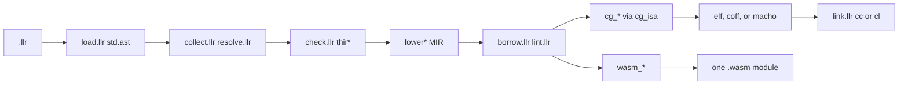

# Llrst: implementation handoff

This file is the work plan for Llrst. It is written so another agent can pick it up cold.
Read it, then `docs/canon/README.md`, then the workflow you need in `docs/workflows/`.
Finished plans are in `history/`: [history/bootstrap.md](history/bootstrap.md) (the first
build), [history/self-hosting.md](history/self-hosting.md) (the `self/` compiler),
[history/phases.md](history/phases.md) (phases 0-7),
[history/phases-8-15.md](history/phases-8-15.md) (phases 8-15),
[history/progress.md](history/progress.md) (the log through 2026-11-07),
[history/comp.md](history/comp.md) (compile speed of `self/`),
[history/OPT.md](history/OPT.md) (retired optimization notes),
[history/ui.md](history/ui.md) (the `llr-ui` framework), and
[history/DARWIN.md](history/DARWIN.md) (self-hosting on an arm64 Mac). The widget workflow is
[docs/workflows/ui.md](docs/workflows/ui.md).
When code and this file disagree, trust the code and fix this file.

Status legend used below: `[ ]` not started, `[~]` in progress, `[x]` done. Update the
boxes as you go and add a dated line to the **Progress log** at the bottom.

## Rules for this work

- Every source file stays under 500 lines; nothing may reach 1000. If a file you touch is
  already near 500, split it in the same phase before adding to it. Functions stay under
  40 lines (`llr-fmt --lint`). Counts in **Line budget** are from 2026-10-27.
- Order of operations for every change: **reuse** an existing function, else **refactor**
  one so it can be reused, else add new code. Do not widen the language only for `self/`.
- Every std function has a `(test ...)` form in its file; every error code has a
  `tests/err` case and a row in `docs/spec/errors.md`; every tool has a `docs/tools` page.
- Before committing: `llr-fmt <changed .llr>`, `llr-fmt --lint std/*.llr tools/*.llr`.
  Each phase is a separate commit with a one-line message. A phase is done only when
  `tests/run.sh` fails=0 under stage 0 (`cargo build --release`, then `tests/run.sh`) and
  under stage 2 (`scripts/self.sh`: `self|stage2=equal`, then the suite with `llrs2`).
  When the change touches Windows, the same bar is `tests/run.ps1` and `scripts/self.ps1`.
- No prose in diagnostics or tool output; one record per line, `|` separated.
- Stage 0 `llrc` (Rust) is the reference. A `self/` change that alters `check` stderr or
  `emit-mir` output must keep `tests/check.sh` and `tests/mir.sh` byte-equal, or change
  stage 0 in the same commit.

## Decisions (already made, do not reopen)

Original request, condensed: a compiled language `Llrst` (`.llr`), Rust bootstrap,
Rust-like memory safety, designed for model readability and few tokens, easy to refactor,
large growing std, one right way per task (documented), cross-platform, machine-readable
errors, low context use. Then: list agents' most used tools, reimplement them in Llrst,
install them, document them, write agent workflows.

| Topic | Decision |
| --- | --- |
| backend | Stage 0 is Cranelift 0.136 (`cranelift-codegen/frontend/module/object/native`), pure Rust, four hardware ISAs. The installed compiler is stage-2 `llrs` from `self/`, emitting x86-64 ELF64 or COFF and aarch64 ELF or Mach-O directly; `llrc` stays in the tree until two releases agree. |
| syntax | S-expressions, delimiters `( ) "` only; trivial grammar, no precedence. |
| memory | ownership + borrows with NLL-style regions on MIR; checked, no GC. |
| tools | `read grep find edit fmt test diff` first (highest-frequency agent tools); `write ls rm git http doc check bench lsp` added since. One `.llr` per binary. |
| tool output | `tag|field|...`, one record per line; exit 0 ok, 1 tool error (`E|<tool>|0|0|0|code|k=v` on stderr), 2 negative result. Lists end with `more|...` when truncated. |
| integers | `+ - * neg` wrap by default. `--checked` traps them, `shl` `shr` outside `0..bitwidth`, an integer cast that does not fit, a float-to-int whose truncation does not fit, and an int-to-float that is not exact. Without it a shift count is masked with `bitwidth - 1`, a cast truncates, float-to-int saturates, int-to-float rounds. `MIN / -1` and `MIN % -1` always panic `int.overflow` via `sys.checked_div`. `wadd wsub wmul wneg` always wrap. |
| regex | backtracking, ASCII, no non-greedy; `\N` backreferences compare captured bytes and an unset group does not match; `--ic` lowercases pattern and text; word boundaries are ASCII `[A-Za-z0-9_]` only (`std/re.llr`). Fine for tool-sized input. |
| perf | `vec.sort` allocates a scratch buffer (stable merge). `map` heads shrink to a power of two, minimum 16, when `len * 8 <= heads` (`std/map.llr`). |
| visibility | `pub` is strict, per module. Only `pub` std types enter the prelude; std module fns need `(use std.X)`. A struct field and an enum variant are private unless `(pub (name type*))`. |
| directories | `fs.list` names come from `llr_readdir_name`, which reads `dirent` on Unix and `WIN32_FIND_DATA` on Windows (`runtime/llr_stat.c`, `runtime/llr_win.c`). |
| generics | A generic is typechecked only for the instances the driver compiles. One that is never instantiated is linted from its AST and is not MIR-checked. |
| git tool | `llr-git` reads status, diff, and log and does not change the repo. |
| C runtime | `runtime/*.c` shims stay C and are prebuilt by install. Cocoa UI shims are `runtime/*.m`, compiled with `clang -fobjc-arc` on Darwin only. The system C compiler is the linker driver only. |
| warnings | A warning exits 0. `--deny CODE` may be repeated; each named warning is printed as `E` and the process exits 1. `use.unused` and `fn.unused` are not emitted for `std`. `fn.unused` is not emitted for `pub`, `extern`, or `main`. |
| trait objects | `(& (dyn Trait))` is a fat pointer. `(box (dyn Trait))` owns the heap value; it is not `copy`. A value is packed where that type is expected. `(& box)` and `(&mut box)` are that fat pointer unless a reference to the box is expected. A trait in another module is `module.Trait`: `(box (dyn id.Id))`, `(impl id.Id ty ...)`, and `id.Id.method`. No trait default methods: a framework callback is a `(clos ...)` field. |

Out of scope: a garbage collector, a second syntax or precedence grammar, Unicode-aware
regex, and any change that exists only to make `self/` smaller.

## Architecture



| path | role | start here |
|------|------|-----------|
| `self/` | installed compiler (`llrs`); the `llrc` command is stage-2 `llrs` | `llrs.llr` (CLI), `drive.llr` (build) |
| `compiler/src/` | stage 0 `llrc` (Rust, Cranelift); not installed; reference for `tests/check.sh`, `tests/mir.sh` | `main.rs`, `driver.rs` |
| `std/` | standard library, 50 modules, all Llrst | `sys.llr` (externs, panic), `str.llr`, `vec.llr` |
| `tools/` | agent tools, one `.llr` per binary; `fmtlint.llr` is a `proj.` module of `llr-fmt` | `llr-read.llr` (smallest) |
| `runtime/` | C shims: `llr_stat.c` (Unix); `llr_wsa.c`, `llr_win.c`, `llr_win_sock.c`, `llr_win_proc.c` (Windows). UI: `llr_ui_win*.c`, `llr_ui_x11*.c`, `llr_ui_mac*.m`. Install compiles the host UI objects | |
| `tests/` | goldens `run/*.llr+.out`, `err/*.llr+.err`, `warn/`, `panic/`; `run.sh`/`run.ps1` suite; `check`, `mir`, `self` differentials (`.sh` + `.ps1`); `cross.sh` | `run.sh` |
| `scripts/` | `install.sh`, `install.ps1` (stage 0, then `llrs0..2`, install `llrs2`); `self.sh` and `self.ps1` (bootstrap); `check-lines.sh` | |
| `docs/spec/` | grammar, tokens, types, memory, errors, targets | `errors.md` is the code catalogue |
| `docs/canon/` | the one right way per topic | `README.md` |
| `docs/std/` | per-module API tables, generated by `llr-doc` from signatures | `README.md` |
| `docs/tools/` | ranked tool list, per-tool output grammars | `README.md` |
| `docs/workflows/` | step lists for agents | `debug.md` maps error codes to actions |

| pass | file(s) | what it owns |
|------|---------|--------------|
| load | `load.llr`, `src.llr` | main, sorted `std/`, host OS externs, then `proj.*` and `ui.*` on use; std search `--std`, `$LLRST_STD`, `<exe>/../std`, `<exe>/../../std`, `<exe>/../share/llrst/std`, `./std`; ui search `--ui`, `$LLRST_UI`, `<exe>/../share/llrst/ui`, `<exe>/../../ui`, `./ui` |
| resolve | `collect.llr`, `resolve.llr`, `prog.llr` | def ids, methods, traits and impls, visibility, `(inline ...)` notes |
| types | `ty.llr`, `lit.llr` | ints, floats, bool, refs, pointers, adts, fns, closures, dyn, params, infer; literal parsing |
| check | `check.llr`, `thir.llr`, `thir_expr.llr`, `thir_call.llr`, `thir_pat.llr`, `thir_lit.llr`, `thir_clos.llr` | one typed body per instance; closure capture |
| MIR | `lower.llr`, `lower_cf.llr`, `lower_call.llr`, `lower_match.llr`, `lower_clos.llr`, `lower_div.llr`, `inline.llr`, `mir.llr`, `mir_print.llr` | places, blocks, drop, `sys.checked_div`, inline substitution |
| borrowck | `borrow.llr`, `holders.llr`, `loans.llr`, `liveness.llr`, `moves.llr`, `static_ck.llr`, `lint.llr` | loans, holders, init, `'static`, warnings |
| codegen | `cg_mod.llr`, `cg_entry.llr`, `cg_frame.llr`, `cg_slot.llr`, `cg_trace.llr`, `cg_lay.llr`, `cg_op.llr`, `cg_cast.llr`, `cg_ovf.llr`, `cg_bits.llr`, `cg_term.llr`, `cg_drop.llr`, `cg_clos.llr`, `cg_vt.llr`, `cg_isa.llr`, `isa_x64.llr`, `isa_a64.llr`, `isa_a64_fp.llr`, `isa_a64_frame.llr`, `isa_a64_ovf.llr`, `x64.llr`, `x64_int.llr`, `x64_sse.llr`, `x64_abi.llr`, `x64_buf.llr`, `a64.llr`, `a64_int.llr`, `a64_mem.llr`, `a64_fp.llr`, `a64_abi.llr`, `a64_buf.llr` | scalar locals in callee-saved registers when their address is not taken, otherwise a stack slot; SysV, Win64, or AAPCS64; `--checked` traps; vtables; closure trampolines |
| objects | `elf.llr`, `elf_out.llr`, `coff.llr`, `macho.llr`, `macho_out.llr`, `wasm.llr`, `wasm_out.llr` | ELF64 (x86-64 or aarch64), COFF (REL32, ADDR64), Mach-O arm64, or one Wasm module (`.wasm`) for `wasm32-wasi` and `wasm32-unknown-unknown`. Language pointers stay 8 bytes. `sys.os_id` is 3 on wasm. |
| link | `link.llr`, `link_so.llr`, `link_win.llr` | Unix `cc` plus `llr_stat.o`; Windows `cl /link /STACK:8388608 /Brepro` plus the prebuilt shims. A reference to `llr_ui_open` also links the host UI shim. `--emit-dylib` passes `-shared` or `/LD` |
| driver | `llrs.llr`, `drive.llr`, `diag.llr`, `cg_reload.llr` | `build run check emit-mir version`; `-o --std --ui --test --checked --deny --target --emit-obj --emit-dylib`; reachable instances from `main` or `--test` |

Generics are monomorphized by re-checking the body per instantiation. Only reachable
instances are compiled; std bodies are checked lazily.

## Status

```
commit|d823ddc|Merge pull request #3 from AVoSI-VI/ui|2026-11-03
version|0.8.0
suite|tests/run.sh fails=0|2026-11-08|stage 0
self|stage2=equal|scripts/self.ps1 --stage at 2026-11-06|windows x64|llrs0 build self/llrs.llr 19.0s|llrs1/llrs0=1.14
bench|2026-11-08|Linux x86_64|Intel Core Ultra 5 125H|benchmarks/baseline.txt|5-run median|gate=30%
compile|llrc self/llrs.llr 3.9s|llrs0 20.6s|llrs1 22.1s|llrs1/llrs0=1.07|http check llrc 60ms|llrs2 303ms|llrs2/llrc=5.1
runtime|stage2/stage0|fib 0.93|sieve 1.09|nbody 1.29|mandelbrot 2.4|spectral 1.18|string 1.18|json 1.08|sort 1.66|map 1.04|trees 0.85
stage0 vs C|fib 23x|sieve 23x|nbody 46x|mandelbrot 3.4x|spectral 28x|string 8.7x|json 38x|sort 3.2x|map 9.6x|trees 9.4x|fannkuch 35x
stage0 vs Rust|fib 17x|sieve 17x|nbody 30x|mandelbrot 3.4x|string 9.4x|json 39x|sort 11x|map 5.3x|trees 7.5x
stage0 vs Nim|fib 21x|sieve 15x|nbody 42x|mandelbrot 3.9x|string 5.7x|json 2.8x|sort 1.9x|map 3.0x|trees 8.2x
wasm|self/ emits one .wasm module|os_id=3|wasm32-wasi and wasm32-unknown-unknown|suite=tests/wasm.sh
lines|compiler=9979 rs|self=20032 llr|std=9471 llr (55 modules)|ui=9622 llr|tools=2099 llr|max_file=runtime/llr_ui_win_a11y.c 596|budget=500 soft, 1000 hard
```

## Implementation notes (things you would otherwise rediscover)

Paths in this section name stage 0 (`compiler/src/`). The `self/` owner of each concern is
in the **Architecture** pass table; the behaviour is the same unless Phase 1 in
[history/phases.md](history/phases.md) says otherwise.

ABI and data (`codegen/mod.rs`, `codegen/func.rs`)
- Scalars by value; aggregates (structs, enums, `str`, `vec`) passed as a pointer and
  copied into the callee's stack slot in the prologue; aggregate returns via an sret
  pointer as first param. Externs must have scalar params/returns.
- Every MIR local is a stack slot; values are loaded/stored, no SSA variables.
- `"literal"` has type `(& str)` and points at a static 24-byte `{ptr,len,cap=0}` record
  (`str_data`); `str.drop` frees only when `cap > 0`. Length bytes follow target
  endianness (`big_endian`).
- Panic messages are built in std: `str.oob(len, idx)` / `str.oob_range(len, lo, hi)`;
  the compiler only supplies `loc`. Goldens for them live in `tests/panic/`.
- Integer `/` and `%` lower to `sys.checked_div` (`mir/lower_div.rs`): operands widen to
  `i64`, the call carries a `file|line|col` literal, the result truncates back. The
  function's own division stays raw (`Lower::raw_div`) so the rewrite does not recurse.
  Float division is unchanged. `checked_div` always rejects signed `MIN / -1` and `MIN % -1`.
  Goldens: `tests/panic/div_zero*`, `tests/panic/div_min`, `tests/panic/rem_min`, `tests/run/div_ok`.
- `fs.mtime` and `fs.size` call `llr_stat_mtime` / `llr_stat_size` in `runtime/llr_stat.c`.
  `fs.list` calls `llr_readdir_name` there for `d_name`.
  On Darwin, `extern_id` renames `open`, `fcntl`, `bind`, `connect`, `socket`, and `setrlimit` to `llr_*` in that object. The wrappers translate Linux open flags, a 16-byte `sockaddr_in`, `EAGAIN` to 11, and `setrlimit` resource 7 to `RLIMIT_NOFILE`. `__errno_location` calls `__error`.
  `link.rs` appends `llr_stat.o` on Unix, or compiles and links `llr_wsa.c`, `llr_win.c`,
  `llr_win_sock.c`, and `llr_win_proc.c` on Windows,
  from `$LLRST_RUNTIME`, `$LLRST_STD/..`, `<exe>/../share/llrst/`, `<exe>/../../runtime/`, or `./runtime/`.
  `install.sh` and `tests/run.sh` compile the Unix object. `tests/run.ps1` does not;
  `llrc` compiles the Windows objects. `poll` is in `llr_win_sock.c`. `llr_call_child` is in `llr_win_proc.c`.
- `mir/lint.rs` runs after borrowck. `flow.unreachable` is an unreachable block that
  contains something other than `Drop`/`StorageDead`/`Nop` (the empty block opened after
  `(ret)` is skipped). `name.unused` is a local or parameter that is never an operand,
  borrow, or discriminant; names starting with `_` are skipped. A warning exits 0 unless
  `--deny CODE` names it; `--deny` may be repeated and then that warning is an `E`.
  `use.unused` and `fn.unused` are not emitted for an `std` module. `fn.unused` is not
  emitted for `pub`, `extern`, or `main`. Goldens: `tests/warn/`.
  An inlined call pushes a panic frame named with `fn_path`. Drop glue pushes `drop.<type>`.
- `+ - * neg` wrap by default. `llrc --checked` traps them (`codegen/ovf.rs` calls
  `sys.abort` with `int.overflow`) using Cranelift `sadd_overflow` / `uadd_overflow` and
  the sub/mul pairs. `wadd` `wsub` `wmul` `wneg` always wrap; the map hash uses `wmul`.
  The same flag panics `cast.overflow` for a float-to-int whose truncation does not fit and
  for an int-to-float that is not exact (`codegen/ops.rs`). Without it, float-to-int saturates.
- `(sizeof T)` is `Callee::Sizeof`; `(sys.arch)` is a compile-time `(& str)`; `sys.argc`
  / `sys.argv` read globals set by the generated C `main` (`emit_entry`).
- `--test`: each `(test ...)` becomes `llr_test_i`; `emit_test_entry` calls
  `test.run(name, fnptr)` per test, sums failures, calls `test.done(fails)`. `test.run`
  forks (`std/test.llr`), filters by `argv[1]` substring.

Drops (`mir/lower.rs`, `codegen/func.rs`, `codegen/drop.rs`)
- Each local whose type `needs_drop` has an i8 drop flag: set on whole-local assign and
  call dest, cleared on `Move` rooted at the local, `Stmt::Forget`, and after `Drop`.
- `Stmt::Drop(place)`: whole local -> flag-guarded glue call; projection -> unconditional.
- Drop glue per concrete type: user `drop` method first (any `(impl T (fn drop ((self (&mut T))) unit ...))`), then fields / enum payload by tag.
- Scopes (`Scope { drops, all }`) emit `Drop` then `StorageDead` on exit; `ret`/`brk`/`cont`
  emit drops down to the target depth without popping.
- Match by value: binding a non-copy payload moves it (clears the whole flag), so
  wildcard payload fields are dropped explicitly only in that case (`moved_any`). Without
  moves, the whole value drops at scope end. This fixed a double free; keep it.
- Assignment `(set place v)` drops the old value unless the place goes through a raw ptr.
- `mem.replace`, `mem.forget`, `ptr.read/write` are the escape hatches std uses.

Borrow checker (`borrow/`)
- Moves: forward "maybe moved" bitset per local; `Move` of a whole local (no deref) marks,
  whole-local write clears. Moving out of a field/deref is rejected earlier in lowering
  (`move.field`, `move.deref`), except match bindings on a whole local.
- Loans (`loans.rs`): one per `Rvalue::Ref`, indexed in program order. Holders are a
  forward dataflow in `holders.rs` over `(loan, local)` pairs, union at joins, recorded per
  point. Transfer: a whole-local `Assign`/call dest and `StorageDead` kill that local's
  pairs; `Ref{place}` gens its own loan plus every pair of `place.local` (a reference into a
  holder reaches what it holds); `Use`/`Cast`/`Struct`/`Variant` operands flow pairs when
  either side is ref-bearing; calls flow eligible args into the dest; and for each arg typed
  `(&mut X)` with ref-bearing `X` (`mut_ref_sink_args`), the referents of the mutable loans
  it holds become holders of every other ref argument (so `vec.push (&mut hold) (& a)` makes
  `hold` hold the loan on `a`).
- Eligible call args (`loans::eligible_args`): params sharing a named lifetime with the
  return type; else the single ref param; else `self` if a ref; else all ref params.
- Region of a loan = points where any holder is live (backward liveness, `liveness.rs`).
  A loan never conflicts at its own creation point or with accesses rooted at a holder.
- Conflicts (`check.rs`): mutable loan vs any access; shared loan vs write/move/`&mut`.
  `Drop`/`StorageDead` of the borrowed local with a holder live afterwards is
  `borrow.escape` (reported at the borrow span); loans through a deref are exempt.
- Two-phase: `&mut` created directly as a call argument (or an implicit reborrow in
  argument position) acts shared until the call terminator of the same block.
- Implicit reborrow: using a `&mut` place as an operand produces `&mut *place` into a
  temp instead of moving it (`Lower::reborrow`).

Checker conventions (`check/`)
- Bidirectional: `want` flows into literals, `opt.none`, `vec.new`, generic calls.
  Unsuffixed int literals are `Infer(_, int=true)` and default to `i64` in `finish`.
- `coerce`: `&mut T` where `& T` is wanted inserts `(& (@ e))`.
- `if` without else accepts any then-type (value discarded); `and`/`or` take 2+ args.
- `(try e)` works on `res`/`opt`; variant 0 is ok/some, 1 is err/none (std relies on it). On `res`, a different error converts through `From.from` when the function's error type implements `From` and the method's parameter is that error; otherwise `type.mismatch`.
- `(assert_eq a b)` lowers to `test.eq_str` / `eq_int` / `eq_bool` for `(& str)`, `i64`, `bool`, and `u8`. Other types with `Show` and `Eq` call `test.eq_by` / `test.ne_by`. `f64` and `f32` call `test.eq_f64` with epsilon 0. `(panic m)` to
  `sys.panic(loc, m)`; `loc` is a `"file|line|col"` literal built by `loc_lit`.
- Callee resolution order: local fn-typed variable, `lookup_fn`, struct ctor, enum variant,
  builtin (`thir::Builtin::from_path`).

Resolver (`resolve.rs`)
- All `std/*.llr` are always loaded; std types are prelude (no `use`), std module fns
  need `(use std.X)`. `proj.X` loads `X.llr` beside the main file. `proj.a.b` loads
  `a/b.llr` there. `(pub (use ...))` re-exports that module's public items.
- A std file compiled directly (its tests) is registered as both `main` and `std.X`.
- `type.fn` resolves methods first, then module-level fns of the module defining the type.
  `vec.sort`, `vec.has`, `vec.index` and the `map` key functions take trait bounds
  (`<T:Eq>`, `<T:Ord>`, `<K:Hash:Eq>`) since `ec125f7`; the fn-pointer forms are gone.
- Visibility: `Def.is_pub`; `Program::visible(from, d)` is `is_pub || same module`,
  checked in `resolve_ty`, the impl owner lookup, and the checker's `require_visible` at
  every fn/ctor/variant/const/pattern resolution. Error `name.private`. Only `pub` std
  types enter the prelude. `(pub ...)` wraps `fn extern struct enum trait const` and impl
  methods; `(pub (impl ...))` is a parse error. A struct field is private unless
  `(pub (name type))`. `field_of` and struct constructors outside the defining module
  report `name.private_field`. `mem.replace` of the whole value still copies private fields.

Tools (`tools/`, `docs/tools/`)
- `llr-fmt` is idempotent on the whole repo; the repo is formatted with it. `--lint` is
  clean on `std/` and `tools/`. `fmtlint.llr` is a `proj.` module of `llr-fmt`.
- `std/sexp.llr` is a comment-preserving S-expression reader used by `llr-fmt`. `std/ast.llr`
  is the surface grammar parsed from that tree and is what `self/` loads.

## Line budget

Raw line count on 2026-11-06. Rows are `.llr`, `.rs`, `.c`, and `.m` files under `compiler/src`, `self`, `std`, `ui`, `tools`, and `runtime` at 400 lines or above. Split before adding if a file is near 500. `scripts/check-lines.sh`
and the copy inside `tests/run.ps1` scan `compiler/src`, `std`, `ui`, `web`, `tools`, `docs`, `scripts`,
`tests`, `self`, and `runtime` for `.rs .llr .md .sh .c .m`. `.gitattributes` stores `*.c` and `*.h` as LF.

| File | Lines | Note |
| --- | --- | --- |
| `runtime/llr_ui_win_a11y.c` | 596 | Over the 500-line soft cap |
| `compiler/src/resolve.rs` | 431 | Loader lives in `load.rs`; pub-use clashes live in `reexp.rs` |
| `self/thir_expr.llr` | 497 | |
| `runtime/llr_win.c` | 496 | |
| `compiler/src/mir/lower.rs` | 495 | |
| `self/cg_frame.llr` | 496 | Register slots live in `cg_slot.llr`; trace pushes live in `cg_trace.llr` |
| `compiler/src/codegen/func.rs` | 494 | Trace push/pop lives in `codegen/trace.rs` |
| `self/link.llr` | 491 | |
| `runtime/llr_ui_android_in.c` | 485 | |
| `ui/text.llr` | 475 | |
| `std/http.llr` | 475 | Chunked bodies live in `http_body.llr`; frames live in `http_ws.llr` |
| `self/thir_call.llr` | 472 | Variant constructors stay reachable when a method shares the name |
| `compiler/src/borrow/holders.rs` | 471 | |
| `runtime/llr_stat.c` | 459 | |
| `self/wasm_op.llr` | 452 | |
| `self/thir.llr` | 449 | |
| `self/elf.llr` | 448 | |
| `std/re.llr` | 445 | |
| `compiler/src/check/expr.rs` | 440 | Assert lowering lives in `check/assert.rs`; `try` lives in `check/try_from.rs` |
| `std/sys_wasm.llr` | 440 | |
| `self/wasm_abi.llr` | 440 | |
| `self/lower.llr` | 438 | |
| `self/isa_a64.llr` | 438 | integer, branch, and memory seam; fp, frame, and overflow are split out |
| `std/ast.llr` | 434 | |
| `runtime/llr_win_proc.c` | 432 | |
| `ui/element.llr` | 430 | |
| `self/collect.llr` | 428 | Trait-impl registration lives in `timpl.llr` |
| `ui/ttf_glyf.llr` | 427 | |
| `ui/semantics.llr` | 427 | |
| `self/cg_isa.llr` | 422 | Callee-saved local slots are `slot_mem`, `slot_gpr`, and `slot_fpr` |
| `compiler/src/codegen/mod.rs` | 420 | |
| `ui/widget.llr` | 417 | |
| `self/prog.llr` | 416 | |
| `compiler/src/link.rs` | 416 | |
| `std/ast_expr.llr` | 415 | |
| `std/xml.llr` | 409 | |
| `self/wasm_fn.llr` | 408 | |
| `self/cg_mod.llr` | 406 | |

## Gaps (2026-11-03)

Found by reading `std/`, `self/`, `ui/`, `tools/`, `compiler/src/`, `docs/`, and `tests/err`
against what Rust, Go, and Python ship in their standard libraries. Nothing here was run.
A count like `x7` is the number of private copies of the same helper outside `std/`; each is
evidence that `std` lacked the function on that date. Rows closed by phases 8-15 are in
[history/phases-8-15.md](history/phases-8-15.md). Every row still open is scheduled in a phase
below unless it is under **Decided out**.

### A. std

| area | missing | evidence |
| --- | --- | --- |
| str | `upper`, `trim_start`, `trim_end`, `rfind`, `rfind_byte`, split by `str`, `replace_byte`, `pad_right`, public `is_space` `is_digit` `is_alpha` `is_alnum`, `str` to and from `(vec u8)`, UTF-8 decode and encode, float parse and format, radix parse and format | `last_seg` x4 (`self/collect.llr:14`, `self/load.llr:224`, `self/prog.llr:312`, `tools/deps.llr:33`); `last_slash` private in `std/path.llr:10`; `slash` x6 (`self/load.llr:13`, `self/drive.llr:82`, `ui/font.llr:17`); `is_space` private at `std/str.llr:103`, digit tests inlined at 21 sites; `to_str` x4 (`self/coff.llr:126`, `self/elf_out.llr:89`); `utf8` only in `ui/text.llr:35`; `fmt_f` x4 (`ui/app.llr:219`), `milli` x7, float parser only in `self/cg_bits.llr:60`; `nib` `hex_byte` `hex` x7 (`self/x64.llr:9-15`, `self/a64*.llr`); hex digit parse x5 |
| numbers | integer `min max clamp abs pow align_up`; `exp` `ln` are private; no `tan asin acos log2 log10 fmod lerp clamp approx`; no `bnot popcount rotl` | `math.min` is `f64` only; `min` inlined x9, `align_up` x4 (`self/cg_lay.llr:17`, `std/alloc.llr:31`); `std/math_trig.llr:98,112`; `near` x3; `clamp` f32 x2 (`ui/layout.llr:8`, `ui/scroll.llr:10`) |
| vec | `clone <T:Clone>`, `extend (& v)`, `filled`, `resize`, `truncate`, `first`, `sort_by`, `eq`, `dedup`, `retain`, `min`, `max`, `swap_remove`, `each` `map` `filter` | element clone loops x20 (`clone_tys` x11, `self/ty.llr:50`); `append` from a borrow x4 (`self/elf_out.llr:78`); `zeros` x6 (`ui/raster.llr:10`); two hand sorts (`self/diag.llr:82`, `self/macho.llr:90`); `bytes_eq` `self/wasm_mod.llr:108`; `docs/canon/collections.md` "No map or filter in v1" |
| map, set, deque | no value or entry iteration, `clear`, `get_or_insert`; no `set`; no deque or heap; traits only for `i64` and `str` | `docs/std/map.md`; linear scans as sets (`tools/deps.llr:43`, `self/cg_mod.llr:278`); `std/cmp.llr:10-37` |
| opt, res | `map and_then ok_or expect unwrap_or_else take` on `opt`; `map map_err ok err expect` on `res` | 15 inline `match` sites that are `opt.or` (`ui/event.llr:81`, `self/drive.llr:235`) |
| fmt | no `Show` trait; no hex, float, or `pad_right`; no pipe-record reader | 7 hand parsers of `a\|b\|c` (`ui/event.llr:128`, `ui/reload.llr:62`, `self/load.llr:252`) |
| io, fs, path, os | no line reader; no `fs.copy is_file temp_dir abs`; `path` is `/` only; no `os.set_env home pid`, no stdin or stderr in `capture` | `copy_file` `tools/serve.llr:17`; `std/path.llr:1`; `docs/std/os.md` |
| time, random | clock is `fs.now_ms`; no monotonic clock, sleep, calendar, ISO 8601; no random | `std/fs.llr:84`; `random_get` extern only (`std/sys_wasm.llr:37`) |
| bytes, encoding, hash | no LE or BE read and write, no varint; base64 encode only, SHA-1 only; no sha256, crc32, percent-encoding, UTF-8 validation | ~20 copies (`self/elf.llr:214`, `ui/ttf.llr:31`, `std/h2.llr:2`, `std/sha.llr:54`); varint in `self/wasm.llr:7` and `std/pb.llr:2` |
| json | no floats; `\u` above 255 is `?`; encoder takes `(vec str)` only; no pretty print | `std/json_read.llr:39,54`; `docs/std/json.md` |
| net, thread | dotted IPv4 only; no DNS, UDP, IPv6, timeouts; pool only; mutex externs not exposed; no channel, no join value | `docs/std/net.md`; `std/thread.llr:24` |
| test, cli | `eq_str eq_int eq_bool` only; no float assert, no `assert_ne`; `cli` has no subcommands or repeated options | `std/test.llr:22-29`; `docs/std/cli.md` |
| std-internal duplication | scanner `peek` `skip` `is_name` x5; `eshort` x3; `hname` `hval` x2; `nan` `pow2` `near` x2; BE push and read x5 | `std/gql_parse.llr:13`, `std/sexp.llr:22`, `std/re.llr:29`, `std/xml.llr:20`; `std/http.llr:26`, `std/http_body.llr:2`, `std/http_ws.llr:2`; `std/math.llr:7,39`; `std/h2.llr:2`, `std/mqtt_pkt.llr:2` |

### B. Language

| feature | status | evidence |
| --- | --- | --- |
| tuples, fixed arrays, slices, `i128`, `usize` | absent | `docs/spec/types.md`; unknown type head is `name.not_type` (`compiler/src/parse/ty.rs:70`) |
| match guards, or-patterns, range patterns, `if let` | absent | arm is `(PAT EXPR)` (`compiler/src/parse/expr.rs:198`); `Pat` is `Wild Bind Lit Variant` (`compiler/src/ast.rs:173`) |
| struct patterns, string literal patterns | rejected `match.not_enum`, `match.bad_lit` | `compiler/src/check/pat.rs:108-125` |
| `for` over a collection, step, descending, labeled `brk`, `brk` with a value | absent | `compiler/src/parse/expr.rs:172-185`; `docs/canon/flow.md` |
| trait impl for a generic type, trait type parameters, supertraits, operator overloading | rejected at parse | `is_trait_impl` wants an atom (`compiler/src/parse/mod.rs:212`); `(trait ...)` children are `(fn ...)` only (`parse/mod.rs:131`) |
| const generics, generic consts, where clauses | absent | `compiler/src/parse/ty.rs:81-111` |
| struct and enum generic bounds | parsed, silently dropped | `compiler/src/resolve.rs:318,322` keep `generics.types` only |
| non-literal `const` | silently lowered to `unit` | `compiler/src/mir/lower.rs:293-296` |
| `static`, thread-locals, `cfg` | absent | top-level heads in `docs/spec/grammar.md`; `parse.bad_head` |
| literals `0b` `0o` `_` `1e9` `\u` | absent; `0x` works but is undocumented | `compiler/src/parse/expr.rs:85-92`; `docs/spec/tokens.md:76` |
| `bnot` | absent | unary forms are `not neg wneg` (`compiler/src/parse/expr.rs:232`) |
| `try` with error conversion | absent | error type must unify (`compiler/src/check/expr.rs:419`) |
| nested `proj` directories, `pub use`, packages, manifest | absent | `compiler/src/resolve.rs:272-286`; `tests/err/parse_expect.err` |
| `(box T)` for a non-dyn `T`, `Rc`, interior mutability | rejected `trait.object\|why=dyn`; absent | `tests/err/box_dyn.err` |
| aggregate or variadic externs, callbacks from C | scalars only | Implementation notes above; `compiler/src/codegen/mod.rs:216` |

### C. Implementation and tooling

| item | evidence |
| --- | --- |
| `docs/std` has no `http_type.md` or `http_mime.md` and `README.md` lacks both rows; `fs.md` lacks `fs.now_ms`; `std/http_mime.llr` has zero `pub` functions and exists only for one test | `docs/std/README.md`; `std/http_mime.llr` |
| Line budget table is dated 2026-10-27 and names files that have since moved | this file |
| `self/` has no register allocation, no optimizer, no debug info | `docs/spec/types.md` "Every local is a stack slot"; no DWARF in `self/elf*.llr` |
| `riscv64` and `s390x` stay on stage 0; `x86_64-apple-darwin` is rejected; wasm has no net, threads, shell, or `llrc run` | `docs/spec/targets.md` |
| no language server (`llr-ls` lists directories), package manager, coverage, benchmark harness; `llr-doc` skips private items; no `link.failed` golden | `docs/tools/README.md`; `docs/tools/llr-doc.md`; `docs/spec/errors.md` |

### D. Decided out

Listed so they are not re-proposed; each is a row under **Decisions** or a canon rule: a garbage
collector, a second syntax, Unicode-aware regex, trait default methods, a `char` type
(`docs/canon/strings.md`), `+=` and `else if` (`docs/canon/bind.md`, `docs/canon/flow.md`),
`==` on `str` (`str.eq`), and widening the language only for `self/`.

## Phases

Phases 0 through 15 are done. Phases 0-7 and their log are
[history/phases.md](history/phases.md). Phases 8-15 are
[history/phases-8-15.md](history/phases-8-15.md). The log through 2026-11-07 is
[history/progress.md](history/progress.md). Phases 16 to 20 add the SQL client layer and four
drivers; Phase 21 adds `i128` (the **Gaps** B row); Phases 22 and 23 add TLS and `llr-sql`. They
come after Phase 11.

### Phase 16: sql common layer `[ ]`

Files: new `std/sql.llr`, new `std/hmac.llr`, new `std/utf16.llr`, `std/url.llr` (Phase 11), new `docs/canon/sql.md`, `docs/canon/README.md`, `docs/std/README.md`.

Depends on Phase 11 items 3 to 6 (`rand`, `bytes`, `sha256`, `b64_decode`, `url`); do those first if Phase 11 is not done. Drivers test themselves against a fake peer forked by `sys.llr_call_child`, as `net_one`, `mqtt_http`, and the `grpc` tests do, so `tests/run.sh` needs no database server.

1. `[ ]` `std/sql.llr`: `(pub (enum val (null) (int i64) (float f64) (text str) (blob (vec u8)) (bool bool)))`; `(pub (struct rows (pub cols (vec str)) (pub data (vec (vec val))) (pub affected i64)))`; `(pub (trait db (fn kind ((& Self)) i64) (fn exec ((&mut Self) (& str) (& (vec val))) (res i64 str)) (fn query ((&mut Self) (& str) (& (vec val))) (res rows str)) (fn close ((&mut Self)) unit)))`. One statement per call; placeholders are `?` in user SQL; `sql.rewrite (text prefix)` turns `?` outside `'...'`, `"..."`, and `--` comments into `$n` (PG) or `@pn` (TDS). `sql.begin commit rollback ((&mut (box (dyn db))))` send `BEGIN`, `COMMIT`, `ROLLBACK` (`BEGIN TRANSACTION` when `kind` is TDS). Row access: `(sql.get (& rows) r c) (& val)`; `val.int text float is_null` return `opt`. `(struct wire (fd i64))` with `wire.send wire.recv_exact` is the one socket seam every network driver uses (Phase 22 puts TLS behind it).
2. `[ ]` `sql.open ((url (& str))) (res (box (dyn db)) str)` by scheme: `postgres postgresql` is Phase 18, `mysql mariadb` is Phase 19, `sqlite` is Phase 17, `mssql sqlserver` is Phase 20; anything else is `sql.scheme|got=`. `url.parse` gains `user` and `pass` (percent-decoded). Default ports 5432, 3306, 1433; the database is the path without its `/`. The error vocabulary is fixed here and reused by every driver: `sql.scheme sql.connect sql.auth|method= sql.proto|got= sql.server|code=|msg= sql.lib|name= sql.type|got= sql.params|want=|got= sql.multi`.
3. `[ ]` `std/hmac.llr`: `hmac_sha256 (key msg) str`, `pbkdf2_sha256 (pw salt iters) str`, `xor (a b) str`, with RFC 4231 and PBKDF2 vectors as tests. `std/utf16.llr`: `to_le ((& str)) str` and `from_le ((& str)) str` through `str.utf8_at` and `str.push_utf8` (`str_more.llr` is at 398 lines, so a new file).
4. `[ ]` `docs/canon/sql.md`: open, exec, query, params, row access, transactions, close, error shape; a `docs/canon/README.md` row; `docs/std/README.md` rows; `llr-doc` regenerates `docs/std`.
5. `[ ]` Commit: `std: sql value, rows, db trait, open by url, hmac, utf16`.

### Phase 17: sqlite `[ ]`

Files: new `runtime/llr_sqlite.c`, new `std/sql_lite.llr`, `self/link.llr`, `compiler/src/link.rs`, `scripts/install.sh`, `scripts/install.ps1`, `scripts/self.sh`, `tests/run.sh`, `std/sys_wasm.llr`, `docs/spec/targets.md`.

1. `[ ]` `runtime/llr_sqlite.c` loads the system library through `llr_dlopen` and `llr_dlsym` at first use: `winsqlite3.dll` then `sqlite3.dll` on Windows, `libsqlite3.dylib` on Darwin, `libsqlite3.so.0` then `libsqlite3.so` elsewhere. Decision: no build-time `-lsqlite3` and no vendored amalgamation; promote this to **Decisions** when the phase lands. Scalar-only forwarders `llr_sqlite_load open close prepare step reset finalize bind_null bind_int64 bind_double bind_text bind_blob column_count column_type column_name column_int64 column_double column_text column_bytes column_blob changes errmsg`. `bind_text` and `bind_blob` use `SQLITE_TRANSIENT`.
2. `[ ]` Link: a reference to `llr_sqlite_load` links `llr_sqlite.o` or `.obj` plus `llr_dl.o` and `link_so.dl_flag`. `link.llr` is 438 lines: first fold the three repeated `want_sym` and `add_need` blocks (`llr_reload_prev`, `llr_dlopen`) into one table-driven helper so the sqlite row is one line each in `via_gnu`, `via_cl`, and `unix_link`; `link.rs` gets the matching `wants_name` row. `install.sh`, `install.ps1`, `self.sh`, and `tests/run.sh` compile the new shim beside `llr_dl.c`.
3. `[ ]` `std/sql_lite.llr`: `(struct lite (db (ptr u8)))`, `open (path)` (`:memory:` allowed; a missing library is `sql.lib|name=sqlite3`), `(impl sql.db lite ...)`: prepare, bind by `val` variant, step loop; `column_type` 1 2 3 4 5 are `int float text blob null`; `exec` returns `changes`; a prepare or step failure is `sql.server|code=<rc>|msg=<errmsg>`; a non-empty tail after one statement is `sql.multi`. wasm: `target.unsupported`, as every other extern.
4. `[ ]` Tests: `:memory:` create, insert every `val` variant through params, select, `affected`, bad SQL error. `docs/spec/targets.md` lists the host sqlite library as a requirement of the `std.sql_lite` tests.
5. `[ ]` Commit: `std: sqlite through the host library`.

### Phase 18: postgresql `[ ]`

Files: new `std/sql_pg.llr`, new `std/sql_pg_auth.llr`, new `std/sql_pg_row.llr`.

1. `[ ]` Framing over `sql.wire`: type byte plus big-endian `i32` length (`bytes.rd_be`). Startup: protocol 196608, `user`, `database`, `client_encoding=UTF8`. Auth `R`: 0 ok; 3 cleartext answers `p`; 10 SASL `SCRAM-SHA-256` in `sql_pg_auth.llr` (client-first `n,,n=<user>,r=<nonce>`, server-first `r= s= i=`, `pbkdf2_sha256`, `ClientKey StoredKey AuthMessage ClientProof`, verify `v=`); 5 md5 and `SCRAM-SHA-256-PLUS` are `sql.auth|method=`. Then `S` and `K` until `Z`.
2. `[ ]` Extended protocol per call: `P` (unnamed, `sql.rewrite` to `$n`, param OIDs 20 701 25 17 16, or 0 for null), `B` (text format), `D` portal, `E`, `S`; read `1 2 T D C Z`; `E` is `sql.server|code=<SQLSTATE>|msg=` after draining to `Z`. `sql_pg_row.llr` decodes text values by OID: 21 23 20 are `int`; 700 701 1700 are `float`; 16 is `bool`; 17 `\x..` is `blob`; anything else is `text`. `affected` comes from the `C` tag (`INSERT 0 n`, `UPDATE n`, `DELETE n`). `close` sends `X`.
3. `[ ]` Tests: a `llr_call_child` fake server speaking cleartext and SCRAM (RFC 7677 vector: `user` and `pencil`, client nonce `rOprNGfwEbeRWgbNEkqO`, salt `W22ZaJ0SNY7soEsUEjb6gQ==`, 4096 iterations) and a canned `T D C Z` result; message encode goldens.
4. `[ ]` Commit: `std: postgresql v3 with scram-sha-256`.

### Phase 19: mariadb and mysql `[ ]`

Files: new `std/sql_my.llr`, new `std/sql_my_pkt.llr`.

1. `[ ]` `sql_my_pkt.llr`: 3-byte LE length plus sequence id; `lenenc` int and string; OK (`0x00`, affected, insert id), ERR (`0xFF`, code, `#` sqlstate, msg, reported as `sql.server|code=|msg=`), EOF; column definition (protocol 41); binary row decode (null bitmap at offset 2; LE ints of 1 2 4 8 bytes, float, double, lenenc strings; binary DATE DATETIME TIME become canonical text).
2. `[ ]` `sql_my.llr`: Handshake v10, HandshakeResponse41 with `PROTOCOL_41 SECURE_CONNECTION PLUGIN_AUTH CONNECT_WITH_DB DEPRECATE_EOF PLUGIN_AUTH_LENENC_CLIENT_DATA`, charset 45. Auth `mysql_native_password` is `sha1(pw) xor sha1(nonce ++ sha1(sha1(pw)))`; `caching_sha2_password` fast path (`0x01 0x03`); `0x01 0x04` full auth is `sql.auth|method=caching_sha2_full` until Phase 22 sends the cleartext password over TLS; AuthSwitchRequest (`0xFE`) re-runs with the named plugin; `client_ed25519` is `sql.auth|method=`. Per call: `COM_STMT_PREPARE`, `COM_STMT_EXECUTE` (types 8 5 253 252 1 6), result set, `COM_STMT_CLOSE`; `close` sends `COM_QUIT`.
3. `[ ]` Tests: a fake server with a fixed nonce; the native-auth scramble vector; a prepare and execute roundtrip with a canned binary row; packet goldens.
4. `[ ]` Commit: `std: mariadb and mysql binary protocol`.

### Phase 20: mssql `[ ]`

Files: new `std/sql_tds.llr`, new `std/sql_tds_tok.llr`, new `std/sql_tds_ty.llr`.

1. `[ ]` TDS 7.4. Header: type, status (`0x01` EOM), BE length, spid, id, window; 4096-byte packets. PRELOGIN with `ENCRYPTION=0x02` (NOT_SUP); a server answer of `0x03` (required) is `sql.tls|need=yes` until Phase 22. LOGIN7: `0x74000004`, OptionFlags2 ODBC, strings in `utf16.to_le`, password nibble-swap then xor `0xA5`. Tokens (`sql_tds_tok.llr`): LOGINACK `0xAD`, ENVCHANGE `0xE3`, INFO `0xAB`, ERROR `0xAA` reported as `sql.server|code=<number>|msg=`, COLMETADATA `0x81`, ROW `0xD1`, NBCROW `0xD2`, DONE, DONEPROC, and DONEINPROC with the row count.
2. `[ ]` `exec` without params is a SQL batch (`0x01`) with the transaction descriptor header; anything with params is RPC (`0x03`) `sp_executesql` (proc id 10) with `@stmt`, `@params` (`@p1 bigint, @p2 nvarchar(max) ...` from the `val` variants), and typed values INTN `0x26`, FLTN `0x6D`, NVARCHAR `0xE7` (PLP above 4000 chars), BIGVARBINARY `0xA5`, BITN `0x68`, null. `sql_tds_ty.llr` decodes INT1 INT2 INT4 INT8 INTN, BIT BITN, FLT4 FLT8 FLTN, DECIMAL and NUMERIC as `float`, BIGVARCHAR BIGCHAR NVARCHAR NCHAR, BIGVARBINARY BIGBINARY, DATETIME DATETIMN DATE TIME DATETIME2 as canonical text, UNIQUEIDENTIFIER as text, and PLP chunks; anything else is `sql.type|got=`.
3. `[ ]` Tests: a fake server answering PRELOGIN, LOGINACK plus DONE, COLMETADATA plus ROW plus DONE; the password obfuscation vector; token parse goldens.
4. `[ ]` Commit: `std: mssql tds 7.4 without encryption`.

### Phase 21: i128 `[ ]`

Files: `compiler/src/ty.rs`, `compiler/src/parse/expr.rs`, `compiler/src/check/expr.rs`, `compiler/src/check/assert.rs`, `compiler/src/mir/lower.rs`, `compiler/src/mir/lower_div.rs`, `compiler/src/mir/print.rs`, `compiler/src/codegen/layout.rs`, `compiler/src/codegen/func.rs`, `compiler/src/codegen/ops.rs`, `compiler/src/codegen/ovf.rs`, `compiler/src/codegen/term.rs`, new `compiler/src/codegen/wide.rs`; `self/ty.llr`, `self/lit.llr`, `self/thir_lit.llr`, `self/thir_expr.llr`, `self/thir_eq.llr`, `self/lower.llr`, `self/lower_div.llr`, `self/mir.llr`, `self/mir_print.llr`, `self/cg_lay.llr`, `self/cg_bits.llr`, `self/cg_op.llr`, `self/cg_cast.llr`, `self/cg_ovf.llr`, `self/cg_isa.llr`, new `self/cg_wide.llr`, new `self/x64_wide.llr`, new `self/a64_wide.llr`, new `self/wasm_wide.llr`; `std/sys.llr`, `std/cmp.llr`; `docs/spec/types.md`, `docs/spec/tokens.md`, `docs/spec/errors.md`, `docs/spec/targets.md`, `docs/canon/collections.md`, `tests/run`, `tests/err`, `tests/panic`.

Stage 0 first, then `self/`: `self/` may use `i128` in its own source once `llrc` compiles it, and `scripts/self.sh` rebuilds `llrs0` from the new stage 0. Each item is its own commit; `tests/check.sh` and `tests/mir.sh` stay byte-equal at the end of each. Decisions, promoted to **Decisions** when the phase lands: `i128` is 16 bytes aligned 8 (no C interop, every slot is 8-aligned); `/` and `%` lower to `sys.div128`, and `--checked` `*` to `sys.checked_mul128`, so no backend emits a 128-bit divide or multiply-overflow; no float cast to or from `i128` (`type.bad_cast`; go through `i64`); an `i128` in an `extern` signature is `type.extern_wide|ty=i128`; an `i128` literal is not a `match` pattern (`match.bad_lit`). `u128` is not in this phase; int id 9 is reserved for it.

1. `[ ]` Stage 0 front end: `IntTy::I128` (`ty.rs`: `from_name`, `name`, `bytes` 16, `signed`, `fits` special-cased so `1i128 << 128` is never evaluated). The literal accumulator is already `i128` (`parse/expr.rs`); `Const::Int(i128, _)` already holds it; `mir/print.rs` prints `3i128` through `name()`. `check/expr.rs`: `(as ...)` rejects `i128` with `f32`/`f64` as `type.bad_cast`; `check/mod.rs`'s `extern_id` path reports `type.extern_wide`; `check/pat.rs` rejects an `i128` literal pattern as `match.bad_lit`. `lit.overflow|ty=i128` falls out of `fits`. `check/expr.rs` is at 458 lines and `mir/lower.rs` at 474: split before adding.
2. `[ ]` Stage 0 codegen in `codegen/wide.rs`: `layout::clif_type` maps `I128` to `types::I128` (fold the private duplicate in `ovf.rs:int_clif` into it); constants are `iconcat` of two `iconst` I64 (`func.rs:289` and `term.rs:123` stop truncating with `as i64`); `icmp_imm` on an I128 becomes `icmp` against a built constant; `--checked` add, sub, and neg derive overflow from the sign bits of operands and result (`bxor`, `band`, `ushr 127`) since Cranelift 0.136 x64 does not lower `*_overflow`, `sdiv`, `udiv`, `clz`, or `fcvt_*` on I128; int-to-int casts use `sextend`/`uextend`/`ireduce` as today, with `cast_oob` and `signed_min` moved to `i128` arithmetic; `mask_shift` masks with 127 and `checked_shift` traps outside `0..128`. `lower_div.rs`: when either operand is `i128`, call `sys.div128` with no widening; under `--checked`, `*` on `i128` lowers to `sys.checked_mul128`. `(sizeof i128)` is 16. `codegen/func.rs` is at 465: split first.
3. `[ ]` std: `sys.div128 ((loc (& str)) (a i128) (b i128) (rem bool)) i128` by shift-subtract on magnitudes using only `shl shr - < ==`, `div.zero` and `MIN / -1` -> `int.overflow`, with the same `raw` exemption `checked_div` has so it does not recurse; `sys.checked_mul128 ((loc (& str)) (a i128) (b i128)) i128` (wrapping product, then `div128` back-check, `MIN * -1`). `std/cmp.llr`: `Eq Ord Hash Clone Show` for `i128` mirroring the `u64` block; `Hash` folds the two 64-bit halves with `bxor` before the i64 mix; `Show` is a digit loop over `div128` with the `MIN` case spelled out. `assert_eq` on `i128` reaches `test.eq_by` through `Show` and `Eq`; `eq_int` is unchanged. Tests in `cmp_ints` for `(shl 1i128 100)`, `MIN`, `MAX`, negative `Show`.
4. `[ ]` `self/` front end: int id 8 in `ty.llr` (`int_name`, `int_id`, `signed` becomes `(or (< i 4) (== i 8))`, `fits` takes `i128`); fold `cg_lay.int_bytes`, `cg_bits.int_w`, and `cg_lay.signed` into `ty.int_bytes` and `ty.signed` (three copies today). `lit.num.val` and `thir.ex.id2` become `i128`; `lit.parse_dec` and `parse_rad` detect overflow by comparing against `MAX / base` before each step instead of the `(< v 0)` test; `mir.op` gains a `hi i64` word so `oconst` carries 128 bits and `mir_print.int_txt` prints through `Show.show`. `thir_expr.cast_ok` adds the float rule, `collect.llr` or `check.llr` adds `type.extern_wide`, `thir_pat.pat_lit` adds `match.bad_lit`. `thir_expr.llr` is at 497 lines: move `atom_ty`, `named_ty`, `check_cast`, and `cast_ok` into a new `self/thir_ty.llr` first. `tests/check.sh` and `tests/mir.sh` byte-equal.
5. `[ ]` `self/` x64 and aarch64: `i128` is `cg_lay.is_agg` (passed by pointer, copied into the callee slot, returned through sret, exactly the struct path), not `is_scalar`, so `cg_frame`, `cg_term`, `cg_clos`, and both `*_abi.llr` files are untouched. `cg_wide.llr` evaluates every `i128` op on two 8-byte halves in memory through new seam ops in `cg_isa.llr`: `add_wide sub_wide mul_wide neg_wide not_wide and_wide or_wide xor_wide shl_wide shr_wide sar_wide cmp_wide ext_wide trunc_wide`. `x64_wide.llr` encodes `adc sbb shld shrd` and the one-operand `mul`/`imul` (`rdx:rax`), with `mul_wide` as `mul lo*lo` plus two `imul` cross terms; `a64_wide.llr` uses `adds adcs subs sbcs` (new encodings) and the existing `mul umulh madd`. `--checked` add, sub, and neg trap on `o`/`vs` after the high half; shifts mask with 127 or trap outside `0..128`; casts from a narrower int sign- or zero-fill the high word, casts to a narrower int take the low word and, under `--checked`, trap `cast.overflow` unless the high word is the sign fill. `lower_div.into_div` skips `widen` for id 8 and calls `div128`; `--checked` `*` calls `checked_mul128`. `isa_a64.llr` is at 436 lines: the new encodings go in `a64_wide.llr`, not there.
6. `[ ]` `self/` wasm: `wasm_wide.llr` holds an `i128` as two `i64` words in linear memory; carry is `i64.lt_u` of the low sum, `mul_wide` builds the high word from four 32-bit products, shifts branch on `count >= 64`. `wasm_op.llr` (452) and `wasm_abi.llr` (440) only dispatch to it. `tests/wasm.sh` runs the new goldens.
7. `[ ]` Goldens: `tests/run/i128.llr` (literals in every radix, `MAX`, wrap at `2^127`, `+ - * neg bnot band bor bxor shl shr`, every compare, `/` and `%` with negatives, casts from and to `i8 u8 i64 u64`, `Show`, `(sizeof i128)` 16, an `i128` struct field and `vec` element); `tests/run/i128_checked.llr` with `--checked` flags where every op fits; `tests/panic/i128_overflow i128_div_zero i128_div_min i128_mul_overflow i128_cast_high i128_shift_high` with `--checked` where needed; `tests/err/i128_extern i128_float_cast i128_match lit_overflow_i128`. `docs/spec/types.md` adds the `i128 | 16 | signed; aligned 8; no float cast; not an extern type` row and the division note; `tokens.md` lists `i128` with the suffixes; `errors.md` adds `type.extern_wide` and the `match.bad_lit` and `type.bad_cast` cases; `targets.md` notes the two-word wasm form; `docs/canon/collections.md:5` already covers the trait impls. `llr-doc` regenerates `docs/std`.
8. `[ ]` Commits: `lang: i128 in stage 0`, `std: div128, checked_mul128, cmp for i128`, `self: i128 front end`, `self: i128 on x64 and aarch64`, `self: i128 on wasm`, `docs: i128 spec and goldens`. `scripts/self.sh --stage` reaches `stage2=equal` at the end.

### Phase 22: tls 1.3 client `[ ]`

Files: new `std/tls.llr`, `std/tls_rec.llr`, `std/tls_hs.llr`, `std/tls_hkdf.llr`, `std/tls_x25519.llr`, `std/tls_chacha.llr`, `std/tls_aes.llr`, `std/tls_gcm.llr`, `std/tls_p256.llr`, `std/tls_rsa.llr`; then `std/sql.llr`, `std/sql_pg.llr`, `std/sql_my.llr`, `std/sql_tds.llr`, `docs/canon/sql.md`, `docs/canon/io.md`, `docs/spec/memory.md`.

Large; each item is its own commit. Depends on Phase 21. Field arithmetic accumulates limb products in `i128`: X25519 on five 51-bit limbs (the radix-2^51 form; a product is under 2^102 and the 19-fold sum under 2^110), Poly1305 on three limbs of 44, 44, and 42 bits, P-256 and RSA Montgomery multiplication on 52-bit limbs (a 40-limb accumulator stays under 2^110). Nothing wraps, so `--checked` is clean. GHASH in `tls_gcm.llr` holds a block as one `i128` and reduces with `bxor`, `shl`, `shr`, and the `0xE1` constant in a single word.

1. `[ ]` Primitives with RFC vectors as tests: X25519 (RFC 7748), ChaCha20-Poly1305 (RFC 8439), AES-128 and GCM (NIST vectors), HKDF-Extract and HKDF-Expand-Label over `hmac` (RFC 5869, RFC 8446 section 7.1), a 2^51 limb carry test against RFC 7748, and a Poly1305 partial-reduction test.
2. `[ ]` `tls_rec.llr` record layer (AEAD nonce is iv xor sequence, 16 KiB limit, KeyUpdate); `tls_hs.llr` ClientHello (`supported_versions` `0x0304`, `key_share` x25519, `server_name`, `signature_algorithms` `0x0804 0x0403 0x0401`, suites `TLS_AES_128_GCM_SHA256` and `TLS_CHACHA20_POLY1305_SHA256`), ServerHello, EncryptedExtensions, Certificate, CertificateVerify, Finished, client Finished, transcript hash; HelloRetryRequest is `tls.hrr`. `tls.connect (fd host) (res tls str)` with `send recv close` matching `net`. This item is `sslmode=require`: encrypted, server not authenticated; `docs/canon/sql.md` says so.
3. `[ ]` Server authentication: `tls_p256.llr` ECDSA P-256 and `tls_rsa.llr` RSA-PSS and PKCS1 v1.5 verify of CertificateVerify against the leaf certificate's SubjectPublicKeyInfo (a minimal DER walk), plus leaf pinning `sslmode=verify-fp&sslfp=<sha256 hex of the DER>`. Decision: no CA store and no chain validation; promote to **Decisions** when the phase lands.
4. `[ ]` Wire it in: `sql.wire` gains `(sec (opt tls.tls))`; URL `sslmode=disable|require|verify-fp`, default `require` for `postgres mysql mssql`. PG sends `SSLRequest` (80877103) and upgrades on `S`; MySQL sets `CLIENT_SSL`, sends the 32-byte SSLRequest, then upgrades, and `caching_sha2` full auth sends the cleartext password; TDS sends `ENCRYPT_ON`, carries handshake records inside PRELOGIN packets (type `0x12`) until Finished, then plain TLS records for the session. `docs/canon/io.md` gets a `tls` row.
5. `[ ]` Commits: `std: tls primitives`, `std: tls 1.3 handshake and records`, `std: tls certificate verify and pinning`, `std: sql over tls`.

### Phase 23: llr-sql tool `[ ]`

Files: new `tools/llr-sql.llr`, new `docs/tools/llr-sql.md`, `docs/tools/README.md`, `docs/workflows/` (one row where tools are listed).

1. `[ ]` `llr-sql URL SQL [--arg V]... [--max N]`: each `--arg` binds the next `?` (`null`, `true`, `false`, an integer, a float, else text). Output `col|name|...`, `row|v|...` (`|` and newline in a value are `\|` and `\n`; `null` is empty), `affected|n`, `more|N`. Exit 0; 2 when a query returns no rows; 1 with `E|llr-sql|0|0|0|<sql.*>|k=v` on stderr. `--help` prints `usage|...`. `scripts/install.sh` already builds every `tools/llr-*.llr`.
2. `[ ]` `docs/tools/llr-sql.md` output grammar; a `docs/tools/README.md` row (unranked, like `llr-http`).
3. `[ ]` Commit: `tools: llr-sql`.

## How to verify each phase

```
cargo build --release                         # stage 0 llrc at target/release/llrc; not installed
scripts/self.sh                               # llrs0, llrs1, llrs2, byte-compare, then the suite
scripts/self.ps1                              # the same bootstrap on Windows
scripts/self.sh --stage                       # stop after self|stage2=equal
scripts/install.sh [PREFIX]                  # stage 0, then install llrs2 as llrc on Linux and Darwin
scripts/install.ps1 [PREFIX]                 # same on Windows
LLRC=<prefix>/bin/llrc tests/run.sh          # goldens + every std test + line check
powershell -File tests/run.ps1                # same suite on Windows
tests/check.sh; tests/mir.sh                  # llrs check / emit-mir byte-equal to stage 0 (.ps1 twins exist)
tests/self.sh [STAGE]                         # diff STAGE (default llr-check) against stage-0 llrc check
<llrc> run tests/run/hello.llr --std std
<llrc> build std/re.llr --test --std std -o /tmp/t && /tmp/t [FILTER]
<llrc> check tests/err/X.llr --std std 2> tests/err/X.err   # regenerate a golden after a deliberate change
<llrc> build tests/panic/X.llr --std std -o /tmp/p && /tmp/p 2> tests/panic/X.err   # panic goldens (exit 101)
<llrc> emit-mir FILE --std std                # MIR dump, for borrow errors
scripts/check-lines.sh                        # W at 500 lines, fail at 1000
```

A phase is not done until both suites above are green: stage 0 (`tests/run.sh` against
`target/release/llrc`) and stage 2 (`scripts/self.sh`, the suite under `llrs2`).
A sandbox may redirect `target/`; `cargo metadata --format-version 1` prints `target_directory`.
The installed `llrc` reads its executable path from `llr_exe_path`, not `argv[0]`, and
accepts flags before or after the subcommand, so `LLRC="llrc --std ./std"` works for `llr-test`.

## Progress log

- 2026-11-09: Phase 3 of `langspeed.md`. Inline frames are pushed only around calls when the inlined region is not a loop (`mir/speed.rs`, `self/optmir.llr`), after borrowck and after `emit-mir`. A `std` `clone`/`from` of a finished local becomes a move when no holder is live afterwards; a whole-local drop whose flag is definitely clear is removed. The unmarked-inline limit stays 0: inlining `vec.len` makes `vec.sort` report `borrow.mut_shared|ref=n`. Median of five, stage 0: `sieve` 151098 ns to 74822, `map_ops` 20608 to 15669. One cross sample: `map-ops` 796 ms to 346, `json-parse` 2633 to 1829, `sieve` 488 to 250. `tests/run.sh` fails=0; check and emit-mir stay byte-equal with stage 2.
- 2026-11-09: SysV float locals live in xmm8-15 (`cg_isa.saved_fpr_n` 8, `isa_x64.saved_base`). The ABI does not preserve them, so `cg_frame.call_sym`/`call_r` spill the function's own FPR locals around every call (externs, `sys.alloc`, drop glue, trace push/pop) and the prologue skips them; spilling only around `extern` calls lost them through any Llrst callee that reached C. `isa_x64_fp.fmov` is `movaps`: a reg-reg `movsd` merges into the low lane and serialized every float op through `xmm0` (`mandelbrot` 162 ms to 92 ms against stage 2 at HEAD). `scripts/self.sh` is `stage2=equal` and the suite is fails=0 under `llrs2`.
- 2026-11-08: Phases 8-15 moved to `history/phases-8-15.md`. The log through 2026-11-07 moved to `history/progress.md`. Llrst is 0.8.0. `tests/run.sh` fails=0 under stage 0. A Unix link pulls `llr_reload.o` when any `llr_reload_*` symbol is referenced. `tests/err/match_miss.err` is UTF-8.
- 2026-11-08: `scripts/self.sh` reaches `stage2=equal` and `tests/run.sh` is fails=0 under both `llrs0` and `llrs2`. SysV stack arguments were stored above the frame (`isa_x64.pass_mem`); the displacement is negative on both ABIs. `cg_bits.scan` keeps seventeen significand digits and moves the exponent for the rest, so `9223372036854775808.0` is 2^63 instead of 0 and `str.from_f64` stops taking the `put_big` path. `lit.parse_dec` accumulates the negated magnitude, so `-9223372036854775808` parses. A call result holds its arguments' loans only when the destination type carries a reference (`holders.dest_ref`), as stage 0 does. `check_match` resolves the scrutinee's inner type through `shallow` and `zonk_ty` before coverage, so a generic call returning `(& (opt T))` is matched as an enum.
- 2026-11-08: A phase is done only when `tests/run.sh` fails=0 under stage 0 and under stage 2 (`scripts/self.sh`). On Windows the same bar is `tests/run.ps1` and `scripts/self.ps1`.
