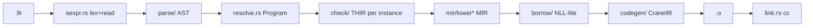

# HANDOFF

For the next agent picking up Llrst. Read this, then `docs/canon/README.md`, then the
workflow you need in `docs/workflows/`. Everything below is verifiable from the repo.

## 1. Status

```
commit|ce284b9|tests: lifetimes, struct escape, move through deref
suite|tests/run.sh|done|fails=0
lines|compiler=6018 rs|std=1685 llr|tools=464 llr|max_file=449|budget=500 soft, 1000 hard
plan_todos|11/11 complete|follow_up|pub enforcement done (strict, per module)|panic goldens + idx.oob fields done|flow-sensitive borrow holders done
```

The bootstrap plan (spec, compiler, std, hello world, tools, install, docs) is finished.
Nothing is half-built. Open work is in section 7 and section 8.

## 2. Original request and locked decisions

Request (condensed): a compiled language `Llrst` (`.llr`), Rust bootstrap, Rust-like
memory safety, designed for model readability and few tokens, easy to refactor, large
growing std, one right way per task (documented), cross-platform, machine-readable
errors, low context use. Then: list agents' most used tools, reimplement them in Llrst,
install them, document them, write agent workflows. Files under 1000 lines (refactor
near that to under 500). Order of work: reuse, refactor, new code.

Decisions taken with the user before building:

| decision | choice | why |
|----------|--------|-----|
| backend | Cranelift 0.136 (`cranelift-codegen/frontend/module/object/native`) | pure Rust, four hardware ISAs |
| syntax | S-expressions, delimiters `( ) "` only | trivial grammar, no precedence |
| memory | ownership + borrows with NLL-style regions on MIR | Rust model, checked, no GC |
| tools | read grep find edit fmt test diff | highest-frequency agent tools |

## 3. Repo map

| path | role | start here |
|------|------|-----------|
| `compiler/src/` | `llrc` (Rust) | `main.rs` (CLI), `driver.rs` (pipeline) |
| `std/` | standard library, 17 modules, all Llrst | `sys.llr` (externs, panic), `str.llr`, `vec.llr` |
| `tools/` | agent tools, one `.llr` per binary | `llr-read.llr` (smallest), `llr-fmt.llr` + `fmtlint.llr` |
| `tests/` | golden tests and runner | `run.sh`, `run/*.llr+.out`, `err/*.llr+.err` |
| `scripts/` | `install.sh PREFIX`, `check-lines.sh` | |
| `docs/spec/` | grammar, tokens, types, memory, errors | `errors.md` is the code catalogue |
| `docs/canon/` | the one right way per topic | `README.md` |
| `docs/std/` | per-module API tables (generated from signatures) | `README.md` |
| `docs/tools/` | ranked tool list, per-tool output grammars | `README.md` |
| `docs/workflows/` | step lists for agents | `debug.md` maps every error code to an action |

## 4. Pipeline



| pass | file(s) | key types |
|------|---------|-----------|
| read | `sexpr.rs` | `Sexpr::{Atom,Str(Vec<u8>),List}` with `Span` |
| parse | `parse/mod.rs` items, `parse/expr.rs`, `parse/ty.rs` (generics `<T 'a>`, targs) | `ast::Item`, `ast::Expr`, `ast::TyExpr` |
| resolve | `resolve.rs` | `Program { defs: Vec<Def>, modules, methods: HashMap<DefId, HashMap<name, DefId>>, prelude }`; `Loader` loads main, all of `std/`, and `proj.*` modules |
| types | `ty.rs` | `Ty::{Int,F32,F64,Bool,Unit,Never,Ref,Ptr,Adt(DefId,args),Fn,Param,Infer}` |
| check | `check/mod.rs` (unify, scopes, `check_fn(def, targs)`), `expr.rs`, `call.rs`, `pat.rs`, `zonk.rs` | `thir::{FnBody, Expr, ExprKind, Callee, Pat}` |
| MIR | `mir/mod.rs` types + `needs_drop`, `lower.rs`, `lower_call.rs`, `lower_match.rs`, `print.rs` | `Body { locals, blocks }`, `Place { local, proj }`, `Operand::{Copy,Move,Const}`, `Rvalue`, `Stmt::{Assign,Drop,Forget,StorageDead}`, `Term` |
| borrowck | `borrow/mod.rs` (accesses, overlap), `liveness.rs`, `moves.rs`, `loans.rs`, `holders.rs`, `check.rs` | `Loan { place, mutable, two_phase, point, span }`, `Holders` (per-point `(loan, local)` bitsets) |
| codegen | `codegen/mod.rs` (module, symbols, data, ABI), `layout.rs`, `func.rs`, `ops.rs`, `term.rs`, `drop.rs` | `Instance = (DefId, Vec<Ty>)`, `Val::{Scalar,Agg(addr),Unit}` |
| driver | `driver.rs` | checks all non-generic user fns, then mono worklist from `main` (or tests) via `cg.discovered` |

Generics are monomorphized by re-checking the body per instantiation (`check_fn` with
concrete `targs`); there is no polymorphic checking. Only reachable instances are
compiled; std bodies are checked lazily.

## 5. Build, run, verify

```
cargo build                                   # debug llrc
cargo build --release
cargo metadata --format-version 1 | ...target_directory   # sandbox may redirect via CARGO_TARGET_DIR
LLRC=<path to llrc> tests/run.sh              # goldens + every std test + line check
<llrc> run tests/run/hello.llr --std std
<llrc> build std/re.llr --test --std std -o /tmp/t && /tmp/t [FILTER]
<llrc> check tests/err/X.llr --std std 2> tests/err/X.err   # regenerate a golden after a deliberate change
<llrc> build tests/panic/X.llr --std std -o /tmp/p && /tmp/p 2> tests/panic/X.err   # same for panic goldens (exit 101)
<llrc> emit-mir FILE --std std                # MIR dump, for borrow errors
<llrc> build f.llr --target aarch64-unknown-linux-gnu --emit-obj   # also riscv64gc-, s390x-, aarch64-apple-darwin
scripts/install.sh /tmp/prefix                # release build, std copy, 7 tools, hello verify
scripts/check-lines.sh                        # W at 500 lines, fail at 1000
```

std discovery order in `driver::find_std`: `--std`, `$LLRST_STD`, `<exe>/../std`,
`<exe>/../../std`, `<exe>/../share/llrst/std`, `./std`.

`llrc` accepts flags before or after the subcommand, so `LLRC="llrc --std ./std"` works
for `llr-test`.

## 6. Implementation notes (things you would otherwise rediscover)

ABI and data (`codegen/mod.rs`, `codegen/func.rs`)
- Scalars by value; aggregates (structs, enums, `str`, `vec`) passed as a pointer and
  copied into the callee's stack slot in the prologue; aggregate returns via an sret
  pointer as first param. Externs must have scalar params/returns.
- Every MIR local is a stack slot; values are loaded/stored, no SSA variables.
- `"literal"` has type `(& str)` and points at a static 24-byte `{ptr,len,cap=0}` record
  (`str_data`); `str.drop` frees only when `cap > 0`. Length bytes follow target
  endianness (`big_endian`).
- Panic messages are built in std: `str.oob(len, idx)` / `str.oob_range(len, lo, hi)`;
  the compiler only supplies `loc`. Goldens for them live in `tests/panic/`.
- `(sizeof T)` is `Callee::Sizeof`; `(sys.arch)` is a compile-time `(& str)`; `sys.argc`
  / `sys.argv` read globals set by the generated C `main` (`emit_entry`).
- `--test`: each `(test ...)` becomes `llr_test_i`; `emit_test_entry` calls
  `test.run(name, fnptr)` per test, sums failures, calls `test.done(fails)`. `test.run`
  forks (`std/test.llr`), filters by `argv[1]` substring.

Drops (`mir/lower.rs`, `codegen/func.rs`, `codegen/drop.rs`)
- Each local whose type `needs_drop` has an i8 drop flag: set on whole-local assign and
  call dest, cleared on `Move` rooted at the local, `Stmt::Forget`, and after `Drop`.
- `Stmt::Drop(place)`: whole local -> flag-guarded glue call; projection -> unconditional.
- Drop glue per concrete type: user `drop` method first (any `(impl T (fn drop ((self (&mut T))) unit ...))`), then fields / enum payload by tag.
- Scopes (`Scope { drops, all }`) emit `Drop` then `StorageDead` on exit; `ret`/`brk`/`cont`
  emit drops down to the target depth without popping.
- Match by value: binding a non-copy payload moves it (clears the whole flag), so
  wildcard payload fields are dropped explicitly only in that case (`moved_any`). Without
  moves, the whole value drops at scope end. This fixed a double free; keep it.
- Assignment `(set place v)` drops the old value unless the place goes through a raw ptr.
- `mem.replace`, `mem.forget`, `ptr.read/write` are the escape hatches std uses.

Borrow checker (`borrow/`)
- Moves: forward "maybe moved" bitset per local; `Move` of a whole local (no deref) marks,
  whole-local write clears. Moving out of a field/deref is rejected earlier in lowering
  (`move.field`, `move.deref`), except match bindings on a whole local.
- Loans (`loans.rs`): one per `Rvalue::Ref`, indexed in program order. Holders are a
  forward dataflow in `holders.rs` over `(loan, local)` pairs, union at joins, recorded per
  point. Transfer: a whole-local `Assign`/call dest and `StorageDead` kill that local's
  pairs; `Ref{place}` gens its own loan plus every pair of `place.local` (a reference into a
  holder reaches what it holds); `Use`/`Cast`/`Struct`/`Variant` operands flow pairs when
  either side is ref-bearing; calls flow eligible args into the dest; and for each arg typed
  `(&mut X)` with ref-bearing `X` (`mut_ref_sink_args`), the referents of the mutable loans
  it holds become holders of every other ref argument (so `vec.push (&mut hold) (& a)` makes
  `hold` hold the loan on `a`).
- Eligible call args (`loans::eligible_args`): params sharing a named lifetime with the
  return type; else the single ref param; else `self` if a ref; else all ref params.
- Region of a loan = points where any holder is live (backward liveness, `liveness.rs`).
  A loan never conflicts at its own creation point or with accesses rooted at a holder.
- Conflicts (`check.rs`): mutable loan vs any access; shared loan vs write/move/`&mut`.
  `Drop`/`StorageDead` of the borrowed local with a holder live afterwards is
  `borrow.escape` (reported at the borrow span); loans through a deref are exempt.
- Two-phase: `&mut` created directly as a call argument (or an implicit reborrow in
  argument position) acts shared until the call terminator of the same block.
- Implicit reborrow: using a `&mut` place as an operand produces `&mut *place` into a
  temp instead of moving it (`Lower::reborrow`).

Checker conventions (`check/`)
- Bidirectional: `want` flows into literals, `opt.none`, `vec.new`, generic calls.
  Unsuffixed int literals are `Infer(_, int=true)` and default to `i64` in `finish`.
- `coerce`: `&mut T` where `& T` is wanted inserts `(& (@ e))`.
- `if` without else accepts any then-type (value discarded); `and`/`or` take 2+ args.
- `(try e)` works on `res`/`opt`; variant 0 is ok/some, 1 is err/none (std relies on it).
- `(assert_eq a b)` lowers to `test.eq_str/eq_int/eq_bool(loc, got, want)`; `(panic m)` to
  `sys.panic(loc, m)`; `loc` is a `"file|line|col"` literal built by `loc_lit`.
- Callee resolution order: local fn-typed variable, `lookup_fn`, struct ctor, enum variant,
  builtin (`thir::Builtin::from_path`).

Resolver (`resolve.rs`)
- All `std/*.llr` are always loaded; std types are prelude (no `use`), std module fns
  need `(use std.X)`. `proj.X` loads `X.llr` beside the main file.
- A std file compiled directly (its tests) is registered as both `main` and `std.X`.
- `type.fn` resolves methods first, then module-level fns of the module defining the type
  (`vec.sort_str`).
- Visibility: `Def.is_pub`; `Program::visible(from, d)` is `is_pub || same module`,
  checked in `resolve_ty`, the impl owner lookup, and the checker's `require_visible` at
  every fn/ctor/variant/const/pattern resolution. Error `name.private`. Only `pub` std
  types enter the prelude. `(pub ...)` wraps `fn extern struct enum const` and impl
  methods; `(pub (impl ...))` is a parse error.

Tools (`tools/`, `docs/tools/`)
- All output is `tag|field|...`; exit 0 ok, 1 tool error (`E|<tool>|0|0|0|code|k=v` on
  stderr), 2 negative result. Lists end with `more|...` when truncated.
- `llr-fmt` is idempotent on the whole repo; the repo is formatted with it. `--lint` is
  clean on `std/` and `tools/`. `fmtlint.llr` is a `proj.` module of `llr-fmt`.
- `std/sexp.llr` is a comment-preserving S-expression reader used by `llr-fmt`; it is
  the seed for self-hosting.

## 7. Known limits and gaps

| area | limit | impact | where |
|------|-------|--------|-------|
| visibility | struct fields are always public; privacy is per module only (no finer scopes) | encapsulate via methods | `resolve.rs visible` |
| traits | none; typed helpers instead (`vec.sort_str`, `vec.has_int`), `map` keyed by `str` only | duplication per element type | `std/vec.llr`, `std/map.llr`, `check/call.rs` |
| moves | whole locals only; no partial moves; `move.field`/`move.deref` errors | use `(& ...)`, `str.clone`, `mem.replace` | `mir/lower.rs as_operand`, `lower_match.rs` |
| regions | holder pairs are per local, not per field: a field write never releases a loan; a container of refs declared before its referents reports `borrow.escape` at scope end | conservative | `borrow/holders.rs` |
| integers | overflow wraps silently (Cranelift `iadd`); `cast.overflow` reserved | silent bugs | `codegen/ops.rs` |
| lifetimes | no `'static`; struct lifetime params parsed but not related to field loans beyond flow | over-approximate | `borrow/loans.rs`, `ty.rs lifetimes` |
| init | no definite-initialization analysis (every `let` has an init, so unreachable today) | would matter for `let` without init | `borrow/moves.rs` |
| runtime | POSIX libc only; `fs.mtime`/`fs.size` hardcode `struct stat` offsets (x86_64 88/48, others 72/48) | Linux-centric; macOS stat layout untested | `std/fs.llr`, `std/sys.llr` |
| regex | backtracking, ASCII, no captures, no non-greedy; `--ic` lowercases pattern and text | fine for tool-sized input | `std/re.llr` |
| perf | insertion sort; `map` tombstones never compacted; `diff` O(n*m) LCS table | tool-sized inputs only | `std/vec.llr`, `std/map.llr`, `std/diff.llr` |
| cross | `--emit-obj` verified for aarch64/riscv64/s390x/apple-darwin; direct `--target` linking needs a clang sysroot | link on target instead | `link.rs` |
| fmt | width fixed at 100; blank-line policy fixed; comments inside a form force multi-line | by design | `tools/llr-fmt.llr` |
| grep | no word-boundary `\b` | check hits manually | `std/re.llr` |
| diagnostics | no `W` warnings emitted by the compiler yet (`flow.unreachable` reserved); division by zero is a SIGFPE trap, not a `P\|div.zero` line | | `diag.rs`, `codegen/ops.rs binop` |
| tests | `tests/run` compares stdout only (no stderr/exit check for normal runs) | | `tests/run.sh` |
| codegen | all locals in memory, `opt_level=speed` only on IR; no inlining of `str.at`/`vec.get` bounds checks | slower than needed | `codegen/func.rs` |

## 8. Suggested next steps, in order

1. `div.zero` as a `P|` line: emit a zero check before integer `sdiv/udiv/srem/urem` in
   `codegen/ops.rs binop` and call `sys.panic` with a per-site `file|line|col` literal
   (`str_data`); add `tests/panic/div_zero.llr`.
2. Integer overflow policy: decide wrap vs trap. If trap, `--checked` flag using
   `iadd_cout`-style checks and `P|...|int.overflow`; document in `docs/spec/types.md`.
3. `fs.stat` portability: replace the hardcoded `struct stat` offsets in `std/fs.llr` with a
   tiny C shim compiled by `install.sh` (`llr_stat_mtime(path, out)`), then verify macOS.
4. Compiler warnings: `W|...|flow.unreachable` for MIR blocks with no predecessors and
   `name.unused` for never-read locals; `Diags::flush` already renders `W`.
5. Field privacy: `(pub (x i64))` field syntax and `name.private_field` on `(. p x)` across
   modules (`parse/mod.rs` struct fields, `check/expr.rs field_of`).
6. `vec.sort` with a comparator `(fn ((& T) (& T)) i64)` and `vec.has` with a predicate,
   replacing the `_str`/`_int` pairs; merge sort instead of insertion sort; update
   `docs/canon/collections.md`.
7. `map`: compact tombstones when `del` ratio passes 1/2; `i64` keys via a second struct or
   a `str.from_int` wrapper.
8. `re`: captures (`mat` groups) and `\b`; then `llr-grep --word` and regex `llr-edit`.
9. `docs/std` regeneration tool in Llrst (`tools/llr-doc.llr`) that reads signatures with
   `std/sexp.llr` and skips private items; today the tables were generated once by hand.
10. Self-hosting: the reader exists (`std/sexp.llr`); next is `std/ast.llr` and a type
    checker in Llrst, checked against `llrc` on `tests/`. Keep `llrc` as the reference.

## 9. Conventions to keep

- Files under 500 lines (`scripts/check-lines.sh` runs in `tests/run.sh`); functions
  under 40 lines (`llr-fmt --lint`).
- Every std function has a `(test ...)` form in its file; every error code has a
  `tests/err` case and a row in `docs/spec/errors.md`; every tool has a `docs/tools` page.
- Reuse std, then refactor std, then write new code.
- Before committing: `llr-fmt <changed .llr>`, `llr-fmt --lint std/*.llr tools/*.llr`,
  `tests/run.sh`. Commit per milestone with a one-line message.
- No prose in diagnostics or tool output; one record per line, `|` separated.
