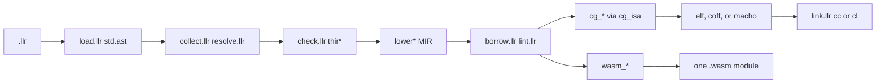

# Llrst: implementation handoff

This file is the work plan for Llrst. It is written so another agent can pick it up cold.
Read it, then `docs/canon/README.md`, then the workflow you need in `docs/workflows/`.
Finished plans are in `history/`: [history/bootstrap.md](history/bootstrap.md) (the first
build), [history/self-hosting.md](history/self-hosting.md) (the `self/` compiler),
[history/phases.md](history/phases.md) (phases 0-7), and
[history/ui.md](history/ui.md) (the `llr-ui` framework). The widget workflow is
[docs/workflows/ui.md](docs/workflows/ui.md).
When code and this file disagree, trust the code and fix this file.

Status legend used below: `[ ]` not started, `[~]` in progress, `[x]` done. Update the
boxes as you go and add a dated line to the **Progress log** at the bottom.

## Rules for this work

- Every source file stays under 500 lines; nothing may reach 1000. If a file you touch is
  already near 500, split it in the same phase before adding to it. Functions stay under
  40 lines (`llr-fmt --lint`). Counts in **Line budget** are from 2026-10-27.
- Order of operations for every change: **reuse** an existing function, else **refactor**
  one so it can be reused, else add new code. Do not widen the language only for `self/`.
- Every std function has a `(test ...)` form in its file; every error code has a
  `tests/err` case and a row in `docs/spec/errors.md`; every tool has a `docs/tools` page.
- Before committing: `llr-fmt <changed .llr>`, `llr-fmt --lint std/*.llr tools/*.llr`,
  `tests/run.sh` (and `tests/run.ps1` when the change touches Windows). Each phase is a
  separate commit with a one-line message; the suite is green at the end of every phase.
- No prose in diagnostics or tool output; one record per line, `|` separated.
- Stage 0 `llrc` (Rust) is the reference. A `self/` change that alters `check` stderr or
  `emit-mir` output must keep `tests/check.sh` and `tests/mir.sh` byte-equal, or change
  stage 0 in the same commit.

## Decisions (already made, do not reopen)

Original request, condensed: a compiled language `Llrst` (`.llr`), Rust bootstrap,
Rust-like memory safety, designed for model readability and few tokens, easy to refactor,
large growing std, one right way per task (documented), cross-platform, machine-readable
errors, low context use. Then: list agents' most used tools, reimplement them in Llrst,
install them, document them, write agent workflows.

| Topic | Decision |
| --- | --- |
| backend | Stage 0 is Cranelift 0.136 (`cranelift-codegen/frontend/module/object/native`), pure Rust, four hardware ISAs. The installed compiler is stage-2 `llrs` from `self/`, emitting x86-64 ELF64 or COFF and aarch64 ELF or Mach-O directly; `llrc` stays in the tree until two releases agree. |
| syntax | S-expressions, delimiters `( ) "` only; trivial grammar, no precedence. |
| memory | ownership + borrows with NLL-style regions on MIR; checked, no GC. |
| tools | `read grep find edit fmt test diff` first (highest-frequency agent tools); `write ls rm git http doc check` added since. One `.llr` per binary. |
| tool output | `tag|field|...`, one record per line; exit 0 ok, 1 tool error (`E|<tool>|0|0|0|code|k=v` on stderr), 2 negative result. Lists end with `more|...` when truncated. |
| integers | `+ - * neg` wrap by default. `--checked` traps them, `shl` `shr` outside `0..bitwidth`, an integer cast that does not fit, a float-to-int whose truncation does not fit, and an int-to-float that is not exact. Without it a shift count is masked with `bitwidth - 1`, a cast truncates, float-to-int saturates, int-to-float rounds. `MIN / -1` and `MIN % -1` always panic `int.overflow` via `sys.checked_div`. `wadd wsub wmul wneg` always wrap. |
| regex | backtracking, ASCII, no non-greedy; `\N` backreferences compare captured bytes and an unset group does not match; `--ic` lowercases pattern and text; word boundaries are ASCII `[A-Za-z0-9_]` only (`std/re.llr`). Fine for tool-sized input. |
| perf | `vec.sort` allocates a scratch buffer (stable merge). `map` heads shrink to a power of two, minimum 16, when `len * 8 <= heads` (`std/map.llr`). |
| visibility | `pub` is strict, per module. Only `pub` std types enter the prelude; std module fns need `(use std.X)`. A struct field and an enum variant are private unless `(pub (name type*))`. |
| directories | `fs.list` names come from `llr_readdir_name`, which reads `dirent` on Unix and `WIN32_FIND_DATA` on Windows (`runtime/llr_stat.c`, `runtime/llr_win.c`). |
| generics | A generic is typechecked only for the instances the driver compiles. One that is never instantiated is linted from its AST and is not MIR-checked. |
| git tool | `llr-git` reads status, diff, and log and does not change the repo. |
| C runtime | `runtime/*.c` shims stay C and are prebuilt by install. Cocoa UI shims are `runtime/*.m`, compiled with `clang -fobjc-arc` on Darwin only. The system C compiler is the linker driver only. |
| warnings | A warning exits 0. `--deny CODE` may be repeated; each named warning is printed as `E` and the process exits 1. `use.unused` and `fn.unused` are not emitted for `std`. `fn.unused` is not emitted for `pub`, `extern`, or `main`. |
| trait objects | `(& (dyn Trait))` is a fat pointer. `(box (dyn Trait))` owns the heap value; it is not `copy`. A value is packed where that type is expected. `(& box)` and `(&mut box)` are that fat pointer unless a reference to the box is expected. A trait in another module is `module.Trait`: `(box (dyn id.Id))`, `(impl id.Id ty ...)`, and `id.Id.method`. No trait default methods: a framework callback is a `(clos ...)` field. |

Out of scope: a garbage collector, a second syntax or precedence grammar, Unicode-aware
regex, and any change that exists only to make `self/` smaller.

## Architecture



| path | role | start here |
|------|------|-----------|
| `self/` | installed compiler (`llrs`); the `llrc` command is stage-2 `llrs` | `llrs.llr` (CLI), `drive.llr` (build) |
| `compiler/src/` | stage 0 `llrc` (Rust, Cranelift); not installed; reference for `tests/check.sh`, `tests/mir.sh` | `main.rs`, `driver.rs` |
| `std/` | standard library, 50 modules, all Llrst | `sys.llr` (externs, panic), `str.llr`, `vec.llr` |
| `tools/` | agent tools, one `.llr` per binary; `fmtlint.llr` is a `proj.` module of `llr-fmt` | `llr-read.llr` (smallest) |
| `runtime/` | C shims: `llr_stat.c` (Unix); `llr_wsa.c`, `llr_win.c`, `llr_win_sock.c`, `llr_win_proc.c` (Windows). UI: `llr_ui_win*.c`, `llr_ui_x11*.c`, `llr_ui_mac*.m`. Install compiles the host UI objects | |
| `tests/` | goldens `run/*.llr+.out`, `err/*.llr+.err`, `warn/`, `panic/`; `run.sh`/`run.ps1` suite; `check`, `mir`, `self` differentials (`.sh` + `.ps1`); `cross.sh` | `run.sh` |
| `scripts/` | `install.sh`, `install.ps1` (stage 0, then `llrs0..2`, install `llrs2`); `self.sh` and `self.ps1` (bootstrap); `check-lines.sh` | |
| `docs/spec/` | grammar, tokens, types, memory, errors, targets | `errors.md` is the code catalogue |
| `docs/canon/` | the one right way per topic | `README.md` |
| `docs/std/` | per-module API tables, generated by `llr-doc` from signatures | `README.md` |
| `docs/tools/` | ranked tool list, per-tool output grammars | `README.md` |
| `docs/workflows/` | step lists for agents | `debug.md` maps error codes to actions |

| pass | file(s) | what it owns |
|------|---------|--------------|
| load | `load.llr`, `src.llr` | main, sorted `std/`, host OS externs, then `proj.*` and `ui.*` on use; std search `--std`, `$LLRST_STD`, `<exe>/../std`, `<exe>/../../std`, `<exe>/../share/llrst/std`, `./std`; ui search `--ui`, `$LLRST_UI`, `<exe>/../share/llrst/ui`, `<exe>/../../ui`, `./ui` |
| resolve | `collect.llr`, `resolve.llr`, `prog.llr` | def ids, methods, traits and impls, visibility, `(inline ...)` notes |
| types | `ty.llr`, `lit.llr` | ints, floats, bool, refs, pointers, adts, fns, closures, dyn, params, infer; literal parsing |
| check | `check.llr`, `thir.llr`, `thir_expr.llr`, `thir_call.llr`, `thir_pat.llr`, `thir_lit.llr`, `thir_clos.llr` | one typed body per instance; closure capture |
| MIR | `lower.llr`, `lower_cf.llr`, `lower_call.llr`, `lower_match.llr`, `lower_clos.llr`, `lower_div.llr`, `inline.llr`, `mir.llr`, `mir_print.llr` | places, blocks, drop, `sys.checked_div`, inline substitution |
| borrowck | `borrow.llr`, `holders.llr`, `loans.llr`, `liveness.llr`, `moves.llr`, `static_ck.llr`, `lint.llr` | loans, holders, init, `'static`, warnings |
| codegen | `cg_mod.llr`, `cg_entry.llr`, `cg_frame.llr`, `cg_lay.llr`, `cg_op.llr`, `cg_cast.llr`, `cg_ovf.llr`, `cg_bits.llr`, `cg_term.llr`, `cg_drop.llr`, `cg_clos.llr`, `cg_vt.llr`, `cg_isa.llr`, `isa_x64.llr`, `isa_a64.llr`, `isa_a64_fp.llr`, `isa_a64_frame.llr`, `isa_a64_ovf.llr`, `x64.llr`, `x64_int.llr`, `x64_sse.llr`, `x64_abi.llr`, `x64_buf.llr`, `a64.llr`, `a64_int.llr`, `a64_mem.llr`, `a64_fp.llr`, `a64_abi.llr`, `a64_buf.llr` | every local a slot; SysV, Win64, or AAPCS64; `--checked` traps; vtables; closure trampolines |
| objects | `elf.llr`, `elf_out.llr`, `coff.llr`, `macho.llr`, `macho_out.llr`, `wasm.llr`, `wasm_out.llr` | ELF64 (x86-64 or aarch64), COFF (REL32, ADDR64), Mach-O arm64, or one Wasm module (`.wasm`) for `wasm32-wasi` and `wasm32-unknown-unknown`. Language pointers stay 8 bytes. `sys.os_id` is 3 on wasm. |
| link | `link.llr`, `link_so.llr`, `link_win.llr` | Unix `cc` plus `llr_stat.o`; Windows `cl /link /STACK:8388608 /Brepro` plus the prebuilt shims. A reference to `llr_ui_open` also links the host UI shim. `--emit-dylib` passes `-shared` or `/LD` |
| driver | `llrs.llr`, `drive.llr`, `diag.llr`, `cg_reload.llr` | `build run check emit-mir version`; `-o --std --ui --test --checked --deny --target --emit-obj --emit-dylib`; reachable instances from `main` or `--test` |

Generics are monomorphized by re-checking the body per instantiation. Only reachable
instances are compiled; std bodies are checked lazily.

## Status

```
commit|d823ddc|Merge pull request #3 from AVoSI-VI/ui|2026-11-03
suite|not re-run for the 2026-11-03 gap catalogue|last recorded fails=0 under the self compiler (2026-10-31, history/phases.md)
self|stage2=equal|scripts/self.sh --stage at 2026-11-01|darwin arm64
wasm|self/ emits one .wasm module|os_id=3|wasm32-wasi and wasm32-unknown-unknown|suite=tests/wasm.sh
lines|compiler=9979 rs|self=20131 llr|std=8372 llr (50 modules)|ui=9690 llr|tools=2099 llr|max_file=std/http.llr 499|budget=500 soft, 1000 hard
```

## Implementation notes (things you would otherwise rediscover)

Paths in this section name stage 0 (`compiler/src/`). The `self/` owner of each concern is
in the **Architecture** pass table; the behaviour is the same unless Phase 1 in
[history/phases.md](history/phases.md) says otherwise.

ABI and data (`codegen/mod.rs`, `codegen/func.rs`)
- Scalars by value; aggregates (structs, enums, `str`, `vec`) passed as a pointer and
  copied into the callee's stack slot in the prologue; aggregate returns via an sret
  pointer as first param. Externs must have scalar params/returns.
- Every MIR local is a stack slot; values are loaded/stored, no SSA variables.
- `"literal"` has type `(& str)` and points at a static 24-byte `{ptr,len,cap=0}` record
  (`str_data`); `str.drop` frees only when `cap > 0`. Length bytes follow target
  endianness (`big_endian`).
- Panic messages are built in std: `str.oob(len, idx)` / `str.oob_range(len, lo, hi)`;
  the compiler only supplies `loc`. Goldens for them live in `tests/panic/`.
- Integer `/` and `%` lower to `sys.checked_div` (`mir/lower_div.rs`): operands widen to
  `i64`, the call carries a `file|line|col` literal, the result truncates back. The
  function's own division stays raw (`Lower::raw_div`) so the rewrite does not recurse.
  Float division is unchanged. `checked_div` always rejects signed `MIN / -1` and `MIN % -1`.
  Goldens: `tests/panic/div_zero*`, `tests/panic/div_min`, `tests/panic/rem_min`, `tests/run/div_ok`.
- `fs.mtime` and `fs.size` call `llr_stat_mtime` / `llr_stat_size` in `runtime/llr_stat.c`.
  `fs.list` calls `llr_readdir_name` there for `d_name`.
  On Darwin, `extern_id` renames `open`, `fcntl`, `bind`, `connect`, `socket`, and `setrlimit` to `llr_*` in that object. The wrappers translate Linux open flags, a 16-byte `sockaddr_in`, `EAGAIN` to 11, and `setrlimit` resource 7 to `RLIMIT_NOFILE`. `__errno_location` calls `__error`.
  `link.rs` appends `llr_stat.o` on Unix, or compiles and links `llr_wsa.c`, `llr_win.c`,
  `llr_win_sock.c`, and `llr_win_proc.c` on Windows,
  from `$LLRST_RUNTIME`, `$LLRST_STD/..`, `<exe>/../share/llrst/`, `<exe>/../../runtime/`, or `./runtime/`.
  `install.sh` and `tests/run.sh` compile the Unix object. `tests/run.ps1` does not;
  `llrc` compiles the Windows objects. `poll` is in `llr_win_sock.c`. `llr_call_child` is in `llr_win_proc.c`.
- `mir/lint.rs` runs after borrowck. `flow.unreachable` is an unreachable block that
  contains something other than `Drop`/`StorageDead`/`Nop` (the empty block opened after
  `(ret)` is skipped). `name.unused` is a local or parameter that is never an operand,
  borrow, or discriminant; names starting with `_` are skipped. A warning exits 0 unless
  `--deny CODE` names it; `--deny` may be repeated and then that warning is an `E`.
  `use.unused` and `fn.unused` are not emitted for an `std` module. `fn.unused` is not
  emitted for `pub`, `extern`, or `main`. Goldens: `tests/warn/`.
  An inlined call pushes a panic frame named with `fn_path`. Drop glue pushes `drop.<type>`.
- `+ - * neg` wrap by default. `llrc --checked` traps them (`codegen/ovf.rs` calls
  `sys.abort` with `int.overflow`) using Cranelift `sadd_overflow` / `uadd_overflow` and
  the sub/mul pairs. `wadd` `wsub` `wmul` `wneg` always wrap; the map hash uses `wmul`.
  The same flag panics `cast.overflow` for a float-to-int whose truncation does not fit and
  for an int-to-float that is not exact (`codegen/ops.rs`). Without it, float-to-int saturates.
- `(sizeof T)` is `Callee::Sizeof`; `(sys.arch)` is a compile-time `(& str)`; `sys.argc`
  / `sys.argv` read globals set by the generated C `main` (`emit_entry`).
- `--test`: each `(test ...)` becomes `llr_test_i`; `emit_test_entry` calls
  `test.run(name, fnptr)` per test, sums failures, calls `test.done(fails)`. `test.run`
  forks (`std/test.llr`), filters by `argv[1]` substring.

Drops (`mir/lower.rs`, `codegen/func.rs`, `codegen/drop.rs`)
- Each local whose type `needs_drop` has an i8 drop flag: set on whole-local assign and
  call dest, cleared on `Move` rooted at the local, `Stmt::Forget`, and after `Drop`.
- `Stmt::Drop(place)`: whole local -> flag-guarded glue call; projection -> unconditional.
- Drop glue per concrete type: user `drop` method first (any `(impl T (fn drop ((self (&mut T))) unit ...))`), then fields / enum payload by tag.
- Scopes (`Scope { drops, all }`) emit `Drop` then `StorageDead` on exit; `ret`/`brk`/`cont`
  emit drops down to the target depth without popping.
- Match by value: binding a non-copy payload moves it (clears the whole flag), so
  wildcard payload fields are dropped explicitly only in that case (`moved_any`). Without
  moves, the whole value drops at scope end. This fixed a double free; keep it.
- Assignment `(set place v)` drops the old value unless the place goes through a raw ptr.
- `mem.replace`, `mem.forget`, `ptr.read/write` are the escape hatches std uses.

Borrow checker (`borrow/`)
- Moves: forward "maybe moved" bitset per local; `Move` of a whole local (no deref) marks,
  whole-local write clears. Moving out of a field/deref is rejected earlier in lowering
  (`move.field`, `move.deref`), except match bindings on a whole local.
- Loans (`loans.rs`): one per `Rvalue::Ref`, indexed in program order. Holders are a
  forward dataflow in `holders.rs` over `(loan, local)` pairs, union at joins, recorded per
  point. Transfer: a whole-local `Assign`/call dest and `StorageDead` kill that local's
  pairs; `Ref{place}` gens its own loan plus every pair of `place.local` (a reference into a
  holder reaches what it holds); `Use`/`Cast`/`Struct`/`Variant` operands flow pairs when
  either side is ref-bearing; calls flow eligible args into the dest; and for each arg typed
  `(&mut X)` with ref-bearing `X` (`mut_ref_sink_args`), the referents of the mutable loans
  it holds become holders of every other ref argument (so `vec.push (&mut hold) (& a)` makes
  `hold` hold the loan on `a`).
- Eligible call args (`loans::eligible_args`): params sharing a named lifetime with the
  return type; else the single ref param; else `self` if a ref; else all ref params.
- Region of a loan = points where any holder is live (backward liveness, `liveness.rs`).
  A loan never conflicts at its own creation point or with accesses rooted at a holder.
- Conflicts (`check.rs`): mutable loan vs any access; shared loan vs write/move/`&mut`.
  `Drop`/`StorageDead` of the borrowed local with a holder live afterwards is
  `borrow.escape` (reported at the borrow span); loans through a deref are exempt.
- Two-phase: `&mut` created directly as a call argument (or an implicit reborrow in
  argument position) acts shared until the call terminator of the same block.
- Implicit reborrow: using a `&mut` place as an operand produces `&mut *place` into a
  temp instead of moving it (`Lower::reborrow`).

Checker conventions (`check/`)
- Bidirectional: `want` flows into literals, `opt.none`, `vec.new`, generic calls.
  Unsuffixed int literals are `Infer(_, int=true)` and default to `i64` in `finish`.
- `coerce`: `&mut T` where `& T` is wanted inserts `(& (@ e))`.
- `if` without else accepts any then-type (value discarded); `and`/`or` take 2+ args.
- `(try e)` works on `res`/`opt`; variant 0 is ok/some, 1 is err/none (std relies on it).
- `(assert_eq a b)` lowers to `test.eq_str/eq_int/eq_bool(loc, got, want)`; `(panic m)` to
  `sys.panic(loc, m)`; `loc` is a `"file|line|col"` literal built by `loc_lit`.
- Callee resolution order: local fn-typed variable, `lookup_fn`, struct ctor, enum variant,
  builtin (`thir::Builtin::from_path`).

Resolver (`resolve.rs`)
- All `std/*.llr` are always loaded; std types are prelude (no `use`), std module fns
  need `(use std.X)`. `proj.X` loads `X.llr` beside the main file.
- A std file compiled directly (its tests) is registered as both `main` and `std.X`.
- `type.fn` resolves methods first, then module-level fns of the module defining the type.
  `vec.sort`, `vec.has`, `vec.index` and the `map` key functions take trait bounds
  (`<T:Eq>`, `<T:Ord>`, `<K:Hash:Eq>`) since `ec125f7`; the fn-pointer forms are gone.
- Visibility: `Def.is_pub`; `Program::visible(from, d)` is `is_pub || same module`,
  checked in `resolve_ty`, the impl owner lookup, and the checker's `require_visible` at
  every fn/ctor/variant/const/pattern resolution. Error `name.private`. Only `pub` std
  types enter the prelude. `(pub ...)` wraps `fn extern struct enum trait const` and impl
  methods; `(pub (impl ...))` is a parse error. A struct field is private unless
  `(pub (name type))`. `field_of` and struct constructors outside the defining module
  report `name.private_field`. `mem.replace` of the whole value still copies private fields.

Tools (`tools/`, `docs/tools/`)
- `llr-fmt` is idempotent on the whole repo; the repo is formatted with it. `--lint` is
  clean on `std/` and `tools/`. `fmtlint.llr` is a `proj.` module of `llr-fmt`.
- `std/sexp.llr` is a comment-preserving S-expression reader used by `llr-fmt`. `std/ast.llr`
  is the surface grammar parsed from that tree and is what `self/` loads.

## Line budget

Raw `wc -l` on 2026-10-27. `self/` rows below were recounted on 2026-10-31. Split before adding if a file is near 500. `scripts/check-lines.sh`
and the copy inside `tests/run.ps1` scan `compiler/src`, `std`, `tools`, `docs`, `scripts`,
`tests`, and `self/` for `.rs .llr .md .sh`, plus `runtime/*.c`. `.gitattributes` stores `*.c` and `*.h` as LF.

| File | Lines | Note |
| --- | --- | --- |
| `compiler/src/mir/lower.rs` | 497 | Stage 0; split before a Phase 2 move change |
| `self/thir_expr.llr` | 493 | Split before Phase 1 span work |
| `self/lower.llr` | 493 | Statement spans are set before a `let` or `set` is lowered |
| `compiler/src/resolve.rs` | 487 | Stage 0 |
| `compiler/src/codegen/func.rs` | 486 | Trace push/pop lives in `codegen/trace.rs` |
| `std/http.llr` | 499 | Chunked bodies live in `http_body.llr`; frames live in `http_ws.llr` |
| `self/collect.llr` | 461 | Trait impl shape and generic bounds |
| `self/elf.llr` | 450 | aarch64 relocation kinds and `e_machine` |
| `self/isa_a64.llr` | 443 | integer, branch, and memory seam; fp, frame, and overflow are split out |
| `self/thir_call.llr` | 424 | Trait calls live in `thir_trait.llr` (82 lines) |
| `self/cg_frame.llr` | 415 | slot access through the ISA seam |
| `self/cg_isa.llr` | 381 | dispatches into an x64 or a64 buffer |
| `self/cg_op.llr` | 269 | Casts live in `cg_cast.llr` |
| `self/cg_cast.llr` | 217 | Cast emitters moved out of `cg_op.llr` |

## Gaps (2026-11-03)

Found by reading `std/`, `self/`, `ui/`, `tools/`, `compiler/src/`, `docs/`, and `tests/err`
against what Rust, Go, and Python ship in their standard libraries. Nothing here was run.
A count like `x7` is the number of private copies of the same helper outside `std/`; each is
evidence that `std` lacks the function. Every row is scheduled in a phase below unless it is
under **Decided out**.

### A. std

| area | missing | evidence |
| --- | --- | --- |
| str | `upper`, `trim_start`, `trim_end`, `rfind`, `rfind_byte`, split by `str`, `replace_byte`, `pad_right`, public `is_space` `is_digit` `is_alpha` `is_alnum`, `str` to and from `(vec u8)`, UTF-8 decode and encode, float parse and format, radix parse and format | `last_seg` x4 (`self/collect.llr:14`, `self/load.llr:224`, `self/prog.llr:312`, `tools/deps.llr:33`); `last_slash` private in `std/path.llr:10`; `slash` x6 (`self/load.llr:13`, `self/drive.llr:82`, `ui/font.llr:17`); `is_space` private at `std/str.llr:103`, digit tests inlined at 21 sites; `to_str` x4 (`self/coff.llr:126`, `self/elf_out.llr:89`); `utf8` only in `ui/text.llr:35`; `fmt_f` x4 (`ui/app.llr:219`), `milli` x7, float parser only in `self/cg_bits.llr:60`; `nib` `hex_byte` `hex` x7 (`self/x64.llr:9-15`, `self/a64*.llr`); hex digit parse x5 |
| numbers | integer `min max clamp abs pow align_up`; `exp` `ln` are private; no `tan asin acos log2 log10 fmod lerp clamp approx`; no `bnot popcount rotl` | `math.min` is `f64` only; `min` inlined x9, `align_up` x4 (`self/cg_lay.llr:17`, `std/alloc.llr:31`); `std/math_trig.llr:98,112`; `near` x3; `clamp` f32 x2 (`ui/layout.llr:8`, `ui/scroll.llr:10`) |
| vec | `clone <T:Clone>`, `extend (& v)`, `filled`, `resize`, `truncate`, `first`, `sort_by`, `eq`, `dedup`, `retain`, `min`, `max`, `swap_remove`, `each` `map` `filter` | element clone loops x20 (`clone_tys` x11, `self/ty.llr:50`); `append` from a borrow x4 (`self/elf_out.llr:78`); `zeros` x6 (`ui/raster.llr:10`); two hand sorts (`self/diag.llr:82`, `self/macho.llr:90`); `bytes_eq` `self/wasm_mod.llr:108`; `docs/canon/collections.md` "No map or filter in v1" |
| map, set, deque | no value or entry iteration, `clear`, `get_or_insert`; no `set`; no deque or heap; traits only for `i64` and `str` | `docs/std/map.md`; linear scans as sets (`tools/deps.llr:43`, `self/cg_mod.llr:278`); `std/cmp.llr:10-37` |
| opt, res | `map and_then ok_or expect unwrap_or_else take` on `opt`; `map map_err ok err expect` on `res` | 15 inline `match` sites that are `opt.or` (`ui/event.llr:81`, `self/drive.llr:235`) |
| fmt | no `Show` trait; no hex, float, or `pad_right`; no pipe-record reader | 7 hand parsers of `a\|b\|c` (`ui/event.llr:128`, `ui/reload.llr:62`, `self/load.llr:252`) |
| io, fs, path, os | no line reader; no `fs.copy is_file temp_dir abs`; `path` is `/` only; no `os.set_env home pid`, no stdin or stderr in `capture` | `copy_file` `tools/serve.llr:17`; `std/path.llr:1`; `docs/std/os.md` |
| time, random | clock is `fs.now_ms`; no monotonic clock, sleep, calendar, ISO 8601; no random | `std/fs.llr:84`; `random_get` extern only (`std/sys_wasm.llr:37`) |
| bytes, encoding, hash | no LE or BE read and write, no varint; base64 encode only, SHA-1 only; no sha256, crc32, percent-encoding, UTF-8 validation | ~20 copies (`self/elf.llr:214`, `ui/ttf.llr:31`, `std/h2.llr:2`, `std/sha.llr:54`); varint in `self/wasm.llr:7` and `std/pb.llr:2` |
| json | no floats; `\u` above 255 is `?`; encoder takes `(vec str)` only; no pretty print | `std/json_read.llr:39,54`; `docs/std/json.md` |
| net, thread | dotted IPv4 only; no DNS, UDP, IPv6, timeouts; pool only; mutex externs not exposed; no channel, no join value | `docs/std/net.md`; `std/thread.llr:24` |
| test, cli | `eq_str eq_int eq_bool` only; no float assert, no `assert_ne`; `cli` has no subcommands or repeated options | `std/test.llr:22-29`; `docs/std/cli.md` |
| std-internal duplication | scanner `peek` `skip` `is_name` x5; `eshort` x3; `hname` `hval` x2; `nan` `pow2` `near` x2; BE push and read x5 | `std/gql_parse.llr:13`, `std/sexp.llr:22`, `std/re.llr:29`, `std/xml.llr:20`; `std/http.llr:26`, `std/http_body.llr:2`, `std/http_ws.llr:2`; `std/math.llr:7,39`; `std/h2.llr:2`, `std/mqtt_pkt.llr:2` |

### B. Language

| feature | status | evidence |
| --- | --- | --- |
| tuples, fixed arrays, slices, `i128`, `usize` | absent | `docs/spec/types.md`; unknown type head is `name.not_type` (`compiler/src/parse/ty.rs:70`) |
| match guards, or-patterns, range patterns, `if let` | absent | arm is `(PAT EXPR)` (`compiler/src/parse/expr.rs:198`); `Pat` is `Wild Bind Lit Variant` (`compiler/src/ast.rs:173`) |
| struct patterns, string literal patterns | rejected `match.not_enum`, `match.bad_lit` | `compiler/src/check/pat.rs:108-125` |
| `for` over a collection, step, descending, labeled `brk`, `brk` with a value | absent | `compiler/src/parse/expr.rs:172-185`; `docs/canon/flow.md` |
| trait impl for a generic type, trait type parameters, supertraits, operator overloading | rejected at parse | `is_trait_impl` wants an atom (`compiler/src/parse/mod.rs:212`); `(trait ...)` children are `(fn ...)` only (`parse/mod.rs:131`) |
| const generics, generic consts, where clauses | absent | `compiler/src/parse/ty.rs:81-111` |
| struct and enum generic bounds | parsed, silently dropped | `compiler/src/resolve.rs:318,322` keep `generics.types` only |
| non-literal `const` | silently lowered to `unit` | `compiler/src/mir/lower.rs:293-296` |
| `static`, thread-locals, `cfg` | absent | top-level heads in `docs/spec/grammar.md`; `parse.bad_head` |
| literals `0b` `0o` `_` `1e9` `\u` | absent; `0x` works but is undocumented | `compiler/src/parse/expr.rs:85-92`; `docs/spec/tokens.md:76` |
| `bnot` | absent | unary forms are `not neg wneg` (`compiler/src/parse/expr.rs:232`) |
| `try` with error conversion | absent | error type must unify (`compiler/src/check/expr.rs:419`) |
| nested `proj` directories, `pub use`, packages, manifest | absent | `compiler/src/resolve.rs:272-286`; `tests/err/parse_expect.err` |
| `(box T)` for a non-dyn `T`, `Rc`, interior mutability | rejected `trait.object\|why=dyn`; absent | `tests/err/box_dyn.err` |
| aggregate or variadic externs, callbacks from C | scalars only | Implementation notes above; `compiler/src/codegen/mod.rs:216` |

### C. Implementation and tooling

| item | evidence |
| --- | --- |
| `docs/std` has no `http_type.md` or `http_mime.md` and `README.md` lacks both rows; `fs.md` lacks `fs.now_ms`; `std/http_mime.llr` has zero `pub` functions and exists only for one test | `docs/std/README.md`; `std/http_mime.llr` |
| Line budget table is dated 2026-10-27 and names files that have since moved | this file |
| `self/` has no register allocation, no optimizer, no debug info | `docs/spec/types.md` "Every local is a stack slot"; no DWARF in `self/elf*.llr` |
| `riscv64` and `s390x` stay on stage 0; `x86_64-apple-darwin` is rejected; wasm has no net, threads, shell, or `llrc run` | `docs/spec/targets.md` |
| no language server (`llr-ls` lists directories), package manager, coverage, benchmark harness; `llr-doc` skips private items; no `link.failed` golden | `docs/tools/README.md`; `docs/tools/llr-doc.md`; `docs/spec/errors.md` |

### D. Decided out

Listed so they are not re-proposed; each is a row under **Decisions** or a canon rule: a garbage
collector, a second syntax, Unicode-aware regex, trait default methods, a `char` type
(`docs/canon/strings.md`), `+=` and `else if` (`docs/canon/bind.md`, `docs/canon/flow.md`),
`==` on `str` (`str.eq`), and widening the language only for `self/`.

## Phases

Phases 0 through 7 are done. The plan and its progress log are
[history/phases.md](history/phases.md). Phases 8 to 15 below schedule every row of **Gaps**.
Order: general-purpose parity (strings, numbers, collections, io, time) first, then the
language changes std needs, then protocols, platform, and tooling. Every new function gets a
`(test ...)`, a `docs/std` row from `llr-doc`, and a canon line when the call shape is new. A
new std module is one file under 500 lines; `str.llr` (257 lines) and `vec.llr` (264) are
split at 400 if the additions take them there.

### Phase 8: handoff and docs hygiene (no behaviour change) `[ ]`

Files: `HANDOFF.md`, `docs/std/README.md`, `docs/std/fs.md`, `docs/std/http_type.md`, `docs/spec/tokens.md`, `std/http_mime.llr`, `std/http.llr`.

1. `[ ]` `llr-doc --out docs/std std/*.llr`: adds `fs.now_ms` to `fs.md` and creates `http_type.md`. Add the `http_type` row to `docs/std/README.md`.
2. `[ ]` `std/http_mime.llr` is a test with no API. Move `http_mime` into `std/http.llr` tests if `http.llr` can stay under 500 after the Phase 9 split of its helpers, else keep the file and add a README row that says it is test-only.
3. `[ ]` `docs/spec/tokens.md` documents `0x` integer literals, which both parsers accept.
4. `[ ]` Recount the **Line budget** table; drop rows under 400.
5. `[ ]` Commit: `docs: std index complete, hex literals documented, line budget recounted`.

### Phase 9: strings and numbers `[ ]`

Files: `std/str.llr`, new `std/str_more.llr` if `str.llr` passes 400 (verify first that the resolver allows a second `(impl str ...)` in another std file; else the new functions are module functions `str_more.X`), `std/math.llr`, `std/math_trig.llr`, `std/fmt.llr`, new `std/scan.llr`, `docs/canon/strings.md`, then `self/`, `ui/`, `tools/` callers.

1. `[ ]` `str`: `upper trim_start trim_end rfind rfind_byte split_str replace_byte pad_right`; `is_space is_digit is_alpha is_alnum` become `pub`; `from_bytes ((& (vec u8)))` and `to_bytes`; `utf8_at ((& str) i)` returning codepoint and length, `push_utf8 ((&mut str) cp)`, `utf8_ok`; `to_int_radix from_int_radix`; `to_f64` and `from_f64 (x digits)` (shortest-roundtrip is out of scope; fixed digits). `str.to_int` keeps its signature.
2. `[ ]` `math`: `imin imax iclamp iabs ipow align_up approx`; export `exp ln`; add `tan asin acos log2 log10 fmod lerp clamp`, each with a `32` twin; one `nan` `inf` `pow2` definition shared by `math.llr` and `math_trig.llr`.
3. `[ ]` `fmt`: `hex (n width)`, `float (x digits)`, `pad_right`, and `fields ((& str))` returning `(vec str)` for a pipe record, with `field_int`.
4. `[ ]` `std/scan.llr`: a cursor over `(& str)` with `peek at skip_ws is_name read_name hex_dig expect`. `gql_parse gql_schema sexp re xml json_read` use it and drop their copies. `eshort` `hname` `hval` live once in `http.llr` and are `pub` for `http_body` and `http_ws`.
5. `[ ]` Delete the duplicates outside std and call the new functions: `nib hex_byte hex` (7 files in `self/`), `fmt_f` and `milli` (`ui/`), `slash` (6), `last_seg` (4), `last_dot` (2), `cstr_eq` (3), `exe_dir` (`self/load.llr:29`, `ui/font.llr:48` use `os.exe_path` and `path.dir`), `ui/font.llr` `dir_of`, `self/cg_drop.llr` and `self/wasm_drop.llr` `cat`. The compiler must stay byte-equal: `tests/x64_ref.sh`, `tests/check.sh`, `tests/mir.sh`.
6. `[ ]` Canon rows in `docs/canon/strings.md` for every new form; `docs/std` regenerated.
7. `[ ]` Commit: `std: str, math, fmt, and scan cover the helpers self and ui had copied`.

### Phase 10: collections, opt, res `[ ]`

Files: `std/vec.llr`, new `std/vec_more.llr` under the Phase 9 split rule, `std/map.llr`, `std/opt.llr`, `std/res.llr`, `std/cmp.llr`, new `std/set.llr`, new `std/deque.llr`, `docs/canon/collections.md`, `docs/canon/errors.md`.

1. `[ ]` `vec`: `clone <T:Clone>`, `extend ((& (vec T))) <T:Clone>`, `filled (n x) <T:Clone>`, `resize`, `truncate`, `first`, `swap_remove`, `eq <T:Eq>`, `dedup <T:Eq>`, `min max <T:Ord>`, `sort_by ((clos ((& T) (& T)) i64))` (stable, same merge as `sort`), `retain ((clos ((& T)) bool))`. `vec.clone_str` stays as a forwarder for one release.
2. `[ ]` `map`: `values ((& m)) (vec (& V))`, `each ((clos ((& K) (& V)) unit))`, `clear`, `take`, `get_or_insert ((&mut m) k (clos () V)) (&mut V)`; `del` keeps `bool`.
3. `[ ]` `std/set.llr`: `(set K)` over `(map K unit)` with `new add has del len items <K:Clone:Ord>`. `tools/deps.llr` `seen` and the parallel-vector lookups in `self/cg_mod.llr:278` and `self/wasm_mod.llr:166` use it where the compiler output stays byte-equal.
4. `[ ]` `std/deque.llr`: ring buffer `(deque T)` with `push_back push_front pop_front pop_back len get`.
5. `[ ]` `opt`: `map and_then ok_or expect unwrap_or_else take`; `res`: `map map_err ok err expect`. Closure-taking forms follow `vec.any`. Replace the 15 inline `(match x ((opt.some n) n) ((opt.none) d))` sites with `opt.or`.
6. `[ ]` `cmp`: `Eq Ord Hash Clone` for `u8 i32 u32 u64 bool`; `Eq Clone` for `f64 f32` (no `Ord`, no `Hash`). `Eq Ord Hash Clone` for `vec opt res` wait for Phase 12 item 1.
7. `[ ]` `vec.each map filter` as closure forms, last, and the `docs/canon/collections.md` line "No map or filter in v1" becomes the blessed form. Replace the 20 element-clone loops with `vec.clone`; the compiler stays byte-equal (`tests/x64_ref.sh`).
8. `[ ]` Commit: `std: vec clone and sort_by, map iteration, set, deque, opt and res combinators`.

### Phase 11: io, fs, path, os, time, random, bytes, encoding, json, test `[ ]`

Files: `std/io.llr`, `std/fs.llr`, `std/path.llr`, `std/os.llr`, new `std/time.llr`, new `std/rand.llr`, new `std/bytes.llr`, new `std/url.llr`, `std/sha.llr`, new `std/sha256.llr`, `std/json.llr`, `std/json_read.llr`, `std/test.llr`, `std/sys_posix.llr`, `std/sys_windows.llr`, `std/sys_wasm.llr`, `runtime/llr_now.c` (or `llr_stat.c`), `runtime/llr_win.c`, `docs/canon/io.md`, `docs/canon/tests.md`.

1. `[ ]` `io.read_line (fd) (opt str)` with a per-fd buffer, `io.lines (fd) (vec str)`. `fs.copy is_file temp_dir abs`. `path.sep` is `/` or `\` by `sys.os_id`; `join base dir` accept both on `os_id` 2; `clean` normalizes to `/`.
2. `[ ]` `os.set_env home pid`, `os.run (file args stdin) (res cmd str)` where `cmd` gains `err`; `os.capture` is unchanged.
3. `[ ]` `std/time.llr`: `now_ms mono_ms sleep_ms utc (ms) date` with `(struct date (pub year month day hour min sec ms))`, `iso8601 parse_iso`. `fs.now_ms` forwards to `time.now_ms` for one release. Shims: `llr_mono_ms`, `llr_sleep_ms`, `llr_entropy` in the host runtime; wasm uses `clock_time_get` and `random_get`.
4. `[ ]` `std/rand.llr`: xorshift64\* `(struct rng (s u64))` with `seed next below f64 shuffle <T>`, `rand.entropy () rng`.
5. `[ ]` `std/bytes.llr`: `rd_le rd_be (b (& (vec u8)) at n) i64`, `wr_le wr_be ((&mut (vec u8)) v n)`, `uvar svar` and their readers, `str` to and from `(vec u8)` through `str.from_bytes`. `h2 hpack http_ws mqtt_pkt pb sha` use it; `self/elf* coff macho* x64_buf wasm` and `ui/ttf*` follow when byte-equal.
6. `[ ]` `sha.b64_decode`, `std/sha256.llr` `sha256`, `bytes.crc32`; `std/url.llr` `encode decode` (RFC 3986 unreserved set), `url.parse` into `(struct url (pub scheme host port path query))`; `str.utf8_ok` from Phase 9 is the validator.
7. `[ ]` `json`: `jval` kind 2 carries floats, `json_read` parses `-?d+(.d+)?([eE][+-]?d+)?` and `\u` escapes as UTF-8 including surrogate pairs; `json.show (v (& jval)) str` and `json.pretty (v indent)`; `json.quote` unchanged.
8. `[ ]` `test.eq_f64 (loc got want eps)`, `test.ne_int`, `test.ne_str`; `assert_near` and `assert_ne` forms in both compilers lower to them (grammar, `docs/canon/tests.md`, `tests/run/assert_more`).
9. `[ ]` Commit: `std: time, rand, bytes, url, sha256, line io, json floats, float asserts`.

### Phase 12: language changes std needs `[ ]`

Files: `compiler/src/parse/mod.rs`, `compiler/src/parse/expr.rs`, `compiler/src/resolve.rs`, `compiler/src/check/traits.rs`, `compiler/src/check/expr.rs`, `compiler/src/traitres.rs`, `compiler/src/mir/lower.rs`, `self/collect.llr`, `self/thir_trait.llr`, `self/thir_expr.llr`, `self/lit.llr`, `self/lower.llr`, `std/cmp.llr`, `std/test.llr`, `docs/spec/grammar.md`, `docs/spec/tokens.md`, `docs/spec/types.md`, `docs/spec/errors.md`, `tests/err`, `tests/run`.

1. `[ ]` Generic trait impls: `(impl Eq (vec T) <T:Eq> (fn eq ...))`. `is_trait_impl` accepts a list type; the impl is monomorphized per instance like a generic fn; `trait.dup` compares the head type only. Then `Eq Ord Hash Clone` for `(vec T)`, `(opt T)`, `(res T E)` in `std/cmp.llr`, and `vec.clone_str` is deleted.
2. `[ ]` `(pub (trait Show (fn show ((& Self)) str)))` in `std/cmp.llr` with impls for every primitive, `str`, `vec`, `opt`, `res`. `assert_eq` and `assert_ne` resolve through `Show` and `Eq` when the operand is not `(& str)`, `i64`, `bool`, or `u8`, so `type.assert_eq` is emitted only for a type with no `Show`. `f64` and `f32` use `Show` plus `test.eq_f64` with an exact compare.
3. `[ ]` `bnot` as a unary integer form in both parsers and both backends (`x64_int`, `a64_int`, `wasm_op`).
4. `[ ]` Literals: `0b` `0o`, `_` separators, `1e9` and `1.5e-3` floats, `\u{HHHH}` string escapes encoded as UTF-8. `docs/spec/tokens.md` lists all of them.
5. `[ ]` New errors: `const.not_lit` for a `const` whose initializer is not a literal (today silent, `compiler/src/mir/lower.rs:293`); struct and enum bounds are either honored at instantiation or reported `type.bound_unused`. Goldens in `tests/err`, rows in `docs/spec/errors.md`.
6. `[ ]` `tests/check.sh` and `tests/mir.sh` byte-equal; `scripts/self.sh --stage` reaches `stage2=equal`.
7. `[ ]` Commit: `lang: generic trait impls, Show, bnot, numeric literal forms, const.not_lit`.

### Phase 13: concurrency and net `[ ]`

Files: `std/thread.llr`, new `std/sync.llr`, `std/net.llr`, new `std/net_dns.llr`, `std/sys_posix.llr`, `std/sys_windows.llr`, `std/sys_wasm.llr`, `runtime/llr_win_sock.c`, `runtime/llr_stat.c`, `docs/canon/io.md`.

1. `[ ]` `std/sync.llr`: `(mutex T)` with `new lock ((&mut m) (clos ((&mut T)) unit))` so the guard cannot escape, and `(chan T)` with `new send recv try_recv close` over a mutex and condition variable (`pthread_cond_*` externs on POSIX, `CONDITION_VARIABLE` on Windows). Sending requires nothing beyond ownership; there is no `Send` trait, documented in `docs/spec/memory.md`.
2. `[ ]` `thread.spawn ((clos () T)) (handle T)` and `thread.join (handle T) T`; the pool is unchanged.
3. `[ ]` `net.resolve (host) (res (vec str) str)` over `getaddrinfo`; `connect` accepts a name or an IPv6 literal; `listen6`; `net.udp_bind udp_send udp_recv`; `net.set_timeout (fd ms)`. Windows maps the new errno values in `map_wsa`.
4. `[ ]` wasm: every new extern writes `target.unsupported` and returns `-1` as the existing ones do.
5. `[ ]` Commit: `std: mutex, channel, spawn and join, dns, udp, ipv6, socket timeouts`.

### Phase 14: language ergonomics `[ ]`

Files: both parsers, both checkers, both lowerers (`compiler/src/parse/expr.rs`, `check/pat.rs`, `mir/lower_match.rs`; `self/thir_pat.llr`, `self/lower_match.llr`, `self/lower_cf.llr`, `self/load.llr`, `self/resolve.llr`), `docs/spec/grammar.md`, `docs/canon/flow.md`, `docs/canon/program.md`, `tests/err`, `tests/run`.

Large. Each item is its own commit with `check.sh` and `mir.sh` byte-equal at the end.

1. `[ ]` Patterns: guard `(PAT (if EXPR) EXPR)`, or-pattern `(or PAT PAT...)`, string literal patterns through `str.eq`, struct patterns `(point x y)`. `match.missing` still covers the result.
2. `[ ]` `(for NAME lo hi step BODY...)` with a signed step; `(brk LABEL)` and `(cont LABEL)` with `(loop LABEL ...)`; `(while ...)` unchanged. Canon keeps `[lo hi)` as the default.
3. `[ ]` `(use proj.a.b)` loads `a/b.llr` under the main file's directory; `(pub (use ...))` re-exports.
4. `[ ]` `try` converts the error through `(trait From ...)` when the function's error type implements it; otherwise today's `type.mismatch`.
5. `[ ]` Commit per item: `lang: match guards and or-patterns`, `lang: for step and labeled brk`, `lang: nested proj and pub use`, `lang: try through From`.

### Phase 15: compiler and tooling `[ ]`

Files: `self/cg_frame.llr`, `self/cg_op.llr`, `self/isa_*.llr`, `self/elf.llr`, `self/elf_out.llr`, `self/macho_out.llr`, `self/coff.llr`, `self/drive.llr`, `tools/llr-doc.llr`, new `tools/llr-bench.llr`, new `tools/llr-lsp.llr`, `docs/tools/`, `docs/spec/targets.md`.

Large; listed last. Each item is its own commit.

1. `[ ]` Scalar locals live in callee-saved registers when a function has no address-taken use of them; the ISA seam gains a register slot kind. `tests/x64_ref.sh` snapshots are refreshed on purpose and the suite stays green.
2. `[ ]` `--debug` emits `.debug_line` (DWARF 5) in ELF and Mach-O and a line table in COFF, from the statement spans `self/lower.llr` already sets.
3. `[ ]` `riscv64` in `self/` as a third ISA behind `cg_isa`; `x86_64-apple-darwin` Mach-O x86-64. `tests/cross.sh` stops skipping them.
4. `[ ]` `llr-doc --private` prints private items; `llr-bench FILE` times each `(bench NAME ...)` form and prints `bench|NAME|ns`; `llr-lsp` speaks LSP over stdio and answers diagnostics by running `llrc check`, definition by `llr-grep` on the resolver's `def` records.
5. `[ ]` Commit per item: `self: registers for scalar locals`, `self: debug line tables`, `self: riscv64 and x86_64 darwin`, `tools: llr-doc private, llr-bench, llr-lsp`.

## How to verify each phase

```
cargo build --release                         # stage 0 llrc at target/release/llrc; not installed
scripts/self.sh                               # llrs0, llrs1, llrs2, byte-compare, then the suite
scripts/self.ps1                              # the same bootstrap on Windows
scripts/self.sh --stage                       # stop after self|stage2=equal
scripts/install.sh [PREFIX]                  # stage 0, then install llrs2 as llrc on Linux and Darwin
scripts/install.ps1 [PREFIX]                 # same on Windows
LLRC=<prefix>/bin/llrc tests/run.sh          # goldens + every std test + line check
powershell -File tests/run.ps1                # same suite on Windows
tests/check.sh; tests/mir.sh                  # llrs check / emit-mir byte-equal to stage 0 (.ps1 twins exist)
tests/self.sh [STAGE]                         # diff STAGE (default llr-check) against stage-0 llrc check
<llrc> run tests/run/hello.llr --std std
<llrc> build std/re.llr --test --std std -o /tmp/t && /tmp/t [FILTER]
<llrc> check tests/err/X.llr --std std 2> tests/err/X.err   # regenerate a golden after a deliberate change
<llrc> build tests/panic/X.llr --std std -o /tmp/p && /tmp/p 2> tests/panic/X.err   # panic goldens (exit 101)
<llrc> emit-mir FILE --std std                # MIR dump, for borrow errors
scripts/check-lines.sh                        # W at 500 lines, fail at 1000
```

A sandbox may redirect `target/`; `cargo metadata --format-version 1` prints `target_directory`.
The installed `llrc` reads its executable path from `llr_exe_path`, not `argv[0]`, and
accepts flags before or after the subcommand, so `LLRC="llrc --std ./std"` works for `llr-test`.

## Progress log

- 2026-11-03: **Gaps** and Phases 8-15 added from reading `std/`, `self/`, `ui/`, `tools/`, `compiler/src/`, `docs/`, and `tests/err` against the Rust, Go, and Python standard libraries. Each std row cites the private copies that stand in for the missing function; each language row cites the rejection site or the doc line. The **Status** block and the `std/` row (50 modules) were recounted. No code changed. The suite was not re-run.

