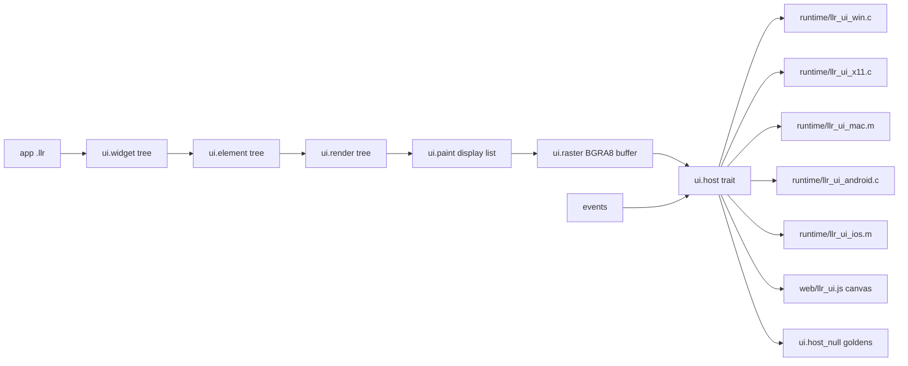

# llr-ui: cross-platform UI framework plan

This file is the work plan for `llr-ui`, the canonical UI framework for Llrst. It is written
so another agent can pick it up cold. Read `HANDOFF.md` first (rules, decisions, architecture
of the compiler), then this file, then `docs/canon/README.md`. The model is Flutter: one
framework draws every pixel itself into a surface the platform only presents, the same
widget code runs on desktop, mobile, and the web, and the web target renders into a
`<canvas>` from WebAssembly. When code and this file disagree, trust the code and fix this file.

Status legend: `[ ]` not started, `[~]` in progress, `[x]` done. Update the boxes as you go
and add a dated line to the **Progress log** at the bottom.

## Rules for this work

- Every rule in `HANDOFF.md` applies: files under 500 lines, functions under 40, reuse before
  refactor before new code, `(test ...)` per function, `|` records in tool output, each phase
  one commit with the suite green.
- `ui/` is Llrst only. Platform glue that must be C or Objective-C lives in `runtime/`
  (`llr_ui_*.c`, `llr_ui_*.m`) and is prebuilt by install, like the existing shims. Web glue is
  one JavaScript file, `web/llr_ui.js`; it holds no layout, paint, or widget logic.
- The framework never calls a platform drawing API. Every pixel comes from `ui/raster*.llr`.
  A platform host only: opens a surface, presents a pixel buffer, delivers events, reports
  size and scale, and offers clipboard, text input, and timers.
- No `ui/` change may widen the language only for `ui/`. A language gap found here becomes
  an item in `HANDOFF.md` Phase 2 (or the **Language prerequisites** phase below) with a
  `tests/run` golden, and is built in both stage 0 and `self/`.
- Every widget, render object, and host has a headless golden under `tests/ui/`: a tree dump
  (`.out`) and, when it paints, a raster (`.ppm`). Goldens are produced by the null host; no
  phase depends on a window being open to pass the suite.
- Fonts bundled into the repo are OFL-licensed and listed in `ui/FONTS.md` with their licence
  file beside them. Do not add a font without that entry.

## Decisions (made with the owner on 2026-10-27, do not reopen)

| Topic | Decision |
| --- | --- |
| name, place | `llr-ui`; a top-level `ui/` tree of `.llr` modules, separate from `std/`. Imported as `(use ui.NAME)`, one module per `use`; `ui` types are not prelude. |
| renderer | Own 2D rasterizer in Llrst: paths, analytic-coverage anti-aliasing, solid and gradient fills, rect and path clips, alpha blending, image blits, into a BGRA8 premultiplied buffer. Platforms blit that buffer. GPU rasterization is not in this plan. |
| text | Own TrueType/OpenType parser and glyph rasterizer in Llrst (`cmap glyf loca hmtx hhea head maxp kern`); a bundled default OFL font; Latin first, kerning only, no complex shaping. |
| wasm | A wasm32 backend in `self/` emitting the binary directly, like `elf.llr` and `coff.llr`. Two targets: `wasm32-unknown-unknown` (browser imports under module `llr`) and `wasm32-wasi` (WASI preview1) so `llrc`-built CLI programs and the test suite run under `wasmtime`. |
| mobile | aarch64 backend in `self/` (ELF for Android, Mach-O for iOS) as a prerequisite phase. Android and iOS are both in scope; Android ships first. |
| desktop | Windows (Win32), Linux (X11 first, Wayland later), macOS (Cocoa). |
| widget model | Flutter's three trees: immutable `widget`, long-lived `element`, `render` object. `stateless`, `stateful` with a `state` and `set_state`, `key`s, `ctx` (BuildContext), box layout by constraints down and size up, paint into a display list, hit testing down the render tree. |
| trees in memory | Each tree is an arena: a `vec` of nodes addressed by `u32` ids, children as id lists. No owning pointers between nodes; parents own children by id. This fits ownership without a GC. |
| callbacks | A widget callback is an owned `(clos ...)` stored in the widget. A closure captures values and message ids, never a `&mut` into a `state`; a `state` changes in its own methods, called by the framework when the message arrives, then `set_state` marks the element dirty. |
| units | Logical pixels as `f32`, origin top-left, y down; the host reports a device scale; the raster buffer is in device pixels. |
| threads | One UI thread owns all three trees. Raster of tiles may use `std/thread.llr` later; nothing in this plan requires it. |
| extras | Hot restart first, then hot reload of `build` code; a `llr-ui` tool (serve, dump, shot, run, pack); a semantics tree with platform accessibility; animation (tickers, controllers, curves, tweens, implicit widgets); a Material-like default widget set and theme. |

Out of scope: GPU rasterization, complex text shaping (Arabic, Indic, emoji sequences),
Wayland before X11, wasm threads, a plugin system for native code, and a second syntax for
widget trees. The widget tree is ordinary S-expression constructor calls.

## Architecture



Planned layout. None of these paths exist yet; create them in the phase that names them.

| path | role |
|------|------|
| `ui/geom.llr`, `ui/path.llr`, `ui/mat.llr` | points, rects, sizes, affine matrices, paths (move line quad cubic close), flattening |
| `ui/bitmap.llr`, `ui/blend.llr`, `ui/raster.llr`, `ui/raster_fill.llr`, `ui/raster_clip.llr`, `ui/ppm.llr` | pixel buffer, premultiplied blend, scanline coverage rasterizer, fills, clips, PPM read/write for goldens |
| `ui/ttf.llr`, `ui/ttf_cmap.llr`, `ui/ttf_glyf.llr`, `ui/glyph.llr`, `ui/font.llr`, `ui/text.llr` | font parsing, glyph outlines, glyph cache, line breaking and layout |
| `ui/paint.llr`, `ui/canvas.llr` | display list ops and the canvas that records them; replay into `raster` |
| `ui/widget.llr`, `ui/key.llr`, `ui/element.llr`, `ui/state.llr`, `ui/ctx.llr` | the widget and element trees, keys, `stateful`/`state`, build context |
| `ui/render.llr`, `ui/layout.llr`, `ui/render_box.llr`, `ui/hit.llr` | render objects, constraints, box protocol, hit testing |
| `ui/event.llr`, `ui/focus.llr`, `ui/sched.llr`, `ui/app.llr` | pointer and key events, focus, frame scheduler, `app.run` |
| `ui/host.llr`, `ui/host_null.llr`, `ui/host_win.llr`, `ui/host_x11.llr`, `ui/host_mac.llr`, `ui/host_android.llr`, `ui/host_ios.llr`, `ui/host_web.llr` | the host trait and one implementation per platform; the `.llr` side calls the shim externs |
| `ui/w_*.llr` | basic widgets: `container padding row column stack text sized_box align center expanded gesture image` |
| `ui/anim.llr`, `ui/ticker.llr`, `ui/curve.llr`, `ui/tween.llr`, `ui/w_anim.llr` | animation |
| `ui/m_*.llr`, `ui/theme.llr` | Material-like set: `scaffold app_bar button text_field list checkbox switch slider dialog` |
| `ui/semantics.llr`, `ui/a11y_*.llr` | semantics tree and platform bridges |
| `ui/fonts/`, `ui/FONTS.md` | bundled OFL font(s) and the licence record |
| `runtime/llr_ui_win.c`, `runtime/llr_ui_x11.c`, `runtime/llr_ui_mac.m`, `runtime/llr_ui_android.c`, `runtime/llr_ui_ios.m` | platform shims, scalar-only externs |
| `web/llr_ui.js`, `web/index.html` | browser glue and page template |
| `self/wasm*.llr`, `self/a64*.llr`, `self/macho.llr` | new backends |
| `std/math.llr`, `std/alloc.llr`, `std/sys_wasm.llr` | float math, an allocator for targets without libc, WASI externs |
| `tools/llr-ui.llr` | `serve dump shot run pack` |
| `tests/ui/`, `tests/wasm.sh`, `tests/wasm.ps1` | goldens; the suite under `wasmtime` |
| `docs/ui/`, `docs/canon/ui.md`, `docs/workflows/ui.md`, `docs/tools/llr-ui.md` | reference, the one right way to write a widget, the agent workflow, the tool page |
| `examples/counter.llr`, `examples/todo.llr` | the Flutter counter and a list app |

## Status

```
plan|2026-10-31|phases=0-13|phase 0 done
compiler|self/ emits x86-64 ELF64 and COFF, and aarch64 ELF and Mach-O|no wasm (HANDOFF Phase 6 item 2)
language|no owned trait object|closures: whole-binding capture, no nesting, no coercion to fn (HANDOFF Phase 2 item 6)
std|35 modules|no math, no allocator, no png
```

## Implementation notes (constraints the plan is built around)

Language and std facts that shape every phase. Each is verified against `docs/spec/` and
`HANDOFF.md` on 2026-10-27; recheck before relying on one.

- Trait objects exist only as `(& (dyn T))` and `(&mut (dyn T))` (`docs/spec/types.md`).
  There is no owned trait object, so a heterogeneous widget list cannot be a `vec` of user
  widget types today. **Language prerequisites** adds one. Until it lands, Phases 1 and 2
  (raster, text) do not need it and proceed.
- A closure `(clos ...)` captures whole bindings, cannot contain a closure, and does not
  coerce to `(fn ...)` (`docs/spec/grammar.md`, HANDOFF Phase 2 item 6). `std/thread.llr`
  `submit` takes `(fn ((ptr u8)) unit)` plus a context pointer. Widget callbacks therefore
  carry a message value; see **callbacks** above.
- Externs take and return scalars only; aggregates are passed as pointers (HANDOFF
  "ABI and data"). Every shim call is `(ptr u8)` plus lengths. The pixel buffer is handed to
  the shim as pointer, width, height, stride.
- `self/` codegen keeps every local in a stack slot. x86-64 goes through `isa_x64` into ELF
  or COFF. aarch64 goes through `isa_a64` into ELF or Mach-O (`docs/spec/targets.md`). wasm
  has no registers and no stack pointer, so the wasm backend lowers MIR to a shadow stack in
  linear memory held in a global; aarch64 reuses the slot model with AAPCS64.
- Stage 0 (Cranelift) already emits aarch64 ELF and apple-darwin objects (`tests/cross.sh`).
  It is the reference for the `self/` aarch64 backend. Cranelift does not emit wasm; the
  wasm backend has no stage 0 twin, so its reference is `tests/run` goldens under `wasmtime`.
- `std/` has no float math (`sqrt sin cos floor ceil pow`), no allocator (`sys` imports
  `malloc` `realloc` `free`), and no image codec. wasm32 has no libc unless WASI brings one,
  so `std/alloc.llr` and `std/math.llr` are written in Llrst and used on every target where
  the extern is missing.
- `self/load.llr` loads `main`, every file in sorted `std/`, the host OS externs, then `proj.*`
  modules found beside `main`. `(use ui.NAME)` loads `ui/NAME.llr` only when named, from
  `--ui`, `$LLRST_UI`, `<exe>/../share/llrst/ui`, `<exe>/../../ui`, `./ui`. Stage 0
  (`compiler/src/driver.rs`, `resolve.rs`) resolves the same prefix.
- `--target` does not switch `sys_windows.llr` / `sys_posix.llr` (HANDOFF Phase 6 item 3).
  Every cross target in this plan (wasm, Android, iOS) needs that fixed first.
- `scripts/check-lines.sh` and the copy in `tests/run.ps1` scan `compiler/src`, `std`, `ui`,
  `web`, `tools`, `docs`, `scripts`, `tests`, `self`, and `runtime/*.{c,m}`.

## Phases

Phases 1 and 2 need nothing new from the compiler. Phase 3 is the language work. Phases 6
and 8 are compiler backends and can run in parallel with 4, 5, 10, 11 once Phase 3 is in.

### Phase 0: plan, loader, harness `[x]`

Files: `UIFRAME.md`, `self/load.llr`, `self/src.llr`, `compiler/src/driver.rs`, `compiler/src/resolve.rs`, `scripts/check-lines.sh`, `scripts/install.sh`, `scripts/install.ps1`, `tests/run.sh`, `tests/run.ps1`, `README.md`, `docs/canon/program.md`.

1. `[x]` `ui.*` module prefix: `self/load.llr` and stage 0 resolve `(use ui.NAME)` to `ui/NAME.llr` with the search list in the notes. `std/` is loaded in full. `ui/` is loaded only when named by a `use`. Error for a missing dir mirrors `io.read|path=std|fix=set LLRST_STD` with `ui`.
2. `[x]` `install.sh` and `install.ps1` copy `ui/` to `<prefix>/share/llrst/ui` beside `std`; `--ui` and `$LLRST_UI` documented in `docs/install.md`.
3. `[x]` `tests/run.sh` and `tests/run.ps1`: a `tests/ui/` group where `NAME.llr` is built with `--std std --ui ui`, run, stdout compared to `NAME.out`, and if `NAME.ppm` exists the program's `--shot PATH` output is compared bytewise.
4. `[x]` `scripts/check-lines.sh` and the `run.ps1` copy scan `ui/`, `web/`, `runtime/*.m`.
5. `[x]` `README.md` rows for `ui/`, `web/`, `UIFRAME.md`; `docs/canon/program.md` gains the `ui.*` import rule.
6. `[x]` Commit: `ui: loader knows ui.*, install copies it, tests/ui group`.

### Phase 1: geometry and rasterizer `[ ]`

Files: `ui/geom.llr`, `ui/mat.llr`, `ui/path.llr`, `ui/bitmap.llr`, `ui/blend.llr`, `ui/raster.llr`, `ui/raster_fill.llr`, `ui/raster_clip.llr`, `ui/ppm.llr`, `ui/paint.llr`, `ui/canvas.llr`, `std/math.llr`, `tests/ui/`.

1. `[ ]` `std/math.llr`: `sqrt floor ceil round abs min max sin cos atan2 pow` for `f32` and `f64`, pure Llrst (no libm) so every target has them; tests against known values.
2. `[ ]` `geom`: `pt size rect` with `f32`; `mat`: 2x3 affine, `mul invert apply`; `path`: `move line quad cubic close`, `transform`, flatten to polylines with a tolerance, `bounds`.
3. `[ ]` `bitmap`: BGRA8 premultiplied `w h stride (vec u8)`; `blend`: src-over, `clear`, `src`; `ppm`: read and write P6 for goldens (alpha dropped on write; a second `.pam`-free form is not needed).
4. `[ ]` `raster`: scanline coverage accumulation (non-zero and even-odd), fill a flattened path with a solid colour, with a linear gradient, with an image (nearest, then bilinear); `raster_clip`: a clip stack of rects and coverage masks; stroke by offsetting to a fill path (`butt round square` caps, `miter round bevel` joins).
5. `[ ]` `paint`: display list ops `save restore translate scale rotate clip_rect clip_path fill_rect fill_path stroke_path draw_image draw_glyphs` (glyphs land in Phase 2); `canvas`: records ops; `canvas.replay` draws into a `bitmap` through `raster`.
6. `[ ]` Goldens: `tests/ui/raster_*.llr` each draw one feature and write a `.ppm`; dumps of a display list as `op|args` lines in `.out`.
7. `[ ]` Commit: `ui: geometry, paths, scanline rasterizer, display list, ppm goldens`.

### Phase 2: text `[ ]`

Files: `ui/ttf.llr`, `ui/ttf_cmap.llr`, `ui/ttf_glyf.llr`, `ui/glyph.llr`, `ui/font.llr`, `ui/text.llr`, `ui/fonts/`, `ui/FONTS.md`, `tests/ui/`.

1. `[ ]` Pick one OFL font (regular weight) and record it in `ui/FONTS.md` with the licence file beside it. The font bytes are read at run time from the `ui/fonts` dir found by the same search as `ui/`; embedding in the binary is a later `llr-ui pack` concern.
2. `[ ]` `ttf`: table directory, `head hhea maxp hmtx loca`; `ttf_cmap`: formats 4 and 12; `ttf_glyf`: simple and composite outlines to `path`; `kern` format 0. TrueType outlines only; CFF is rejected with `font.unsupported`.
3. `[ ]` `glyph`: rasterize an outline at a pixel size into an 8-bit coverage mask; a cache keyed by `(font, glyph, size)` with a byte budget; `font`: metrics (`ascent descent line_gap`), advance, kerning pair.
4. `[ ]` `text`: a paragraph layout: runs of one style, greedy line breaking at spaces, max width, max lines with an ellipsis, alignment, `height`, `hit` from a point to a byte offset, caret rect from an offset. UTF-8 decoded to code points; unmapped code points draw `.notdef`.
5. `[ ]` `paint.draw_glyphs` and the `canvas` op; goldens for one line, wrapped text, ellipsis, kerning on and off.
6. `[ ]` Commit: `ui: truetype parsing, glyph cache, paragraph layout`.

### Phase 3: language prerequisites `[ ]`

Files: `compiler/src/` and `self/` twins per item, `docs/spec/types.md`, `docs/spec/grammar.md`, `docs/spec/errors.md`, `tests/run/`, `tests/err/`, `HANDOFF.md`.

1. `[ ]` Owned trait object `(box (dyn Trait))`: heap data plus vtable, moved not copied, dropped through the vtable, borrowed to `(& (dyn Trait))` and `(&mut (dyn Trait))` by `(& b)`; `(box.new <Trait> v)` or a coercion at a `(box (dyn T))`-typed `let` (pick one; the canon doc records it). Codegen reuses `cg_vt.llr` vtables. Goldens: construction, drop order, a `vec` of boxes, a method call through a `vec` element.
2. `[ ]` Closures usable as framework callbacks: a `(clos ...)` stored in a struct field and in a `vec`, dropped with it, called via `(call (. w on_tap) msg)`; a closure value moved into a `box`. Depends on HANDOFF Phase 2 item 6 for capture rules; add the ui-shaped goldens there.
3. `[ ]` Trait default methods or an equivalent: `widget` has `build`, `create_element`, `key`; a user `stateless` writes `build` only. If defaults are not added, a `stateless` is a struct holding a `(clos ((& ctx)) (box (dyn widget)))` and the plan item is closed as "no default methods, closures instead"; record the choice.
4. `[ ]` `f32` is complete in both backends: arithmetic, compare, casts, `--checked` behaviour, passing in XMM through closure trampolines (HANDOFF Phase 1 item 9 names the gap).
5. `[ ]` Update `docs/spec/types.md`, `errors.md`, `HANDOFF.md` decisions and Phase 2 list.
6. `[ ]` Commit: `lang: owned trait objects, closures as fields, f32 parity`.

### Phase 4: the three trees and the null host `[ ]`

Files: `ui/widget.llr`, `ui/key.llr`, `ui/element.llr`, `ui/state.llr`, `ui/ctx.llr`, `ui/render.llr`, `ui/layout.llr`, `ui/render_box.llr`, `ui/hit.llr`, `ui/event.llr`, `ui/focus.llr`, `ui/sched.llr`, `ui/app.llr`, `ui/host.llr`, `ui/host_null.llr`, `ui/w_*.llr`, `examples/counter.llr`, `tests/ui/`, `docs/ui/`, `docs/canon/ui.md`.

1. `[ ]` `host` trait: `size scale present(bitmap) poll(events) request_frame now_ms set_cursor clipboard_get clipboard_set text_input(on off rect) quit`. `host_null`: fixed size from args, no events unless scripted from a `.events` file, `present` writes the `--shot` PPM.
2. `[ ]` `widget` trait and `key`; `element` arena with `mount update unmount rebuild` and dirty list; `stateful` / `state` with `init build dispose set_state`; `ctx` gives `size theme find_ancestor`. Reconciliation by runtime type id plus key, like Flutter's `canUpdate`.
3. `[ ]` `render` arena: `layout(constraints) -> size`, `paint(canvas, offset)`, `hit(point) -> ids`; `render_box` protocol with `min/max w/h`; relayout and repaint boundaries as dirty flags; `layout.llr` holds flex and stack algorithms.
4. `[ ]` Basic widgets `w_*`: `container padding sized_box align center row column expanded flex stack positioned text image gesture opacity clip_rect transform`.
5. `[ ]` `event`: pointer `down move up cancel scroll`, key `down up` with modifiers, text input; `hit` routing to the deepest `gesture`; `focus` traversal with tab. `sched`: one frame = handle events, run message callbacks, rebuild dirty elements, layout, paint, present; frames only when dirty or a ticker asks.
6. `[ ]` `app.run(host, root_widget)`; `examples/counter.llr` is the Flutter counter; `tests/ui/` tree dumps as `widget|id|type|key`, `render|id|x|y|w|h`, and a `.ppm` of the counter.
7. `[ ]` `docs/ui/` per-module tables generated by `llr-doc`; `docs/canon/ui.md`: the one way to write a stateless widget, a stateful widget, a callback, a custom render object.
8. `[ ]` Commit: `ui: widget, element, render trees; basic widgets; null host; counter`.

### Phase 5: desktop hosts `[ ]`

Files: `runtime/llr_ui_win.c`, `runtime/llr_ui_x11.c`, `runtime/llr_ui_mac.m`, `ui/host_win.llr`, `ui/host_x11.llr`, `ui/host_mac.llr`, `ui/host_pick.llr`, `self/link.llr`, `self/link_win.llr`, `scripts/install.sh`, `scripts/install.ps1`, `docs/install.md`.

1. `[ ]` Win32: `CreateWindowExW`, message pump, `StretchDIBits` present, DPI per monitor, mouse, keyboard with `WM_CHAR`, clipboard, IME minimum (`WM_IME_COMPOSITION` committed text only), cursor. Shim externs are scalar; events are pulled into a caller buffer, one fixed-size record each.
2. `[ ]` X11: `XOpenDisplay`, `XCreateSimpleWindow`, `XPutImage` with a 32-bit `XImage`, Xkb for keysyms, `Xft.dpi` resource for scale, selection clipboard. Wayland is a later item under this phase, not a blocker.
3. `[ ]` Cocoa (`.m`): `NSApplication`, `NSWindow`, an `NSView` whose `drawRect` blits a `CGImage` from the buffer, `backingScaleFactor`, `NSEvent` mouse and key, `NSPasteboard`. The decision that `.m` is an allowed shim language is recorded here; `scripts/install.sh` compiles it with `clang -fobjc-arc` on Darwin only.
4. `[ ]` `host_pick`: selects the host by `(sys.os_id)`; link: `link.llr` and `link_win.llr` add the ui shim object and system libraries (`user32 gdi32 shell32`; `X11`; `-framework Cocoa`) only when the program uses `ui.host_*`.
5. `[ ]` Manual check list in `docs/ui/hosts.md`: resize, DPI change, minimise, close, paste; the suite stays headless.
6. `[ ]` Commit: `ui: win32, x11, cocoa hosts`.

### Phase 6: wasm32 backend `[ ]`

Files: `self/wasm.llr`, `self/wasm_mod.llr`, `self/wasm_fn.llr`, `self/wasm_op.llr`, `self/wasm_abi.llr`, `self/wasm_imp.llr`, `self/drive.llr`, `self/llrs.llr`, `self/load.llr`, `std/alloc.llr`, `std/sys_wasm.llr`, `std/sys.llr`, `tests/wasm.sh`, `tests/wasm.ps1`, `docs/spec/targets.md`.

1. `[ ]` `--target wasm32-wasi` and `wasm32-unknown-unknown` accepted by `drive.llr` `target_ok`; `load.llr` selects `sys_wasm.llr` by target, not host (closes HANDOFF Phase 6 item 3 for this target).
2. `[ ]` `wasm.llr`: LEB128, sections (`type import function memory global export code data`), names section for debugging; `wasm_mod`: one module per program, one linear memory, a shadow-stack global, data segment for `str_data` literals.
3. `[ ]` `wasm_abi`: every MIR local is an offset from the shadow stack pointer; aggregates by pointer as on x86-64; scalars in wasm locals only as temporaries; calls, indirect calls through a table for `fn` pointers, closures, and vtables; `sret` returns.
4. `[ ]` `wasm_op`: integer and float ops with wrap semantics, `--checked` traps via `unreachable` after an overflow test, shifts masked, float-to-int saturating (`i32.trunc_sat_f64_s` and kin), casts, `sizeof`; panics call `proc_exit(101)` after writing to fd 2.
5. `[ ]` `std/alloc.llr`: a free-list allocator over `memory.grow`, exposing the `malloc realloc free` shapes `sys` expects, used when the target has no libc; `std/sys_wasm.llr`: WASI preview1 `fd_write fd_read path_open fd_close clock_time_get proc_exit args_get args_sizes_get environ_get environ_sizes_get random_get`; the `net thread os.shell fs.list` externs return `E|...|target.unsupported`.
6. `[ ]` `tests/wasm.sh` and `.ps1`: build every `tests/run` and `tests/panic` golden with `--target wasm32-wasi`, run under `wasmtime`, compare; skip list in the script for `net thread` cases with the reason per line. `wasmtime` missing prints `fail|setup|wasmtime=missing` like `tests/cross.sh`.
7. `[ ]` `docs/spec/targets.md`: triples, what each lacks, how `sys` picks externs.
8. `[ ]` Commit: `self: wasm32 backend, wasi externs, allocator, suite under wasmtime`.

### Phase 7: web host `[ ]`

Files: `web/llr_ui.js`, `web/index.html`, `ui/host_web.llr`, `tools/llr-ui.llr`, `docs/tools/llr-ui.md`, `docs/tools/README.md`.

1. `[ ]` Browser imports (module `llr`): `present(ptr w h)` copies the buffer into an `ImageData` and `putImageData` on the `<canvas>`; `size scale now_ms request_frame poll_event(ptr) set_cursor clipboard_get clipboard_set text_input quit`; `llr_ui.js` queues DOM events (pointer, wheel, key, input, resize, visibility) into one record format shared with the C shims.
2. `[ ]` `host_web`: `request_frame` drives `requestAnimationFrame`; the frame callback is an exported wasm function; `devicePixelRatio` resizes the canvas backing store. Text input uses a hidden `<input>` placed at the caret rect for IME and mobile keyboards.
3. `[ ]` `llr-ui serve FILE`: builds `FILE` with `--target wasm32-unknown-unknown`, writes `index.html app.wasm llr_ui.js` to an out dir, serves it with `std/http.llr` (`application/wasm` and `text/html` types are needed; HANDOFF Phase 5 item 5 notes it serves everything as `text/plain`), rebuilds on change with `fs.mtime` polling. Records: `serve|url=`, `build|ok|ms=`, `build|fail|...`.
4. `[ ]` `examples/counter.llr` runs in a browser unchanged; `docs/tools/llr-ui.md` and the `docs/tools/README.md` row.
5. `[ ]` Commit: `ui: web host on canvas, llr-ui serve`.

### Phase 8: aarch64 backend `[ ]`

Files: `self/a64.llr`, `self/a64_int.llr`, `self/a64_fp.llr`, `self/a64_abi.llr`, `self/a64_buf.llr`, `self/cg_isa.llr`, `self/cg_*.llr`, `self/elf.llr`, `self/macho.llr`, `self/link.llr`, `self/link_mac.llr`, `self/drive.llr`, `tests/cross.sh`, `docs/spec/targets.md`.

1. `[x]` Split the ISA out of `cg_*`: `cg_isa.llr` is the interface the `cg_*` passes call (`load store op call branch prologue epilogue`), `x64*` and `a64*` implement it. `cg_op.llr` casts live in `cg_cast.llr`.
2. `[x]` `a64*`: encoder for the subset MIR needs (loads/stores with offsets, add/sub/mul/sdiv/udiv, logical, shifts, compares and branches, fp ops, conversions, `blr`), AAPCS64, every local a slot, `--checked` via flags. Stack arguments are 8-byte slots. The Apple packed-stack variant does not apply: externs are scalar and never exceed eight arguments (`DARWIN.md`).
3. `[x]` Objects: `elf.llr` aarch64 relocations (`R_AARCH64_CALL26`, `ADR_PREL_PG_HI21`, `ADD_ABS_LO12_NC`, `ABS64`); `macho.llr` arm64 (`ARM64_RELOC_BRANCH26`, `PAGE21`, `PAGEOFF12`, `UNSIGNED`), symbol table, `__TEXT __DATA`, no code signing in the writer.
4. `[ ]` Link: a non-empty Unix triple, including `aarch64-unknown-linux-gnu`, links with `clang --target=` (`link.llr`). Still open: `link_mac.llr` uses `xcrun clang` with `-target arm64-apple-macos` / `arm64-apple-ios` and `-isysroot` from `xcrun --show-sdk-path`; Android uses the NDK clang from `$ANDROID_NDK` to a shared library.
5. `[ ]` Verify: `tests/cross.sh` runs a `self/` compiler when `LLRC` names one, and a Darwin arm64 object is checked with `file`. Still open: `tests/run` goldens under `qemu-aarch64` when the host is not aarch64 (`fail|setup|qemu=missing` otherwise).
6. `[ ]` Commit: `self: aarch64 backend, mach-o, isa split`.

### Phase 9: mobile hosts and packaging `[ ]`

Files: `runtime/llr_ui_android.c`, `runtime/llr_ui_ios.m`, `ui/host_android.llr`, `ui/host_ios.llr`, `tools/llr-ui.llr`, `docs/ui/mobile.md`, `scripts/install.sh`.

1. `[ ]` Android: `NativeActivity` with `android_native_app_glue`; `ANativeWindow_lock` present with the RGBA/BGRA format negotiated once; touch via `AInputQueue`; soft keyboard through `ANativeActivity_showSoftInput` and key events; density from `AConfiguration`; lifecycle `pause resume destroy` delivered as host events; insets for status and navigation bars.
2. `[ ]` `llr-ui pack --target aarch64-linux-android FILE`: builds the `.so`, writes a minimal manifest, runs `aapt2 zipalign apksigner` from `$ANDROID_HOME/build-tools` with a debug key; prints `pack|apk=PATH`. The tool shells out; it does not reimplement the SDK.
3. `[ ]` iOS: `UIApplication` delegate in `.m`, a `UIView` whose `CALayer.contents` is set from a `CGImage` of the buffer each frame driven by `CADisplayLink`, touches, `UITextInput` minimum through a hidden `UITextField`, safe area insets, `contentScaleFactor`, lifecycle.
4. `[ ]` `llr-ui pack --target aarch64-apple-ios FILE`: `.app` bundle with `Info.plist`, `codesign` with an identity from `--sign`; simulator first (`x86_64` or `arm64` simulator slice from `xcrun simctl`), device second.
5. `[ ]` `docs/ui/mobile.md`: prerequisites (NDK, SDK build-tools, Xcode), the two pack commands, what is not supported (no background execution, one window).
6. `[ ]` Commit: `ui: android and ios hosts, llr-ui pack`.

### Phase 10: animation `[ ]`

Files: `ui/ticker.llr`, `ui/anim.llr`, `ui/curve.llr`, `ui/tween.llr`, `ui/w_anim.llr`, `ui/sched.llr`, `tests/ui/`.

1. `[ ]` `ticker`: registered with `sched`, called once per frame with elapsed ms; `anim`: controller `forward reverse repeat stop value status` with a duration; `curve`: `linear ease_in ease_out ease_in_out` plus cubic bezier; `tween`: `f32 color rect size` interpolation.
2. `[ ]` `w_anim`: `animated_builder`, implicit `animated_container animated_opacity animated_padding`, `hero`-free page transition in Phase 11's `navigator`.
3. `[ ]` Goldens: the null host accepts `--frames N --step MS` and dumps the render tree after each frame.
4. `[ ]` Commit: `ui: tickers, controllers, curves, implicit animations`.

### Phase 11: default widget set `[ ]`

Files: `ui/theme.llr`, `ui/m_*.llr`, `ui/w_scroll.llr`, `ui/w_list.llr`, `ui/navigator.llr`, `examples/todo.llr`, `tests/ui/`, `docs/canon/ui.md`.

1. `[ ]` `theme`: colours, text styles, spacing, light and dark; found through `ctx`.
2. `[ ]` `w_scroll`: a scroll view with a viewport, pointer drag and wheel, clamped physics with fling; `w_list`: a builder list that lays out only visible children; a `sliver`-free design, recorded here.
3. `[ ]` `m_*`: `scaffold app_bar button icon_button text_field checkbox switch slider dialog snack_bar list_tile card divider progress`. `text_field` uses `text.hit` and caret from Phase 2, selection by drag, clipboard through the host.
4. `[ ]` `navigator`: a page stack with push/pop and a transition from Phase 10; back button and web history (`llr_ui.js` `pushState`) mapped to pop.
5. `[ ]` `examples/todo.llr`; goldens for every widget in default and dark theme; `docs/canon/ui.md` names the one widget per task.
6. `[ ]` Commit: `ui: theme, scrolling, material-like set, navigator`.

### Phase 12: accessibility `[ ]`

Files: `ui/semantics.llr`, `ui/a11y_win.llr`, `ui/a11y_mac.llr`, `ui/a11y_web.llr`, `ui/a11y_android.llr`, `ui/a11y_ios.llr`, `runtime/llr_ui_*.c|m`, `web/llr_ui.js`, `docs/ui/a11y.md`.

1. `[ ]` `semantics`: a tree built from render objects after layout: `role label value flags rect actions`; `m_*` widgets fill it; a `semantics` widget overrides; dump as `sem|id|role|label|x|y|w|h` in goldens.
2. `[ ]` Web: `llr_ui.js` keeps a hidden DOM mirror under the canvas with ARIA roles and `tabindex`; focus and activation flow back as events.
3. `[ ]` Windows UIA provider, macOS `NSAccessibility`, Android `AccessibilityNodeInfo` via `ANativeActivity`'s JNI, iOS `UIAccessibilityElement`; Linux AT-SPI is a later item. Each shim exposes `a11y_update(ptr len)` taking the serialised tree and raises actions as events.
4. `[ ]` Commit: `ui: semantics tree, aria mirror, platform a11y bridges`.

### Phase 13: hot restart, hot reload, tool completion `[ ]`

Files: `ui/app.llr`, `ui/state.llr`, `ui/reload.llr`, `tools/llr-ui.llr`, `web/llr_ui.js`, `docs/tools/llr-ui.md`, `docs/workflows/ui.md`, `HANDOFF.md`.

1. `[ ]` Hot restart: `llr-ui run FILE` builds, launches, watches `FILE` and its `proj.*` and `ui.*` deps with `fs.mtime`, rebuilds, asks the running app to serialise `state` values that implement `save/load` (`ui.state` trait methods returning a `str`), relaunches, restores. Web: re-instantiate the module and restore from `sessionStorage`.
2. `[ ]` Hot reload: desktop builds the app as a shared library (`--emit-dylib`, new in `drive.llr`; `dlopen`/`LoadLibraryW` in a small launcher) with the element and render arenas owned by the launcher; a rebuild swaps the library and re-runs `build` on every element without losing `state`. Web: swap the wasm instance, keep the arenas in a retained memory region. Document what resets (changed `state` struct layout forces a restart).
3. `[ ]` `llr-ui dump FILE` prints the three trees of the first frame; `llr-ui shot FILE OUT.ppm [--w --h --scale --frames]`; `llr-ui run`, `serve`, `pack` from earlier phases; every record tagged, `--max` where lists appear.
4. `[ ]` `docs/workflows/ui.md`: write a widget, test it headless, run on each target, fix a layout bug by `dump`; `HANDOFF.md` links this file and `history/` gets it when done.
5. `[ ]` Commit: `ui: hot restart and reload, llr-ui complete`.

## How to verify each phase

```
LLRC=<prefix>/bin/llrc tests/run.sh                   # includes tests/ui/ after Phase 0
powershell -File tests/run.ps1                         # same on Windows
<llrc> run examples/counter.llr --std std --ui ui -- --shot /tmp/c.ppm --w 400 --h 300   # null host, Phase 4
tests/wasm.sh                                          # Phase 6: run/panic goldens under wasmtime
<llrc> build FILE --target wasm32-wasi --std std -o /tmp/a.wasm && wasmtime /tmp/a.wasm
llr-ui serve examples/counter.llr                      # Phase 7: open the printed url
tests/cross.sh                                         # Phase 8: self/ aarch64 objects and links
llr-ui pack --target aarch64-linux-android examples/counter.llr   # Phase 9
llr-ui dump examples/todo.llr; llr-ui shot examples/todo.llr /tmp/t.ppm   # Phase 13
scripts/check-lines.sh                                 # ui/ web/ runtime/*.m included after Phase 0
```

## Progress log

- 2026-10-27: plan written after eight scope questions were answered by the owner (place and name, own rasterizer, own TrueType, wasm32 in `self/` with WASI, aarch64 in `self/` with both mobile OSes, three desktop OSes, Flutter's three trees, all five extras). No code changed. Language gaps were taken from `HANDOFF.md` and `docs/spec/`; no path under `ui/`, `web/`, or the new `self/` and `std/` files exists yet.
- 2026-10-31: Phase 0. `(use ui.NAME)` loads `ui/NAME.llr` on use in stage 0 and `self/`. `std/` stays eager. Install copies `ui/` beside `std`. `tests/ui` compares stdout and, when a `.ppm` exists, the `--shot` bytes.
