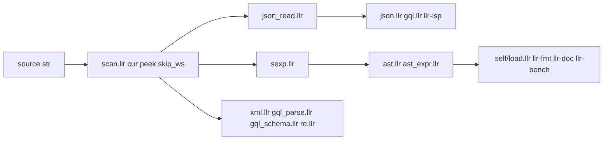

# jsonspeed: faster JSON and faster parsing in Llrst

This file is the work plan for the speed of `std/json_read.llr` and of the other byte parsers
written in Llrst (`std/scan.llr`, `std/sexp.llr`, `std/xml.llr`, `std/gql_parse.llr`). It is
written so another agent can pick it up cold. Read [HANDOFF.md](HANDOFF.md) first (rules,
architecture, how to verify), then [langspeed.md](langspeed.md) (the benchmark gate and what
already landed), then this file, then `docs/canon/README.md`. [expand.md](expand.md) is the
sibling plan for language width. When code and this file disagree, trust the code and fix this
file.

Status legend used below: `[ ]` not started, `[~]` in progress, `[x]` done. Update the boxes as
you go and add a dated line to the **Progress log** at the bottom.

## Rules for this work

Those in `HANDOFF.md` **Rules for this work**, plus:

- Measure first. Every row under **Where the time goes** was found by reading code. Phase 0 puts
  a number next to each row before any std change lands.
- A change is kept only when a `benchmarks/` line or an `llr-bench` micro moves in the same
  commit. One that does not move a number is reverted and its row is marked killed here.
- No benchmark-specific special cases in the compiler or std (`langspeed.md` **Non-goals**). A
  change that helps only `benchmarks/tasks/json_parse/` does not land.
- Any commit that touches a hot `std/` file runs `benchmarks/run.sh --check` on the machine named
  in `benchmarks/baseline.txt`. A commit meant to move a number runs `--update-baseline` in that
  same commit and names the lines that moved. On another machine the check is advisory.
- Error behaviour does not change. `json.parse`, `xml.parse`, `gql.parse`, `lex.*`, and
  `parse.unbalanced` are returned for the same inputs as today, and the existing tests in each
  file pass unedited unless a phase below changes that file's public API.
- Both stages. A phase is done only when the suite is fails=0 under stage 0 and under stage 2,
  `tests/check.sh` and `tests/mir.sh` stay byte-equal, and `docs/std` is regenerated by `llr-doc`.

## Decisions (made for this plan on 2026-11-10)

| Topic | Decision |
| --- | --- |
| scope | Runtime speed of JSON reading first, then the shared scanner and the readers built on it. Compiler codegen is `langspeed.md` and is not reopened here. |
| document shape | `json_read` returns one flat document: a node vec, a child-index vec, and one copy of the source. Nodes are addressed by `i64` index through accessor functions, the convention `std/sexp.llr` already uses (`sexp.kind`, `sexp.text`, `sexp.count`, `sexp.child`). The representation is private, so later phases change it without touching callers. |
| leaves | A string, number, `true`, or `false` node is a byte range into the source copy, not an owned `str`. Text is materialized only when a caller asks for it. |
| escapes | A string with a backslash is marked at parse time and decoded when read. A string without one is never copied by the reader. |
| source | The document owns one copy of the input (`sexp.read` does the same at `std/sexp.llr:143`). A borrowing document is not planned. |
| kinds | Unchanged: 0 null, 1 bool, 2 number, 3 string, 4 array, 5 object. Children of an object alternate key, value, as `items` does today. |
| old API | `jval` and its `text` and `items` fields are removed in the commit that adds the document. Every caller is in this repo and moves in that commit. There is no forwarding release. |
| inlining | Explicit `(inline ...)` only. The automatic limit stays 0 (`langspeed.md` Phase 3). |
| benchmark | `json_parse` compares tree builders with tree builders. The digit-run scan that Rust, Zig, and Java run today moves to a new `json_scan` task that every language runs, Llrst included. |

Out of scope: float parsing, a streaming or SAX reader, SIMD, threads, a `str` view or slice type
in the language (`HANDOFF.md` **Gaps** B), changing what `sexp.text` returns, the stage 0 Rust
parser (`compiler/src/parse/`), and stricter JSON validation.

## Architecture



| path | role | start here |
|------|------|-----------|
| `std/scan.llr` | `cur` cursor, `peek`, `skip_ws`, `read_name`, `hex_dig`, `expect`; none is `(inline ...)` | `peek` (line 4), `skip_ws` (line 10) |
| `std/json_read.llr` | recursive descent into an owned `jval` tree | `skip` (8), `parse_str` (53), `parse_val` (110), `parse_obj` (135), `get` (159) |
| `std/json.llr` | encoder; `show` and `pretty` walk a `jval` | `show_one` (83) |
| `std/sexp.llr` | comment-preserving reader; flat `nodes` and `kids` | `peek` (24), `adv` (26), `form` (112), `read` (142) |
| `std/xml.llr` | XML tree; flat `nodes`, `kids`, `attrs` | `eat` (40), `special` (207), `inner` (242) |
| `std/gql_parse.llr`, `std/gql_schema.llr`, `std/re.llr` | each has a private `peek` that builds a `cur` | `gql_parse.llr:15`, `gql_schema.llr:14`, `re.llr:31` |
| `std/str.llr`, `std/vec.llr` | `str.slice`, `str.reserve`, `vec.reserve`, `vec.push` | `str.llr:70`, `vec.llr:15` |
| `benchmarks/` | cross tasks, micros, baseline, the gate | `run.sh`, `README.md` |

| consumer of `jval` | where | what it reads |
|--------------------|-------|---------------|
| `std/json.llr` | lines 57-98, test `json_show` | `kind`, `text`, `items` |
| `std/gql.llr` | lines 236-268 | `get`, `kind`, `text`, `items` of `variables` and `query` |
| `tools/llr-lsp.llr` | helpers 121-164, handlers 337-436, test at 454 | `get`, `kind`, `text`, `items` |
| `benchmarks/tasks/json_parse/json_parse.llr` | lines 26-39 | `get`, `items`, `text` through `str.to_int` |
| docs | `docs/std/json_read.md`, `docs/std/json.md`, `docs/canon/io.md` rows `json number` and `json text` | signatures |

`self/load.llr:107` calls `ast.parse_src`, which is `sexp.read` then `ast.parse`
(`std/ast.llr:387`). Stage 0 parses with its own Rust code. So `sexp` speed moves
`compile|llrs0`, `compile|llrs1`, the `llrs2` lines, and the tools; it does not move
`compile|llrc`.

## Status

```
plan|jsonspeed.md|2026-11-10|no code changed|nothing below was run for this plan
bench|2026-11-09|Linux x86_64|Intel Core Ultra 5 125H|benchmarks/baseline.txt|5-run median|gate=30%
json_parse ms|llr-stage0 767|llr-stage2 896|zig 29|rust 42|c 54|java 135|go 292|node 307|python 379|nim 522
json_parse stage2 vs|zig 31x|rust 21x|c 17x|java 6.6x|go 3.1x|node 2.9x|python 2.4x|nim 1.7x|stage0 1.17x
string_build ms|llr-stage0 84|llr-stage2 113|c 36
compile ms|llrc self/llrs.llr 3041|llrs0 4211|llrs1 5894
split|build text ?|json_read.read ?|sum ?|drop ?|Phase 0 item 1
parse phase|time parse ? ms of llrs0 building self/llrs.llr|Phase 0 item 1
```

The comparison is not like for like today. Zig, Rust, and Java sum digit runs in the text and
build nothing. C walks the grammar and allocates nothing. Go, Node, Python, Nim, and Llrst build
a tree (`benchmarks/README.md` **Fairness**). Against the tree builders stage 2 is 1.7x to 3.1x.

## Implementation notes (things you would otherwise rediscover)

Strings and vectors (`std/str.llr`, `std/vec.llr`)
- `str.slice` (line 70) always returns an owned `str`: one `sys.alloc` and one `sys.memcpy`
  unless the range is empty. Native `sys.alloc` is libc `malloc` (`std/sys.llr:21`);
  `std/alloc.llr` matters on wasm only.
- `str.p` and `str.len` are `pub` fields; `cap` is private. Code outside `std/str.llr` may read
  `(. s p)` and `(. s len)`. `json_read.parse_str` already scans with `ptr.read`.
- `str.len` and `vec.len` are calls. `str.at`, `vec.get`, `vec.set`, and `vec.check` are
  `(inline ...)`. An automatic limit of 12 inlined `vec.len` and `vec.sort` then failed
  `borrow.mut_shared|ref=n` (`langspeed.md` Phase 3), so prefer a field read in a hot loop over
  marking `len` inline.
- A first `vec.push` reserves 8 slots (`vec.llr:19`). `(vec.reserve v n)` on an empty vec with
  `n > 1` allocates exactly `n`. `vec.truncate` is in `std/vec_more.llr:23`.
- `(inline (fn ...))` substitutes `ret`, loops, `match`, and owned params; a closure in the body
  is `inline.reject` (`docs/spec/grammar.md:26`).

Calls and locals (`HANDOFF.md` **Implementation notes**, `docs/spec/types.md:149`)
- Aggregates are passed as a pointer and copied into the callee's stack slot; an aggregate
  return goes through an sret pointer. A `jval` travels `parse_num` to `try` to `leaf` to
  `res.ok` to `try` to `vec.push`, and is copied at each hop.
- A scalar local lives in a register only when its address is never taken. The cursor in
  `json_read` is `(i (&mut i64))`, so every `(@ i)` is a load or a store. Copy it to a local,
  loop, and store it back once.
- Layout is declaration order with natural alignment (`docs/spec/types.md:35`). By that rule
  `jval` (`u8`, `str`, `vec`) is 56 bytes and the `sexp` node (line 6) is 80. Confirm with
  `(sizeof jval)` before quoting either.

JSON reader (`std/json_read.llr`)
- One `{"id":N,"ok":true}` costs four `str.slice` calls (two keys, the number, `true`) and one
  `items` buffer of 8 slots, of which 4 are used. That is 5 allocations per object and the same
  number of frees when the root drops.
- `skip` runs 12 times per object on text with no whitespace. Each run builds a `cur` and calls
  `scan.skip_ws`, `scan.peek`, `str.len`, and `str.is_space`.
- `null` advances 4 bytes with no bounds test (line 114). `take_word` checks length only, so
  `txxx` reads as `true`. Both are existing behaviour and stay.
- `get` returns the index of the value in `items`, not the key (line 163).

Benchmarks (`benchmarks/run.sh`)
- A cross time is the whole process: building the text, reading it, summing, and dropping.
- `--update-baseline` rewrites `baseline.txt` from the lines of the run that just finished
  (lines 330-336). Combined with `--only` it would drop every other line. Never combine them.
- `--check` fails with `fail|check|<key>|missing` for a Llrst line that is not in the baseline,
  so a new task or micro needs `--update-baseline` in the commit that adds it.
- The task list is `tasks` at `run.sh:100` and `run.ps1:109`; micros are the line below each.

## Line budget

Counted on 2026-11-10 for the files this plan edits. Split before adding if a file is near 500.

| File | Lines | Note |
| --- | --- | --- |
| `tools/llr-lsp.llr` | 472 | Phase 2 must not grow it; the `jtext` and `jint` helpers shrink onto the new accessors |
| `std/ast.llr` | 452 | read only; `sexp` accessors keep their signatures |
| `std/ast_expr.llr` | 452 | read only |
| `std/re.llr` | 445 | Phase 4 changes one line (`peek`) |
| `std/xml.llr` | 409 | |
| `std/str_more.llr` | 398 | do not add here |
| `std/gql.llr` | 316 | |
| `std/str.llr` | 299 | room for one helper |
| `std/vec.llr` | 271 | |
| `std/gql_parse.llr` | 269 | |
| `std/sexp.llr` | 230 | |
| `std/json_read.llr` | 183 | split the accessors into a second file if Phase 2 passes 400 |
| `std/json.llr` | 114 | |
| `std/gql_schema.llr` | 100 | |
| `std/scan.llr` | 51 | |

## Where the time goes (2026-11-10)

Found by reading `std/`, `benchmarks/`, and `langspeed.md`. Nothing here was run. Phase 0 writes
a measured cost, or `not separable`, into the last column. Every row is scheduled in a phase.

### A. JSON reader

| area | cost | evidence | phase | measured |
| --- | --- | --- | --- | --- |
| owned leaves | 4 `malloc` plus `memcpy` per object, 4 `free` at drop | `str.slice` at `json_read.llr:65,99,108`; `str.llr:70` | 2 | |
| one vec per container | 1 `malloc` of 8 slots per object, half unused | `parse_obj` line 137; `vec.llr:19` | 2, 3 | |
| whitespace skip | about 5 calls per `skip`, 12 skips per object | `json_read.llr:8-13`; `scan.llr:4-10`; `str.llr:120` | 1 | |
| cursor in memory | load and store per byte in `parse_str` and `digits` | `json_read.llr:59-62,80-84` | 1 | |
| `str.len` calls | one call per bounds test | `parse_num` lines 89-98; `parse_val` line 112 | 1 | |
| value copies | each `(res jval str)` hop copies the aggregate | `leaf` line 101; `parse_val` lines 114-121 | 2 | |
| key lookup and integer read | `str.eq` call per key; `str.to_int` on an owned copy | `get` line 163; `json_parse.llr:26-29` | 2 | |

### B. Other readers

| area | cost | evidence | phase | measured |
| --- | --- | --- | --- | --- |
| `sexp` byte tests | `peek` builds a `cur` and calls `scan.peek`; `skip_ws` calls it up to 4 times per byte; `adv` calls it again | `sexp.llr:24,26-30,32-33` | 1, 4 | |
| `sexp` lists | one `(vec i64)` per list, then copied into `kids` | `sexp.llr:126-135` | 3 | |
| `xml.eat` | slices the whole rest of the source per call; called once per byte inside comments, CDATA, and processing instructions | `xml.llr:40-43,183,191,201,209-213` | 4 | |
| `xml`, `gql_parse` containers | one `(vec i64)` per element or selection | `xml.llr:173,243`; `gql_parse.llr:39` | 3 | |
| private `peek` copies | five wrappers that each build a `cur` | `sexp.llr:24`, `xml.llr:22`, `gql_parse.llr:15`, `gql_schema.llr:14`, `re.llr:31`; `HANDOFF.md` **Gaps** A, last row | 4 | |

### C. The benchmark

| item | evidence | phase |
| --- | --- | --- |
| Rust, Zig, Java sum digit runs; C allocates nothing; Llrst builds a tree | `benchmarks/tasks/json_parse/`; `benchmarks/README.md` **Fairness** | 0 |
| building the text is inside the timed region: one `str.from_int` and three `str.push` per object | `json_parse.llr:15-24` | 0 (measured, not changed) |
| no micro for any reader | `micros` at `run.sh:101` | 0 |

### D. Decided out

Listed so they are not re-proposed: a `str` view type, SIMD scanning, a borrowing document,
lazy `sexp.text`, and a `jval` compatibility layer. A general codegen gap remains after this plan
(stage 2 is 4.5x to 8.7x C on plain loops, `HANDOFF.md` **Status**); it belongs to `langspeed.md`.

## Phases

Each phase is one commit unless it says otherwise. The exit bar for the whole plan is under
Phase 5. Names marked *proposed* do not exist yet.

### Phase 0: measure, and make the comparison like for like `[ ]`

Files: new `benchmarks/tasks/json_scan/`, `benchmarks/tasks/json_parse/json_parse.{c,rs,zig}` and
`Main.java`, new `benchmarks/micro/json_read.llr`, `sexp_read.llr`, `xml_read.llr`,
`benchmarks/run.sh`, `benchmarks/run.ps1`, `benchmarks/README.md`, `benchmarks/baseline.txt`,
this file.

1. `[ ]` Split the 896 ms. Time three throwaway copies of `json_parse.llr` under both stages:
   build the text only; build and `json_read.read`; the full task. Run
   `LLRST_TIME=1 benchmarks/results/compile/llrs0 build self/llrs.llr` and read `time|parse`.
   Write the numbers into the `split|` and `parse phase|` lines under **Status**. The copies are
   not checked in.
2. `[ ]` Micros, in the shape of `benchmarks/micro/string_build.llr`: `json_read` reads a literal
   with objects, an array, whitespace, and one escaped string; `sexp_read` reads a literal of
   Llrst source; `xml_read` reads a literal with a comment, CDATA, and attributes. Add the three
   names to `micros` in `run.sh` and `run.ps1`.
3. `[ ]` New cross task `json_scan` in all nine languages: build the same text, sum each run of
   digits, print the same line as `json_parse/expected.txt`. Rust, Zig, and Java start from
   their current `json_parse` sources. The Llrst file is a `str.at` loop. Add `json_scan` to
   `tasks` in `run.sh` and `run.ps1`.
4. `[ ]` `json_parse` in C, Rust, Zig, and Java builds a tree (array, objects, key and value
   nodes), sums `id` from the tree, and frees it. Rewrite the `README.md` **Fairness** sentence
   that says those four use a direct scanner. These lines are reported and never gated.
5. `[ ]` Fill the `measured` column under **Where the time goes**. Kill any row under 2% of the
   task and say so in the row.
6. `[ ]` `benchmarks/run.sh --update-baseline` (full run, no `--only`). Name the new lines.
7. `[ ]` Commit: `bench: json_scan task, reader micros, tree-building json_parse peers`.

Exit: `benchmarks/run.sh --check` passes against the new baseline; no row under **Where the time
goes** is unmeasured.

### Phase 1: scanner hot path, no API change `[ ]`

Files: `std/scan.llr`, `std/str.llr`, `std/json_read.llr`.

1. `[ ]` `scan.peek` reads `(. (. c s) len)` instead of calling `str.len`. Mark `scan.peek`,
   `scan.skip_ws`, `str.is_space`, and `str.is_digit` `(inline ...)` one at a time. Keep each
   mark only if `json_read` or `sexp_read` moves and borrowck and `tests/mir.sh` stay clean.
2. `[ ]` `json_read.skip` tests the byte at the cursor first and returns when it is not a space.
   It no longer builds a `cur`.
3. `[ ]` `parse_str`, `digits`, and `parse_num` copy `(@ i)` to a local, loop on the local, and
   store it back once. Each function reads `(. s len)` once.
4. `[ ]` `json_read_vals` and `scan_cur` pass unedited.
5. `[ ]` Commit: `std: scan and json_read hot path without calls`.

Exit: `bench|*|json_read` and `cross|json_parse|llr-*` improve or hold; `sexp_read` and
`compile|llrs0` do not regress; baseline updated with the lines that moved.

### Phase 2: flat document, leaves are offsets `[ ]`

Files: `std/json_read.llr`, `std/json.llr`, `std/gql.llr`, `tools/llr-lsp.llr`,
`benchmarks/tasks/json_parse/json_parse.llr`, `benchmarks/micro/json_read.llr`,
`docs/std/json_read.md`, `docs/std/json.md`, `docs/canon/io.md`, and any other doc that a search
for `jval` under `docs/` finds.

1. `[ ]` Types, *proposed*: `(struct jnode (kind u8) (lo i64) (hi i64))` and
   `(pub (struct jdoc (src str) (nodes (vec jnode)) (kids (vec i64)) (pub (root i64))))`. For a
   leaf, `lo` and `hi` are byte offsets into `src` (a string's range excludes its quotes). For an
   array or object they are a range in `kids`. A string that contains a backslash is stored with
   a private kind and reported as 3. `json_read.read ((s (& str))) (res jdoc str)`.
2. `[ ]` Accessors, *proposed*, each with a `(test ...)`: `json_read.kind (d n) u8`,
   `json_read.count (d n) i64`, `json_read.child (d n k) i64`,
   `json_read.text (d n) str` (owned; decodes escapes with the existing `push_esc`),
   `json_read.int (d n) (opt i64)` (digits read in place),
   `json_read.push_text (out d n) unit` (appends without a temporary), and
   `json_read.get (d n key) (opt i64)`, which still returns the value's node and compares an
   unescaped key in place with `sys.memcmp`.
3. `[ ]` The parser returns node indexes (`(res i64 str)`), not values. In this phase a container
   collects its children in a local `(vec i64)` and copies it into `kids`, as `sexp.form` does.
4. `[ ]` `json.show` and `json.pretty` take the document; `show_one`, `show_arr`, and `show_obj`
   walk `(d n)`. Output is byte-identical; `json_show` changes only where it names the type.
5. `[ ]` Move `std/gql.llr:236-268` and `tools/llr-lsp.llr` onto the accessors. Remove `jval`.
6. `[ ]` The cross task reads `id` with `json_read.get` and `json_read.int`.
7. `[ ]` `llr-doc` regenerates `docs/std`; update the two `json` rows in `docs/canon/io.md`.
8. `[ ]` Commit: `std: json_read.jdoc, leaves are offsets into one source copy`.

Exit: every test in `std/json_read.llr`, `std/json.llr`, `std/gql.llr`, and `tools/llr-lsp.llr`
passes under both stages; `cross|json_parse|llr-*` and `bench|*|json_read` improve; by reading
the code, allocations per object fall from 5 to 1.

### Phase 3: containers without their own vec `[ ]`

Files: `std/json_read.llr`, `std/sexp.llr`; `std/xml.llr` and `std/gql_parse.llr` only if item 5
keeps them.

1. `[ ]` `json_read`: one pending `(vec i64)` in the reader state. A container records the
   stack length on entry, pushes each child index, and on close appends that tail to `kids` and
   calls `vec.truncate` back to the recorded length. No allocation per container once the stack
   has grown.
2. `[ ]` Candidate: reserve `nodes` and `kids` once from the source length. Keep only if
   `json_read` moves; a short document must not pay for it.
3. `[ ]` Candidate: `i32` offsets in `jnode` (12 bytes by the layout rule, against 24). A source
   of 2 GiB or more is then `json.parse`. Keep only if `cross|json_parse` moves.
4. `[ ]` The same pending stack in `sexp.form` (lines 126-135). Bar: `sexp_read` and
   `compile|llrs0|self/llrs.llr`.
5. `[ ]` `xml.inner` with `close` (lines 173, 242) and `gql_parse.close` (line 39): apply only if
   `xml_read` moves; otherwise mark the row killed under **Where the time goes**.
6. `[ ]` Commits: `std: json_read containers share one stack`, `std: sexp lists share one stack`.

Exit: by reading the code, `json_read.read` allocates only when `nodes`, `kids`, or the stack
grow; the lines named in items 1 and 4 improve; baseline updated.

### Phase 4: the other readers `[ ]`

Files: `std/sexp.llr`, `std/xml.llr`, `std/gql_parse.llr`, `std/gql_schema.llr`, `std/re.llr`,
`std/str.llr`, `docs/std/str.md`, `docs/canon/strings.md`.

1. `[ ]` `sexp`: `skip_ws` reads the byte once per step; `adv` takes the byte its caller already
   has instead of calling `peek` again; the atom loop in `form` does the same. Line and column
   results are unchanged, and `sexp_read` and `sexp_scan` pass unedited.
2. `[ ]` `xml.eat` and the three tests in `special` compare in place at the cursor, the way
   `str.find_from` does (`str.llr:81`). If a public helper is the reuse, it is *proposed*
   `str.starts_at ((self (& str)) (p (& str)) (i i64)) bool` in `std/str.llr` with a test, a
   `docs/std/str.md` row, and a `docs/canon/strings.md` row. This turns a comment or CDATA
   section from quadratic in the remaining document to linear.
3. `[ ]` The five private `peek` wrappers call the Phase 1 `scan.peek` on a cursor they keep, or
   read the byte directly. This closes the scanner part of the `std-internal duplication` row in
   `HANDOFF.md` **Gaps** A.
4. `[ ]` Re-run item 1 of Phase 0 for `time|parse` and record it under **Status**.
5. `[ ]` Commit: `std: sexp, xml, and gql readers scan without per-byte calls`.

Exit: `sexp_read` and `xml_read` improve; `compile|llrs0`, `compile|llrs1`, and the `llrs2` line
improve or hold; `tests/check.sh` and `tests/mir.sh` byte-equal.

### Phase 5: lock it in `[ ]`

Files: `benchmarks/baseline.txt`, `benchmarks/README.md`, `langspeed.md`, `HANDOFF.md`, this file.

1. `[ ]` Full `benchmarks/run.sh --check`, then `--update-baseline`. Name every line that moved.
2. `[ ]` `langspeed.md` Phase 5 table: the `json_parse` row and its cause, and a `json_scan` row.
   `benchmarks/README.md` **Current baseline**. `HANDOFF.md`: the `runtime|` and `stage2 vs`
   lines under **Status**, the line references in the `json` row and the `std-internal
   duplication` row under **Gaps**, and a **Progress log** line.
3. `[ ]` List what is still slower than Go, Node, C, Rust, and Zig on `json_parse` and
   `json_scan`, one line each with the cause or `unknown`.
4. `[ ]` Move this file to `history/` and link it from the first paragraph of `HANDOFF.md`.
5. `[ ]` Commit: `bench: json and reader baseline after jsonspeed`.

Exit for the plan: stage 2 `json_parse` is at or under the Python line on the baseline machine
(379 ms on 2026-11-09). That is the one task where `langspeed.md` Phase 5 records stage 2 losing
to Python. Go (292) and Node (307) are the stretch bar and are reported, with a cause, if not
met. These are bars to measure against, not predictions.

## How to verify each phase

```
cargo build --release                                  # stage 0 llrc
scripts/self.sh --stage                                # llrs0..2, stop after self|stage2=equal
scripts/self.sh                                        # the same, then the suite under llrs2
<llrc> build std/json_read.llr --test --std std -o /tmp/t && /tmp/t
<llrc> build std/sexp.llr --test --std std -o /tmp/t && /tmp/t
benchmarks/run.sh --once --only json_parse             # one sample of one cross task
benchmarks/run.sh --only micro                         # every micro, both stages
benchmarks/run.sh --only compile                       # also builds benchmarks/results/compile/llrs0
LLRST_TIME=1 benchmarks/results/compile/llrs0 build self/llrs.llr --std std -o /tmp/llrs1
benchmarks/run.sh --check                              # the gate; full run
benchmarks/run.sh --update-baseline                    # full run only, never with --only
tests/check.sh; tests/mir.sh                           # byte-equal to stage 0
llr-fmt <changed .llr>; llr-fmt --lint std/*.llr tools/*.llr
scripts/check-lines.sh
```

`benchmarks/run.ps1`, `tests/run.ps1`, and `scripts/self.ps1` are the Windows twins and take the
same flags. A phase is not done until both suites are green and the baseline commit names the
lines that moved.

## Progress log

- 2026-11-10: Plan written from a read of `benchmarks/`, `std/json_read.llr`, `std/scan.llr`, `std/sexp.llr`, `std/xml.llr`, `std/gql_parse.llr`, `std/str.llr`, `std/vec.llr`, `langspeed.md`, and `HANDOFF.md`. Numbers under **Status** are copied from `benchmarks/baseline.txt` (2026-11-09). No code changed and nothing was run.
